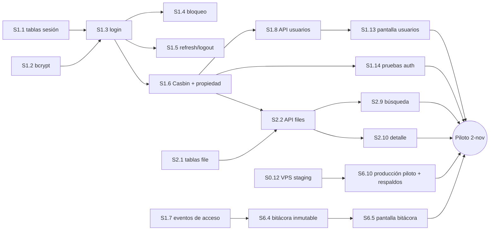

# SISET — Roadmap de sprint (piloto de noviembre)

**Fecha:** 2026-10-13 · **Repo:** `996e64a` (main) · **Backlog:** [2026-10-12 - Backlog-Epics-Tasks.md](2026-10-12%20-%20Backlog-Epics-Tasks.md) · **Board del tracker revisado:** sí, ClickUp, lista SISET (`901115543466`) · **Reemplaza a:** [2026-10-12 - Sprint-Roadmap.md](2026-10-12%20-%20Sprint-Roadmap.md)

**Qué cambió:** D-06 quedó cerrada con la **opción B** ([DEC-009](../decisions/LOG.md)). El objetivo inmediato ya no es el sistema completo sino un **piloto del 2 al 6 de noviembre**, en el que el personal administrativo carga datos reales de estudiantes. El desarrollo del piloto termina el **viernes 30 de octubre**. El sistema completo (v1.0) sigue después, con meta de referencia el **18-ene-2027**.

**Capacidad usada:** 30 h por semana (6 h por día hábil), la del plan original. Del 14 al 30 de octubre hay 13 días hábiles, es decir **unas 78 h**.

## 1 · Dónde estamos

Fuente: el repo. La Ola 1 del roadmap anterior está terminada: monorepo, Docker, CI con 4 checks obligatorios, Prisma con el modelo v1, base del API con bitácora (`registrarEvento`), web en el stack vigente con Axios, TanStack Query y E2E, y configuración de staging. Falta la demo con la escuela (S0.1) y el despliegue real en el VPS.

| Estado | Horas | Tareas | % horas |
|---|---:|---:|---:|
| ✅ Listo (S0.3–S0.11) | 28 | 9 | 9 % |
| 🟡 En curso (S0.1, demo con la escuela) | 3 | 1 | 1 % |
| ⬜ Pendiente: piloto, desbloqueado (Olas 1 y 2) | 70 | 21 | 21 % |
| ⛔ Piloto, espera una respuesta (Ola 3a) | 17 | 4 | 5 % |
| ⬜/⛔ Después del piloto | 209 | 55 | 64 % |
| **Total** | **327** | **90** | |

El total del roadmap anterior era 322 h. Ahora suma 327 h: +3 h por dos tareas nuevas (S0.12 despliegue en el VPS y S0.13 demo en línea), +4 h por S0.10 y S0.11 (no estaban en el plan; se cuentan 2 h cada una), y −2 h porque S1.7 se redujo (la bitácora ya existe desde S0.7).

**Discrepancias con el board:** S0.9 figura como "completadas", pero el despliegue en el VPS no se hizo (pasa a S0.12, que espera tu autorización). S0.10 y S0.11 no estaban en el plan original y ya están hechas.

## 2 · Prioridades — cuatro olas

### Ola 1 — llave/barata · 14–16 oct · sin stakeholder (13 h)

De esto cuelga el piloto: **S1.3 es llave de 10 tareas del Sprint 1** y **S0.12 es llave de la producción del piloto (S6.10) y de la demo en línea (S0.13)**.

- **S1.1** Tablas de sesión (`refresh_token`) y campos de bloqueo (2 h). *Llave de S1.3.*
- **S1.2** bcrypt y política de contraseña (2 h).
- **S1.7** Eventos de acceso en la bitácora: login, login fallido, logout (1 h; la base ya está hecha desde S0.7).
- **S1.3** `POST /auth/login` con CI y contraseña (6 h). *Llave: 10 tareas del Sprint 1 dependen de esta.* Se hace con la propuesta provisional de D-14/D-25 (se entra con el CI).
- **S0.12** Despliegue de staging en el VPS (2 h). **Necesita tu autorización**: hoy la regla es no tocar el servidor. *Llave de S6.10 y S0.13.*

### Ola 2 — volumen · 19–30 oct · sin stakeholder (57 h)

El grueso del piloto. Hay tres frentes en paralelo:

- **Acceso y permisos (34 h):** S1.4 bloqueo tras 5 intentos, S1.5 refresh y logout, S1.6 Casbin y "solo lo propio", S1.8 API de usuarios, S1.9 login conectado, S1.10 sesión real e inactividad, S1.11 rutas por rol, S1.13 pantalla de usuarios y S1.14 pruebas.
- **Bitácora (6 h, DEC-007):** S6.4 bitácora inmutable con cobertura y S6.5 pantalla de bitácora.
- **File académico básico (16 h):** S2.1 tablas del file y catálogo, S2.2 API de files, S2.9 búsqueda y S2.10 detalle (datos personales y académicos; los requisitos TACFI/TCLO quedan con el catálogo provisional hasta D-04).
- **S0.13** Demo del prototipo en línea para el docente tutor (1 h; depende de S0.12).

**Control de avance:** el **viernes 23 de octubre** se revisa cuánto se avanzó. Si va atrasado, S2.10 pasa a después del piloto; el piloto sigue con búsqueda y alta de files.

### Ola 3 — esperando a la escuela · bloqueado

**3a · Para el piloto (17 h).** Entran en la semana del 2 al 6 de noviembre solo si la respuesta llega a tiempo:

1. **D-12 Dónde funcionará el sistema** → S6.10 producción del piloto con respaldo diario y restauración probada (5 h). **Sin esto no hay piloto con datos reales** (DEC-009 #6). Hay que confirmarla antes del 26-oct.
2. **D-07 Notas** → S2.3 matrículas y resultado anual (4 h). Fecha límite: 23-oct.
3. **D-13 Files existentes** → S2.8 importación de Excel y S2.13 pantalla de carga masiva (8 h). Fecha límite: 23-oct. Si no llega, la carga del piloto es manual.

**3b · Después del piloto (por apalancamiento, como en el roadmap anterior):** D-05 etapas (66 h), D-04/D-18/D-10 requisitos y formatos (42 h), D-16 quién valida (25 h), D-20 indicadores (17 h), D-08 egresados (11 h), D-11 dictamen (8 h).

### Ola 4 — decisiones de alcance (sin costo de build)

- **D-06** ✅ cerrada: opción B (DEC-009).
- **D-27 Administrador del sistema**: Kardex o un rol aparte (provisional: Kardex). Se necesita antes de S1.6 y S1.8 (21-oct).
- **D-24 Sede del personal** y **D-26 intentos con CI inexistente**: van con la propuesta provisional; confirmarlas antes del 21-oct.
- **D-03 MFA**, **D-19 avisos**, **D-22 escaneos**, **D-09 hoja de ruta de estudiantes** y **D-15 sedes**: sin cambio, confirmar que quedan fuera de v1.0.
- **Usuarios del piloto**: solo el personal (DEC-009 #2). Estudiantes y egresados después.

### Después del piloto — sistema completo (v1.0)

| Sprint | Fechas | Objetivo | Horas aprox. |
|---|---|---|---:|
| Piloto | 2–6 nov | Puesta en marcha, capacitación, carga de datos, correcciones; Ola 3a si hay respuestas | 30 |
| S2 | 9–20 nov | Resto del file: S2.4–S2.7, S2.11, S2.12, S2.14, S1.12; S0.2 y reviews S1/S2 (S2.3, S2.8 y S2.13 si no entraron en el piloto) | 32 |
| S3 | 23 nov – 4 dic | Hojas de ruta y pases (S3.1–S3.12) | 48 |
| S4 | 7–18 dic | Tracking y dictamen (S4.1–S4.12) | 45 |
| S5 | 21–23 dic y 4–8 ene | Emisión e impresión (S5.1–S5.10) | 42 |
| S6 | 11–15 ene | Reportes, carga, UAT, migración y Go-Live (sin S6.4/S6.5/S6.10, ya hechas en el piloto) | 42 |

Quedan 209 h para unas 8,5 semanas efectivas (~255 h), es decir **unas 45 h de margen**. El 18-ene-2027 es alcanzable, pero sin holgura: si D-05 se demora más allá del 20-nov, S3 se corre y la fecha también. **Se recalcula el 6-nov** con la velocidad real del piloto.

## 3 · Listado de tareas

Tamaño en horas. Estado: ✅ listo · 🟡 en curso o UI en prototipo · ⬜ pendiente · ⛔ bloqueado. **Piloto** = entra en el alcance de DEC-009.

| ID | Módulo | Tarea | Tamaño | Estado | Ola | Piloto | Ticket | Depende de | Bloqueo |
|---|---|---|---:|---|---|---|---|---|---|
| S0.1 | Negocio | Demo del prototipo + dudas | 3 | 🟡 | 1 | sí | [868mgh27v](https://app.clickup.com/t/868mgh27v) | — | — |
| S0.3–S0.11 | Entorno | Fundaciones (9 tareas) | 28 | ✅ | — | sí | ClickUp | — | — |
| S0.12 | DevOps | Despliegue de staging en el VPS | 2 | ⬜ | 1 | sí | | S0.9 | Tu autorización |
| S0.13 | Negocio | Demo en línea para el tutor | 1 | ⬜ | 2 | sí | | S0.12 | — |
| S1.1 | Seguridad | refresh_token + campos de bloqueo | 2 | ⬜ | 1 | sí | | S0.11 | — |
| S1.2 | Seguridad | bcrypt + política de contraseña | 2 | ⬜ | 1 | sí | | S0.7 | — |
| S1.3 | Seguridad | POST /auth/login | 6 | ⬜ | 1 | sí | | S1.1, S1.2 | D-14/D-25 (provisional) |
| S1.7 | Auditoría | Eventos de acceso en bitácora | 1 | ⬜ | 1 | sí | | S0.7 | — |
| S1.4 | Seguridad | Bloqueo 5 intentos + rate limit | 3 | ⬜ | 2 | sí | | S1.3 | — |
| S1.5 | Seguridad | refresh (rotación) + logout | 4 | ⬜ | 2 | sí | | S1.3 | — |
| S1.6 | Seguridad | Casbin + "solo lo propio" + sede | 5 | ⬜ | 2 | sí | | S1.3 | D-24, D-27 (provisional) |
| S1.8 | Usuarios | API de usuarios | 6 | ⬜ | 2 | sí | | S1.6 | D-27 (provisional) |
| S1.9 | Seguridad | Login y cambio de clave conectados | 2 | 🟡 | 2 | sí | | S1.3 | — |
| S1.10 | Seguridad | Sesión real, refresh, inactividad | 4 | 🟡 | 2 | sí | | S1.5 | — |
| S1.11 | Seguridad | Rutas por rol, menú, 403 | 1 | 🟡 | 2 | sí | | S1.10 | — |
| S1.13 | Usuarios | Pantalla de usuarios conectada | 3 | 🟡 | 2 | sí | | S1.8 | — |
| S1.14 | QA | Pruebas auth + 403 + URL directa | 6 | ⬜ | 2 | sí | | S1.6 | — |
| S6.4 | Auditoría | Bitácora inmutable + cobertura | 4 | ⬜ | 2 | sí | | S1.7 | — |
| S6.5 | Auditoría | Pantalla de bitácora conectada | 2 | 🟡 | 2 | sí | | S6.4 | — |
| S2.1 | File | Tablas del file + catálogo | 5 | ⬜ | 2 | sí | | S0.11 | — |
| S2.2 | File | API de files con paginación | 6 | ⬜ | 2 | sí | | S2.1, S1.6 | — |
| S2.9 | File | Búsqueda de files conectada | 2 | 🟡 | 2 | sí | | S2.2 | — |
| S2.10 | File | Detalle del file (sin requisitos oficiales) | 3 | 🟡 | 2 | sí | | S2.2 | D-04 para requisitos |
| S6.10 | DevOps | Producción del piloto + respaldos | 5 | ⛔ | 3a | sí | | S0.12 | D-12 |
| S2.3 | File | Matrículas y resultado anual | 4 | ⛔ | 3a | si llega D-07 | | S2.1 | D-07 |
| S2.8 | File | Importación Excel | 6 | ⛔ | 3a | si llega D-13 | | S2.2 | D-13 |
| S2.13 | File | Carga masiva conectada | 2 | ⛔ | 3a | si llega D-13 | | S2.8 | D-13 |
| S1.12 | Inicio | Inicios por rol | 1 | 🟡 | después | no | | S1.11 | — |
| S2.4 | File | Requisitos TACFI/TCLO/notas | 5 | ⛔ | 3b | no | | S2.1 | D-04, D-18 |
| S2.5 | File | Motor de semáforo | 6 | ⬜ | después | no | | S2.4 | parcial D-04 |
| S2.6 | File | Bloqueo por UF | 4 | ⛔ | 3b | no | | S2.3 | D-07 |
| S2.7 | File | Endpoint "mi file" | 2 | ⬜ | después | no | | S2.2 | — |
| S2.11 | File | Semáforo + banner | 1 | 🟡 | después | no | | S2.5 | — |
| S2.12 | File | "Mi file" conectado | 1 | 🟡 | después | no | | S2.7 | — |
| S2.14 | QA | Pruebas semáforo/bloqueo | 5 | ⛔ | 3b | no | | S2.6 | D-07 |
| S3.1–S3.12 | Hojas de ruta | Ingesta, correlativo, estados, pases | 45 | ⛔ | 3b | no | | S2.1 | D-05, D-21 |
| S4.1–S4.12 | Tracking/Dictamen | Tracking, revisión, dictamen, E2E, colchón | 42 | ⛔ | 3b | no | | S3.3 | D-05, D-08, D-11 |
| S5.1–S5.10 | Emisión | Plantillas, PDF, emisión, retorno | 39 | ⛔ | 3b | no | | S0.2, S3.3 | D-10, D-04, D-05 |
| S6.1–S6.3, S6.6 | Reportes | KPI, dashboard, exportación, carga | 17 | ⛔ | 3b | no | | S3.1 | D-20 |
| S6.7, S6.8 | QA | OWASP, navegadores y 360 px | 8 | ⬜ | después | no | | — | — |
| S6.9, S6.11–S6.13 | Go-Live | UAT, migración, manual, Go-Live | 17 | ⛔ | 3b | no | | S6.10 | D-16, D-13 |
| S0.2, reviews | Negocio | Plantillas físicas y reviews por sprint | 16 | ⛔ | 3b | no | | S0.1 | D-10, D-16 |

Los grupos de tareas posteriores al piloto conservan el detalle del roadmap anterior (§3); aquí se agrupan para no repetirlo.

**El board del tracker no es la verdad.** Los estados de esta tabla salen del
repo, no del board — ver discrepancias anotadas en §1.

## 4 · Qué preguntarle a la escuela ahora

En este orden. **Las dos primeras deciden si hay piloto**; las demás deciden qué tan completo llega.

1. **¿En qué servidor va a funcionar el sistema y aceptan que los datos reales de estudiantes estén en un servidor externo (VPS) con respaldo diario?** `D-12` — *sin esto no hay piloto con datos reales (S6.10, 5 h, y todo el piloto en cascada). Fecha límite: 26-oct.*
2. **¿Se entra con el número de carnet? ¿Con complemento? ¿Quién restablece la contraseña?** `D-14`, `D-25` — *llave de S1.3 y de las 10 tareas que cuelgan de ella. Fecha límite: 19-oct (si no hay respuesta, se usa el CI).*
3. **¿Kardex registra el resultado anual y las UF reprobadas, o la nota de cada UF?** `D-07` — *4 h en el piloto (S2.3) y 9 h después. Fecha límite: 23-oct.*
4. **¿Cuántos files existen hoy y en qué formato? ¿Quién los cargará?** `D-13` — *8 h en el piloto (importación de Excel). Fecha límite: 23-oct.*
5. **¿Quién administra el sistema? ¿El personal trabaja en una sola sede? ¿Quién valida el piloto?** `D-27`, `D-24`, `D-16` — *confirman lo provisional de S1.6/S1.8 y definen quién acepta el piloto. Fecha límite: 21-oct.*
6. **¿Por qué etapas pasa un trámite?** `D-05` — *66 h después del piloto; ya no bloquea noviembre, pero sí el sprint S3 (23-nov).*
7. **¿Qué son TACFI y TCLO, y hay otros requisitos y formatos oficiales?** `D-04`, `D-18`, `D-10` — *42 h después del piloto.*
