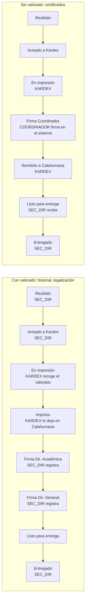

# Brief del módulo de hojas de ruta (S3.x, S4.x, S5.x) — 2026-10-14

Antes de escribir los SDD de S3.1–S3.3 (la raíz de los módulos M3–M6), este brief contrasta lo que suponen el
prototipo, el PRD y `business-rules.md` con lo que respondió la escuela, y propone un flujo nuevo y un orden de
tickets. **Necesita la aprobación del responsable**: las respuestas cambian el corazón del módulo.

## 1 · Qué dice el repo vs. qué respondió la escuela

| Supuesto del prototipo / PRD                                                                                               | Qué respondió la escuela                                                                                                                                                                                                                                                                                                                                                  |
| -------------------------------------------------------------------------------------------------------------------------- | ------------------------------------------------------------------------------------------------------------------------------------------------------------------------------------------------------------------------------------------------------------------------------------------------------------------------------------------------------------------------- |
| **Un solo flujo de 11 estados**: Registrado → En tránsito → Recibido → En revisión ⇄ Observado → Dictaminado → En impresión → En tránsito a La Paz → En firma → Listo → Entregado | **D-05: dos flujos.** **Con valorado** (historial académico, legalización de historial): el egresado presenta la solicitud escrita, el valorado canjeado en cajas de la ESFM Calahumana y otros requisitos en **Secretaría de Dirección General**; esta lo retiene ~2 semanas y **avisa a Kardex de Ancocagua**; Kardex **va a Calahumana, recoge el valorado, lo imprime y lo deja en Calahumana** para la firma de **Dirección Académica y Dirección General**; luego se entrega al interesado. **Sin valorado** (certificados de notas y de excelencia de años pasados): **Kardex imprime, firma el Coordinador de la UA y se remite a Calahumana** para la entrega. |
| **Dictamen del Coordinador** (Aprobado/Observado) antes de imprimir (S4.7, RF-09)                                           | **D-11:** el Coordinador **solo firma** lo que le pasa el personal de Ancocagua. No hay dictamen como decisión propia (DEC-018 #4).                                                                                                                                                                                                                                       |
| **Pases entre sedes** (envío y recepción con bandeja, S3.6, S3.10)                                                          | D-05: el papel **lo lleva Kardex en persona** (va a Calahumana, recoge, imprime, lo deja). No describe envíos ni recepciones formales.                                                                                                                                                                                                                                      |
| **Tipos de trámite**: historial, copia legalizada, certificación (+ titulación, conclusión… en la tesis)                    | **D-21:** a Ancocagua llegan **4 tipos** por ahora: historial académico, legalización de historial, certificado de notas de años pasados, certificado de excelencia de años pasados. La lista oficial no la dio Secretaría de Dirección General.                                                                                                                           |
| Hojas de ruta también para trámites de estudiantes                                                                          | **D-09: no.** Solo los de egresados.                                                                                                                                                                                                                                                                                                                                      |
| El egresado sigue su trámite con su cuenta                                                                                  | **D-08:** sin cuenta; seguimiento **público** con N.º de trámite + CI.                                                                                                                                                                                                                                                                                                    |
| Panel del Coordinador con KPIs de tiempos                                                                                   | **D-20:** solo trámites **en cola o entregados**, y los que esperan **su firma o visto bueno**.                                                                                                                                                                                                                                                                           |

## 2 · Flujo propuesto (provisional, hasta las respuestas del §4)

Dos flujos según el tipo de trámite (una columna `requiere_valorado` en `tipo_tramite`). Cada paso lo registra
quien lo hace o, si esa persona no tiene cuenta (Dirección Académica, Dirección General), **Secretaría de
Dirección** (SEC_DIR), que está en Calahumana.

- **Observado**: solo si la escuela confirma que Kardex puede devolver un trámite (D-34). Mientras tanto, no se
  modela.
- **File bloqueado** (DEC-029): no se puede registrar un trámite ni imprimir (`business-rules.md`).
- Se mantienen las reglas técnicas: correlativo `HR-AAAA-NNNNNN` por gestión, una fila de `movimiento_hoja_ruta`
  por paso en la misma transacción, `SELECT … FOR UPDATE`, 409 en una transición inválida, seguimiento público
  sin datos sensibles.

## 3 · Tickets: qué cambia

| Ticket del backlog                                 | Con las respuestas                                                                                         |
| -------------------------------------------------- | ---------------------------------------------------------------------------------------------------------- |
| S3.1 tablas + enum de estados                      | **Se rehace**: dos flujos, `tipo_tramite` con los 4 tipos y `requiere_valorado`.                             |
| S3.2 correlativo                                   | Igual.                                                                                                     |
| S3.3 máquina de estados                            | **Se rehace** con el flujo del §2 (tabla de transiciones por tipo y rol).                                    |
| S3.4 ingesta / S3.8 formulario / S3.9 lista        | Igual, con los 4 tipos y el valorado.                                                                       |
| S3.5 QR + carátula                                 | Igual.                                                                                                     |
| S3.6 pases / S3.7 concurrencia / S3.10 bandeja     | **En duda** (D-35): si el papel lo lleva Kardex, los "pases" son pasos del flujo, no una bandeja aparte.     |
| S4.1–S4.4 seguimiento público                      | Igual (D-08 ya respondida: sin cuenta).                                                                     |
| S4.5 "Mis trámites" del egresado                   | **Se elimina** (D-08: sin cuenta).                                                                          |
| S4.6 revisión de Kardex (tomar, observar)          | **En duda** (D-34).                                                                                         |
| S4.7 dictamen / S4.9 dictámenes del Coordinador     | **Se reemplaza** por "Firma del Coordinador" (D-11): un paso del flujo sin valorado.                          |
| S5.x emisión                                       | Kardex imprime en los dos flujos; las plantillas siguen esperando D-10 (formatos).                          |

**Orden propuesto:** S3.1 + S3.3 (un solo SDD: tablas y máquina de estados) → S3.2 → S3.4 + S3.8 + S3.9 (ingesta y
lista) → S3.5 → S4.1–S4.3 (seguimiento público) → bandejas por rol según D-34 y D-35.

## 4 · Preguntas nuevas para la escuela (a la hoja)

- **D-32:** ¿Dónde se recibe la solicitud de los **certificados** (notas, excelencia): también en Secretaría de
  Dirección General, en Calahumana?
- **D-33:** ¿Quién **anota en el sistema** los pasos que pasan en Calahumana (aviso a Kardex, firmas de Dirección
  Académica y General, entrega)? Propuesta: Secretaría de Dirección, porque Dirección Académica y Dirección General
  no tendrán cuenta.
- **D-34:** ¿Kardex **revisa** el trámite y puede **observarlo** (por ejemplo, si falta un requisito o el file
  está bloqueado)? Si es así, ¿qué pasa con el trámite?
- **D-35:** Cuando Kardex lleva o trae documentos entre Calahumana y Ancocagua, ¿hace falta registrar el **envío y
  la recepción** por separado, o basta con anotar que Kardex recogió o dejó el documento?
