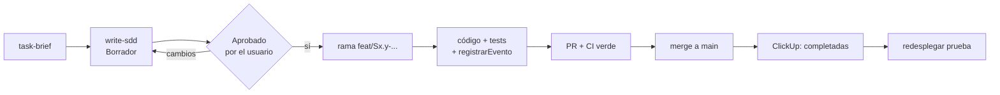

# Modo de trabajo normal de SISET

Así se trabajó del 11 al 14 de octubre de 2026. Está **suspendido** hasta después de la presentación del viernes
16-oct (ver [modo-demo.md](modo-demo.md)); después se vuelve a esto tal cual.

## 1 · Resumen en una línea

Un ticket a la vez: **task-brief → SDD aprobado → rama → código + tests + evento de bitácora → PR con CI verde →
merge → ClickUp a "completadas" → (si toca) redespliegue de la prueba**.

## 2 · Fuentes de verdad

Precedencia completa en [docs/README.md](../README.md):

1. El estado real del repo gana sobre cualquier documento de planificación.
2. Una `DEC-###` más nueva en [decisions/LOG.md](../decisions/LOG.md) gana sobre una más vieja.
3. `docs/product/*` (PRD, scope, business-rules, modelo-datos) es la base; el LOG la enmienda.

Antes de cada ticket se lee lo relevante de `business-rules.md`, las DEC del tema, `dudas.md` y
`do-not-touch.md` (tocar algo de esa lista exige ADR en `docs/adr/`).

## 3 · Planificación: de PRD a tickets (skills del repo, `.claude/skills/`)

| Skill            | Qué hace                                                                                       | Salida                                           |
| ---------------- | ---------------------------------------------------------------------------------------------- | ------------------------------------------------ |
| `prd-to-backlog` | Desglosa PRD + scope + business-rules en Epics/Tasks con dependencias, horas y tier de riesgo. | `docs/planning/<fecha> - Backlog-Epics-Tasks.md` |
| `sprint-roadmap` | Cruza el backlog con el repo (git) y el board de ClickUp; ordena las tareas en olas.           | `docs/planning/<fecha> - Sprint-Roadmap.md`      |
| `ticket-cards`   | Convierte las tareas de la ola en tarjetas y las sube a ClickUp (pide confirmación antes).     | `docs/planning/<fecha>-tickets/` + ClickUp       |
| `prd-to-tickets` | Corre las tres anteriores de punta a punta (proyecto nuevo o PRD cambiado).                    | Todo lo anterior                                 |

Los archivos de `docs/planning/` llevan fecha y no se editan a mano: si algo cambia se genera uno nuevo que
"reemplaza a" el anterior.

### Tier de cada tarea (lo pone `prd-to-backlog`)

- 🟢 nativo/config — lo da el stack, solo configuración.
- 🟡 net-new validado — hay CA medibles en el PRD y/o la pantalla ya existe en el prototipo.
- 🔴 net-new sin diseñar — sin mecanismo confirmado.
- 🛑 bloqueado — espera una respuesta de `dudas.md` (se nombra la duda).

## 4 · Cómo se decide qué tarea va primero

Lo calcula `sprint-roadmap` y se revisa a mano cada día:

1. **Olas por desbloqueo, no por épica.** Ola 1 = tareas _llave_ y baratas (de las que cuelgan muchas otras;
   p. ej. S1.3 login era llave de 10 tareas). Ola 2 = volumen sin stakeholder. Ola 3 = lo que espera una duda.
   Ola 4 = decisiones de alcance.
2. **Primero lo que no espera a nadie.** Una tarea 🛑 no se empieza; se trabaja con la propuesta provisional de
   la duda solo si la duda lo permite, nunca inventando la regla.
3. **Dependencias del grafo** (columna "Depende de" del backlog): no se toma una tarea cuyo padre no está en main.
4. **Meta del momento.** Desde DEC-009 la meta es el piloto del 2-nov: lo que el piloto necesita va antes que lo
   de v1.0 (S2.16, S4.x, S5.x quedaron para después).
5. **Backend antes que pantalla conectada** del mismo flujo (S3.2+S3.4 API → S3.8+S3.9 pantallas).
6. Tareas muy acopladas se juntan en un solo ticket/SDD (S1.2+S1.7, S2.9+S2.10, S3.1+S3.3…).
7. Al cerrar el día se anota en la memoria "estado del proyecto" qué quedó y cuál es el siguiente.

## 5 · Ciclo de un ticket

1. **`task-brief`**: verifica contra el repo cada premisa que el ticket da por hecha (¿existe la tabla, el
   endpoint, la pantalla?), y da un resumen + diagrama de flujo.
2. **`write-sdd`**: genera `docs/sdd/<ID>/SDD.md` con alcance, decisiones técnicas, plan por archivo, tests, DoD,
   riesgos y preguntas abiertas. Estado `Borrador`.
3. **Aprobación**: no se escribe código hasta que el SDD diga `Estado: Aprobado (fecha)`. Si la implementación
   se desvía, se versiona el SDD (v1.1, v1.2…) y al final pasa a `Implementado`.
4. **Decisiones**: las técnicas las toma Claude y las deja escritas en el SDD o en una DEC; al cliente solo se
   llevan decisiones de flujo del trámite o críticas (hoja de Google "SISET — Preguntas para la escuela" →
   `dudas.md` → DEC).
5. **Rama** `feat/Sx.y-descripcion` (o `docs/...`); commits `Sx.y <qué hace>` en español.
6. **Implementación** en el monolito modular (ADR-0001): `apps/api/src/modulos/<modulo>/` rutas → controlador →
   servicio → repositorio; un módulo solo importa otro desde su `index.ts`. Toda escritura de negocio y todo
   evento de acceso llama a `auditoria.registrarEvento()` en la misma transacción (DEC-007). Frontend: las
   pantallas usan `src/services/`, nunca mocks directos.
7. **PR** a `main` con el CI (`.github/workflows/ci.yml`): formato, lint, tipos, tests, build, audit y base de
   datos (migraciones + tests de API). Husky corre `lint-staged` en cada commit.
8. **Merge** lo hace el usuario; recién después se empieza el ticket siguiente.
9. **ClickUp** (lista SISET `901115543466`) con el adaptador del repo:
   `CLICKUP_TOKEN_FILE=~/.config/clickup-token-yhonnyyapu python3 scripts/tracker/clickup <tasks|create|update|set>`.
   Estados: `pendiente`, `en curso`, `necesita revisión`, `completadas`.

### Definición de Terminado (PRD §6)

Código en main vía PR revisado · todos los CA del RF · tests unitarios y de API en CI con cobertura del servicio
≥ 70 % · permisos verificados por rol (con prueba negativa) · acción crítica en bitácora · pantalla probada en
360 px y escritorio · endpoint en OpenAPI · desplegado en staging y mostrado en la Sprint Review.

## 6 · Reglas de ritmo

- **Un ticket a la vez, sin multiagente** (desde el 14-oct: 5 agentes en paralelo agotaron el límite de uso y
  dejaron trabajo a medias).
- Merge antes de seguir con el siguiente.
- Nada se despliega a producción con datos reales hasta ~50 % del proyecto; la prueba sí.

## 7 · Despliegue

Detalle en [despliegue/prueba-coolify.md](../despliegue/prueba-coolify.md).

- **Local:** Node 26, `docker compose up -d` (Postgres en el puerto 5434). E2E contra la API real: base
  `siset_e2e` + `E2E_API_REAL=1`.
- **Prueba (datos ficticios):** `https://siset.vertexall.com`, servicio docker-compose de Coolify en el VPS,
  imágenes públicas de GHCR, Cloudflare solo DNS, certificado de Traefik.
  1. GitHub Actions → **Publicar imágenes** (`publicar-imagenes.yml`) → etiquetas `prueba` y `AAAA.MM.DD-sha`.
  2. En el VPS: `for i in api migrar web; do docker pull -q ghcr.io/franz-yapu/siset-$i:prueba; done`
     (Coolify no vuelve a bajar una etiqueta que ya tiene).
  3. Redeploy del servicio `cai7cygdb77qhrzfng6fcrwx` (UI de Coolify o `POST localhost:8000/api/v1/deploy`).
  4. `migrar` aplica migraciones, seed y datos de prueba; repara las 4 cuentas de prueba (`Prueba.2026`).
- **Producción y respaldos (S0.13, S6.10):** esperan al ~50 % y a la autorización del usuario.

## 8 · Cierre del día

Se actualiza la memoria "estado del proyecto": PR mergeados, DEC nuevas, qué quedó en borrador, siguiente
ticket, dudas pendientes en la hoja y el % de avance por horas del backlog.
