# Guía para entender las pruebas de SISET (22 de octubre de 2026)

Esta guía explica, con palabras simples, **qué pruebas se hicieron, para qué sirven, cómo se leen las imágenes y
qué significa cada resultado**. Está pensada para que puedas explicarlo en la defensa o en el perfil del proyecto
sin tener que saber programar.

> **Idea general en una frase:** se puso a SISET “bajo presión” de muchas formas (mucha gente a la vez, ataques,
> distintos navegadores, cortes, copias de seguridad) y se midió con herramientas reconocidas si responde bien,
> rápido y sin perder datos.

---

## 0. Antes de empezar: ¿dónde se hicieron las pruebas?

Se usaron **dos lugares**:

| Lugar                                   | Qué es                                                                                     | Qué se probó ahí                                                         |
| --------------------------------------- | ------------------------------------------------------------------------------------------ | ------------------------------------------------------------------------ |
| **Copia local en la computadora**       | El mismo sistema, armado igual que en el servidor, pero en la máquina del equipo (Docker). | Las pruebas “pesadas”: mucha gente a la vez, ataques, respaldos.         |
| **Servidor de prueba** (siset.vertexall.com) | El sistema publicado en internet, con **datos inventados** (no de estudiantes reales).     | Solo cosas livianas: ¿está encendido?, ¿responde?, ¿es seguro el acceso? |

**¿Por qué no se hicieron las pruebas pesadas en el servidor?** Porque ese servidor lo comparten otros sistemas.
Saturarlo a propósito podía afectarlos. Es como probar los frenos de un auto en un circuito cerrado y no en la
avenida.

---

## 1. Prueba de carga — “¿aguanta a todo el personal trabajando a la vez?”

**Comparación:** es como medir cuánto tarda la cajera de un banco cuando llegan 50 clientes juntos.

**Qué se hizo:** con la herramienta **k6** se simularon personas usando SISET: empezó con 0 y subió hasta **50
usuarios a la vez** durante 6 minutos. Cada “persona” abría 9 pantallas (files, hojas de ruta, reportes, etc.)
y esperaba de 1 a 3 segundos entre clic y clic, como alguien de verdad. 50 es más que todo el personal de las dos
sedes junto.

**Resultado:** 36 796 consultas, **ninguna falló**, y el 95 % respondió en **menos de 10 milésimas de segundo**.

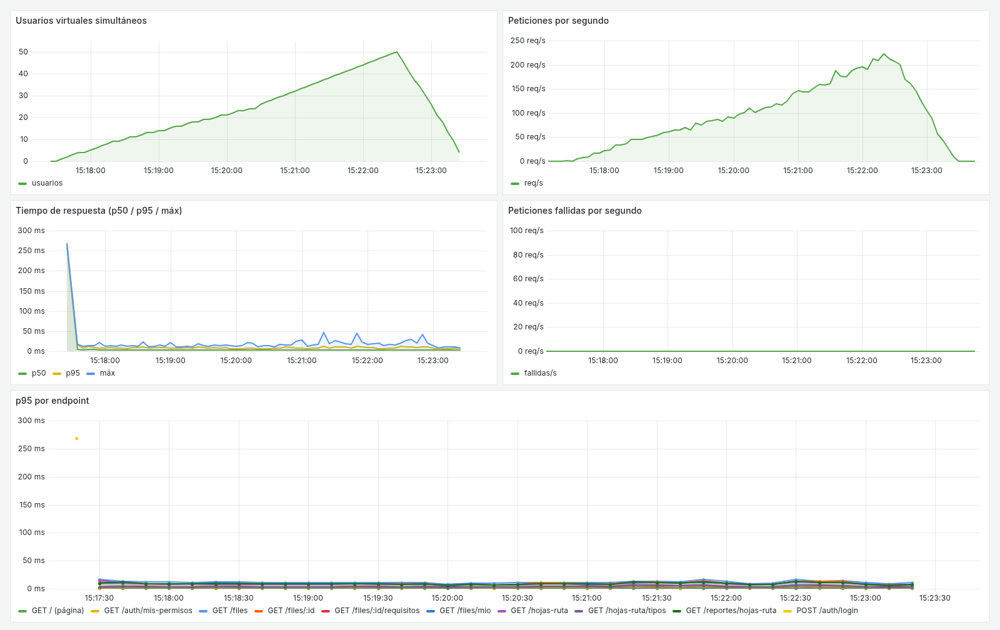

**Cómo leer esta imagen (Grafana):**

- **Arriba a la izquierda, “Usuarios virtuales”:** la rampa que sube de 0 a 50 y baja. Son las personas simuladas.
- **Arriba a la derecha, “Peticiones por segundo”:** cuántas consultas recibe el sistema cada segundo. Sube junto
  con los usuarios (hasta ~220 por segundo).
- **Al medio a la izquierda, “Tiempo de respuesta”:** las líneas están pegadas al piso (cerca de 0 ms). **Eso es
  lo bueno:** aunque suben los usuarios, el sistema no se pone lento. El pico del inicio es el inicio de sesión,
  que es lento **a propósito** (ver punto 6).
- **Al medio a la derecha, “Peticiones fallidas”:** una línea plana en 0. **Ningún error.**
- **Abajo, “p95 por endpoint”:** el tiempo de cada pantalla por separado; todas bajo 15 ms.

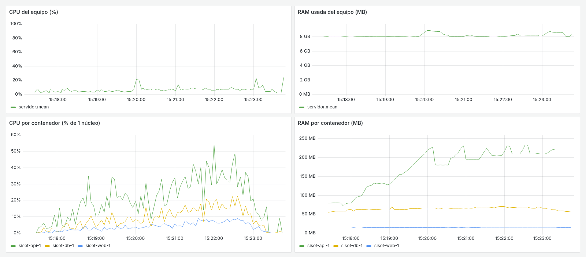

**Cómo leer esta imagen:** muestra cuánto “esfuerzo” hizo la computadora. La CPU (el cerebro de la máquina)
estuvo en promedio al **6 %**: le sobró muchísima capacidad. Abajo se ve cada parte del sistema: la API
(la que piensa) usó como máximo la mitad de un núcleo; la base de datos y la web, casi nada.

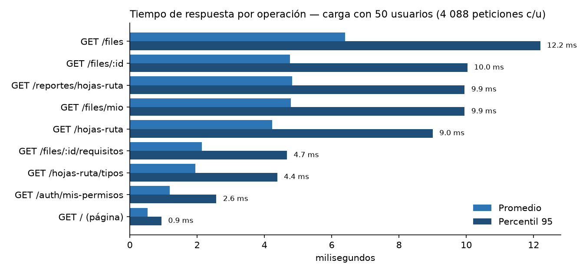

**Cómo leer:** cada barra es una pantalla o consulta. La barra clara es el promedio y la oscura el **p95**. La más
lenta (lista de files) tarda 12 ms en el peor 5 % de los casos.

**Palabra clave — p95:** si ordenas todos los tiempos de menor a mayor, el p95 es el valor bajo el cual quedó el
95 %. Se usa en lugar del promedio porque el promedio “esconde” los casos lentos.

**La meta del proyecto** era que el 95 % responda en menos de **2 segundos** con 50 usuarios. Se logró 9,35 ms:
**unas 200 veces más rápido que la meta.**

---

## 2. Prueba de estrés — “¿cuándo se rompe y por qué?”

**Comparación:** en la prueba de carga medimos al banco en un día normal. En la de estrés metemos cada vez más
gente **sin dejarla respirar** hasta que algo falle, para saber dónde está el límite.

**Qué se hizo:** de 0 a **400 usuarios** que hacen clic sin parar (sin esperar entre pantallas). Eso es mucho
más de lo que SISET tendrá en la vida real.

### Lo que pasó la primera vez

Desde unos **60 usuarios sin pausa** empezaron a aparecer errores (57 % de las consultas fallaron en total).

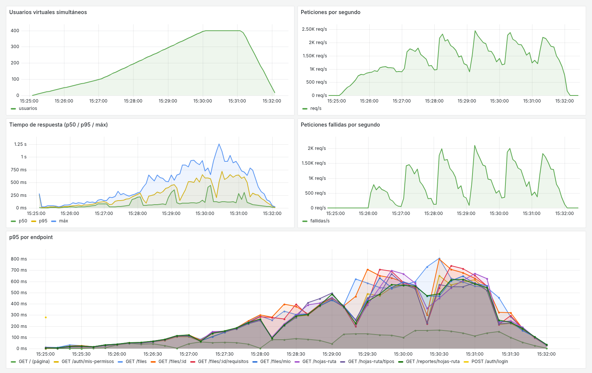

**Cómo leer:** en el cuadro “Peticiones fallidas por segundo” (al medio a la derecha) aparece una montaña: son
los errores. Empiezan cuando hay ~60 usuarios.

**¿Por qué falló?** Se investigó y **la culpa no era del sistema en sí**, sino de una configuración del servidor
web (Nginx). Nginx es como el **portero** que recibe a cada visitante y lo lleva a la oficina (la API). El
portero abría **una puerta nueva para cada visitante** y nunca reutilizaba ninguna. Con tanta gente, se quedó sin
puertas (técnicamente: sin “puertos”). La API nunca se cayó: seguía atendiendo bien a quien llegaba.

### La corrección

Se le indicó al portero que **reutilice las puertas abiertas** (esto se llama **keepalive**). Se repitió
exactamente la misma prueba:

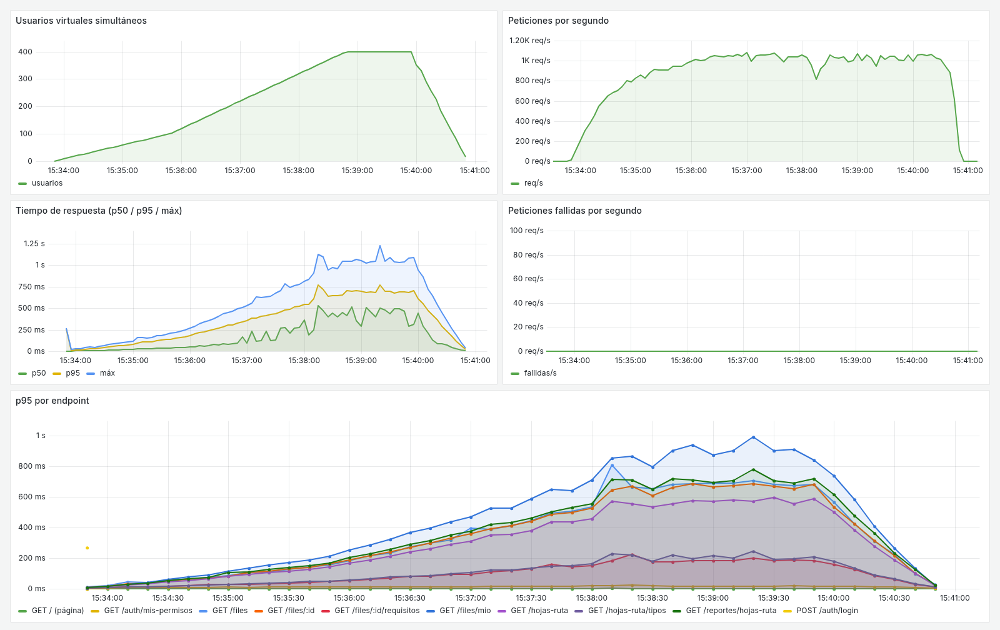

**Resultado:** **0 errores con 400 usuarios** (384 349 consultas). El sistema se pone un poco más lento (el p95
sube a 0,6 segundos) pero **no falla**, y sigue dentro de la meta de 2 segundos.

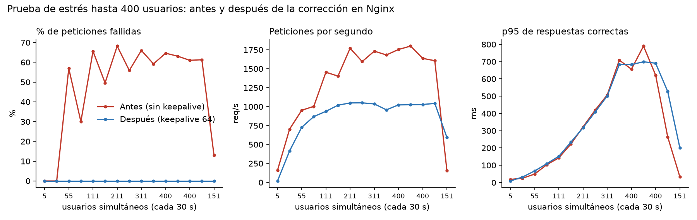

**Cómo leer:** la línea roja es “antes” y la celeste “después”. En el primer cuadro (errores), la roja sube al
50–65 % y la celeste se queda en 0.

> **Qué decir si preguntan:** “La prueba de estrés encontró un límite en la configuración de Nginx. Lo
> diagnosticamos con los logs, aplicamos keepalive y la repetimos: pasó de 57 % de errores a 0 % con 400
> usuarios. Esa es justamente la utilidad de una prueba de estrés.”

**Ojo:** la corrección se probó en la copia local. **Falta aplicarla en el servidor** (es un cambio pequeño).

---

## 3. Prueba de integridad — “¿se mezclan o se pierden datos si muchos escriben a la vez?”

**Comparación:** si 30 secretarias sacan número de trámite al mismo tiempo, ¿puede salir dos veces el mismo
número? ¿Puede saltarse alguno?

**Qué se hizo:** 30 usuarios crearon **300 hojas de ruta al mismo tiempo**. Después se revisó la base de datos con
9 preguntas.

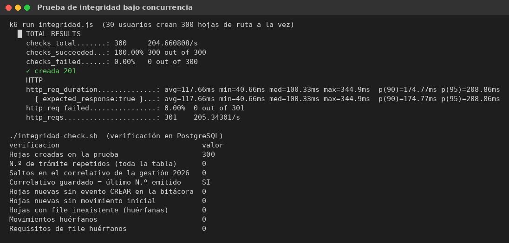

**Resultado (todas correctas):**

- 300 de 300 trámites creados.
- **0 números repetidos** y **0 saltos** en la numeración (HR-2026-000014, 000015, 000016…).
- Los 300 quedaron registrados en la **bitácora** (quién lo creó y cuándo).
- Ningún dato “huérfano” (por ejemplo, un trámite apuntando a un estudiante que no existe).

**Por qué funciona:** el número se genera dentro de una **transacción con bloqueo**: es como una ventanilla
única donde se entrega un número por vez, aunque haya fila.

---

## 4. Disponibilidad — “¿está siempre encendido?”

**Qué se hizo:** durante 10 minutos se consultó el servidor de prueba cada 15 segundos (80 veces). Además se revisó
cuánto tiempo lleva encendido y si tuvo errores.

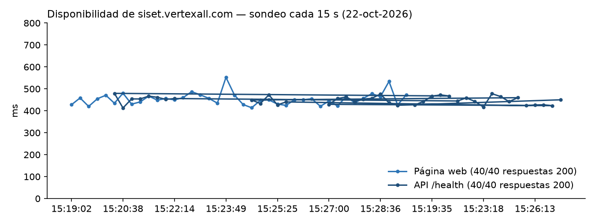

**Cómo leer:** cada punto es una consulta; todas respondieron (80/80) en casi medio segundo (ese tiempo es sobre
todo el viaje por internet).

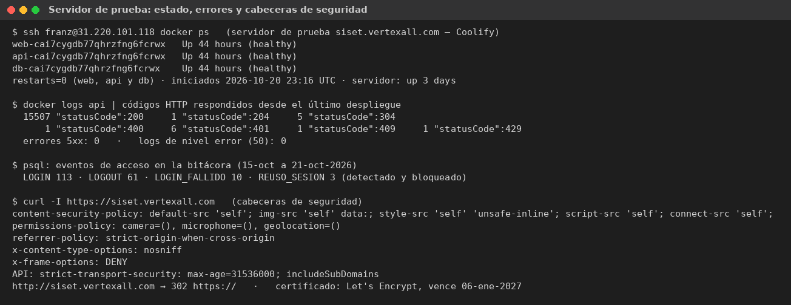

**Cómo leer:** es la “foto” de la terminal del servidor:

- Las 3 partes del sistema (web, api, db) llevan **44 horas encendidas** y **0 reinicios**.
- En 15 522 respuestas hubo **0 errores del servidor** (los famosos “error 500”).
- Las respuestas 401, 403, 409, 429 que aparecen **no son fallas**: son el sistema diciendo “no iniciaste sesión”,
  “no tienes permiso”, “ese dato ya existe” o “demasiados intentos”. Es decir, el sistema **protegiéndose**.
- Abajo: las cabeceras de seguridad y el certificado HTTPS (el candado del navegador), válido hasta enero de 2027.

**Disponibilidad = 44 h encendido / 44 h totales × 100 = 100 %.**

---

## 5. Seguridad — “¿se puede entrar donde no se debe?”

**Comparación:** contratar a alguien para que intente abrir todas las puertas de la oficina y ver cuáles resisten.

**Qué se hizo:** un script hizo **17 ataques o intentos indebidos** contra el sistema:

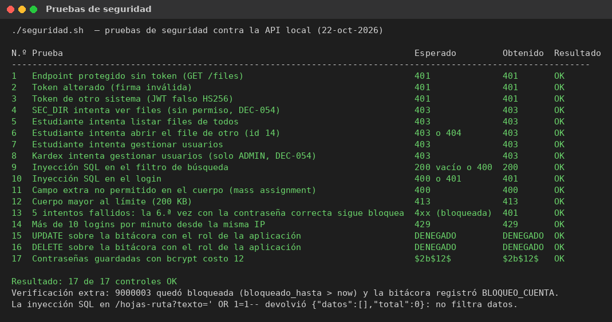

| Intento                                                       | Qué respondió SISET                     |
| ------------------------------------------------------------- | --------------------------------------- |
| Entrar sin iniciar sesión                                     | 401: “no autenticado”                   |
| Usar una credencial falsificada o alterada                    | 401: rechazada                          |
| Secretaría intenta ver los files (no le corresponde)          | 403: “sin permiso”                      |
| Un estudiante intenta ver el file de **otro** estudiante      | 403: “sin permiso”                      |
| Kardex o un estudiante intenta administrar usuarios           | 403: solo el Administrador puede        |
| **Inyección SQL** (escribir código malicioso en el buscador)  | No hizo nada: devolvió 0 resultados     |
| Mandar campos de más para “saltarse” pasos                    | 400: rechazado                          |
| Mandar un mensaje gigante para colgar el sistema              | 413: rechazado                          |
| 5 contraseñas incorrectas seguidas                            | **Cuenta bloqueada** (y queda registrado) |
| Más de 10 intentos de login por minuto                        | 429: “demasiados intentos”              |
| Intentar **borrar o cambiar la bitácora** desde el sistema    | **Denegado** por la base de datos       |
| ¿Cómo se guardan las contraseñas?                             | Cifradas con bcrypt (no se pueden leer) |

**Resultado: 17 de 17 controles funcionaron.** Además, la revisión de las librerías usadas (`npm audit`) dio
**0 vulnerabilidades conocidas**.

---

## 6. ¿Por qué el inicio de sesión tarda más (≈ 260 ms)?

Es **intencional**. La contraseña se compara con un método (bcrypt) que es lento a propósito: para una persona,
un cuarto de segundo no se nota; para un atacante que quiere probar millones de contraseñas, se vuelve
imposible.

---

## 7. Compatibilidad — “¿funciona en cualquier navegador y en el celular?”

**Qué se hizo:** con **Playwright** (un robot que maneja navegadores) se abrió SISET en **3 navegadores**
(Chromium, Google Chrome y Firefox) y **3 tamaños de pantalla** (computadora, tablet y celular). En cada
combinación el robot inició sesión, abrió la lista de files, un file y el seguimiento público.

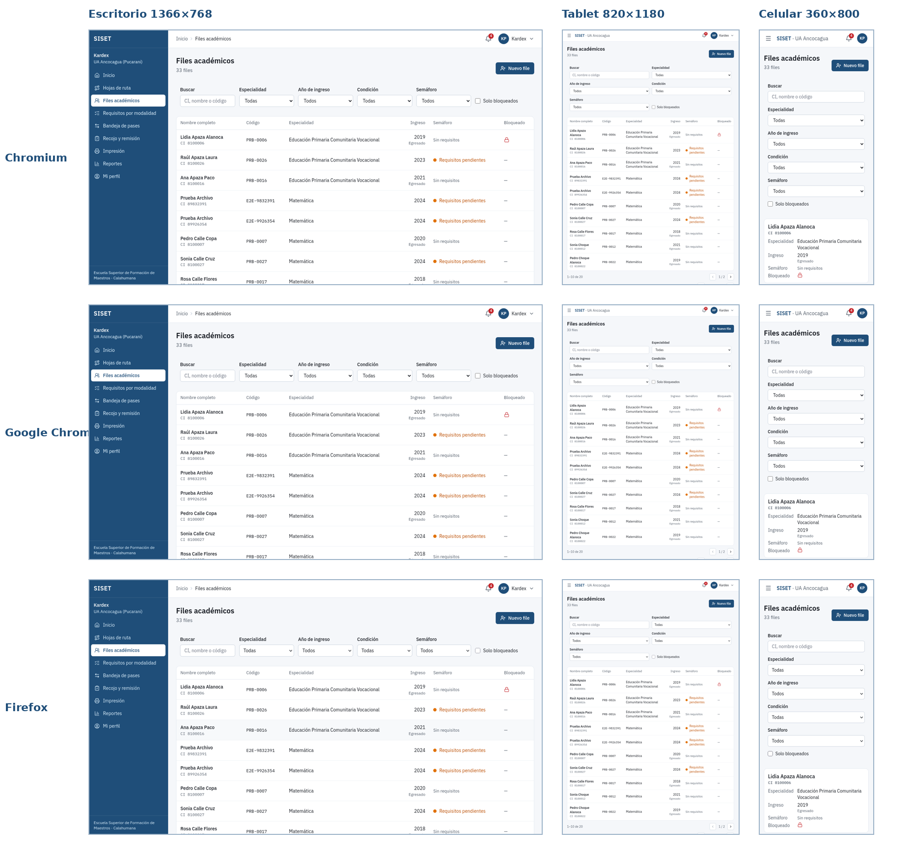

**Cómo leer:** cada fila es un navegador y cada columna un tamaño. Fíjate que en el **celular** la tabla se
convierte en **tarjetas** para que se lea bien: eso es “diseño responsivo”.

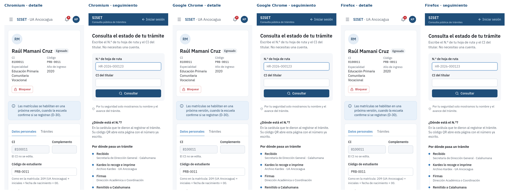

**Resultado: 9 de 9 combinaciones correctas**, sin errores y sin que la pantalla “se salga” hacia los costados.

**Pendiente:** **Safari** (el navegador de iPhone y Mac) no se pudo probar porque la computadora usada es Linux.
Hay que probarlo en un iPhone o una Mac.

Las capturas sueltas de cada combinación están en `imagenes/compatibilidad/`.

---

## 8. Usabilidad y accesibilidad — “¿es fácil de usar, también para personas con dificultades?”

**Qué se hizo:** se usó **Lighthouse**, una herramienta de Google que califica páginas web de 0 a 100. Revisa,
por ejemplo, que el texto tenga buen contraste, que los campos tengan nombre, que se pueda usar con el teclado y
que los botones sean del tamaño del dedo.

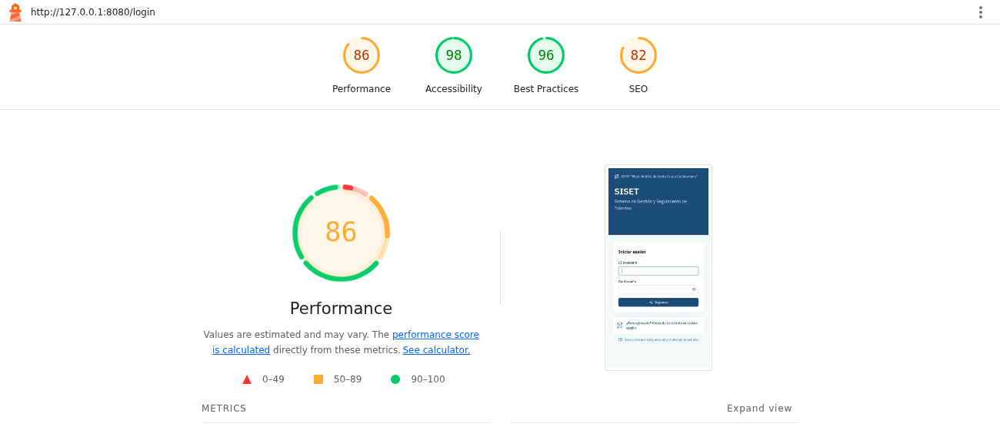

**Cómo leer:** los cuatro círculos de arriba. El que importa aquí es **Accessibility (Accesibilidad): 98**. En
el seguimiento público y en el manual dio **100**. Verde = bueno.

**Importante — lo que NO se hizo todavía:** no se encuestó a usuarios reales. Se hará en la **capacitación del 28
y 29 de octubre** con el cuestionario **SUS** (10 preguntas estándar sobre facilidad de uso; está en el informe).
**No se inventaron resultados de encuestas.**

---

## 9. Copia de seguridad — “si se borra todo, ¿se puede recuperar?”

**Qué se hizo:** se sacó una copia de la base de datos (pg_dump, tardó 0,2 s) y se **restauró en una base nueva y
vacía** (0,5 s). Luego se comparó tabla por tabla.

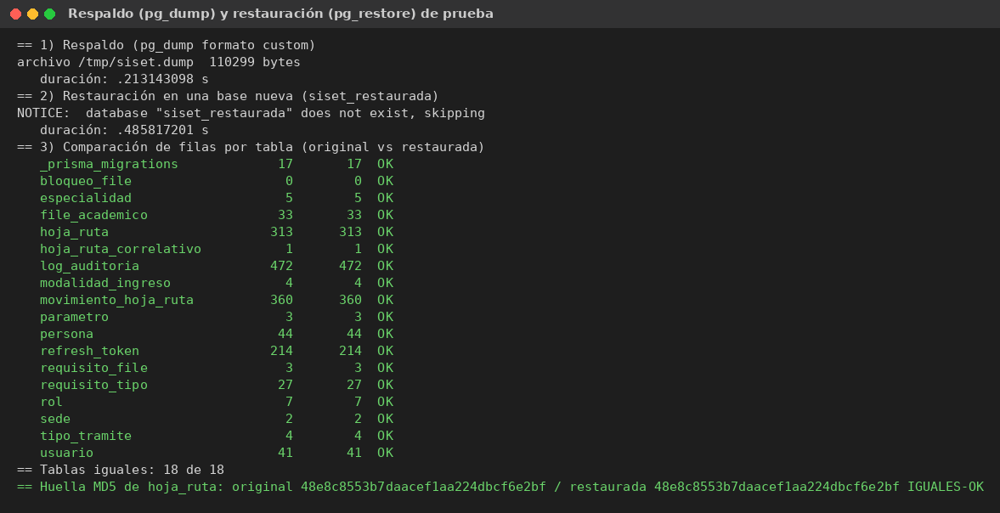

**Cómo leer:** cada fila es una tabla de la base; las dos columnas de números (original y restaurada) son
iguales y dicen **OK**. Abajo, la “huella MD5” (como una huella digital del contenido) es idéntica.

**Resultado:** 18 de 18 tablas iguales. **El procedimiento funciona.**

**Pendiente importante:** todavía **no está programada la copia automática diaria** en el servidor. Es el único
riesgo **alto** del proyecto (ver punto 11) y se debe hacer antes de usar el sistema con datos reales.

---

## 10. Pruebas automáticas — “el sistema se revisa solo cada vez que cambia”

El proyecto tiene **1 490 pruebas que se ejecutan solas** cada vez que se cambia algo en el código:

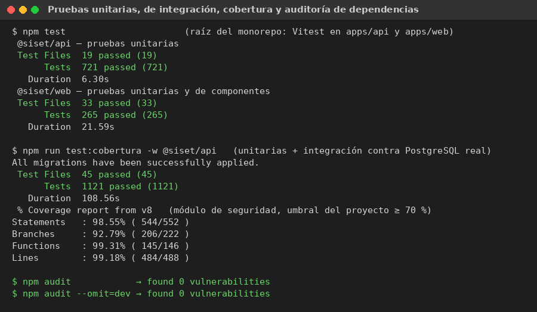

| Tipo                      | Qué revisa                                                       | Resultado     |
| ------------------------- | ---------------------------------------------------------------- | ------------- |
| Unitarias (API)           | Cada regla por separado (ej.: el semáforo, los permisos)         | 721 de 721    |
| Integración (API + base)  | Que las reglas funcionen junto con la base de datos real         | 400 de 400    |
| Web                       | Que cada pantalla muestre lo correcto                            | 265 de 265    |
| De punta a punta (E2E)    | Un robot usa el sistema como una persona, de principio a fin     | 103 de 104    |

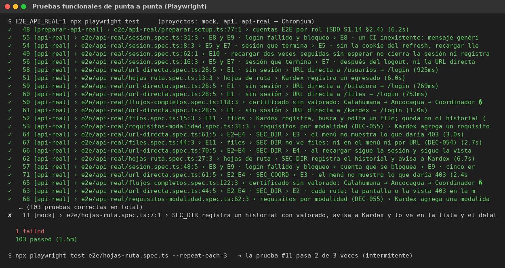

**La que falló (1 de 104)** es **intermitente**: se repitió 3 veces y pasó 2. El problema está en la prueba (que
a veces espera menos de lo necesario), no en el sistema. Quedó anotada para corregir.

**Cobertura 98,55 %:** de todo el código de seguridad, el 98,55 % es revisado por alguna prueba (la meta era 70 %).

---

## 11. Matriz de riesgos — “¿qué podría salir mal y qué tan grave sería?”

Cada riesgo se califica con **Probabilidad (1 a 5) × Impacto (1 a 5)**. El resultado dice si es bajo (1–6),
medio (8–12) o alto (15–25).

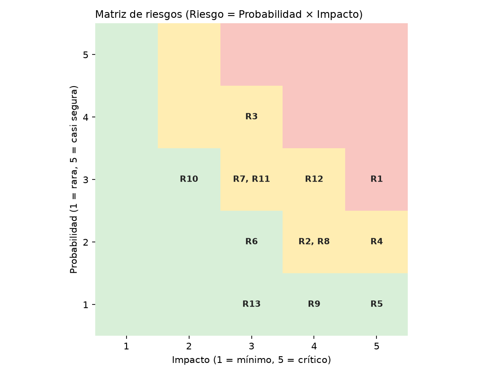

**Cómo leer:** abajo a la izquierda (verde) = poco probable y poco grave. Arriba a la derecha (rojo) = probable y
grave. Cada “R” es un riesgo; la lista completa está en `datos/riesgos.json` y en el informe.

- **Alto (1):** R1 — perder datos porque aún no hay copia automática diaria.
- **Medios (7):** por ejemplo, corte de internet en la sede Ancocagua (R3) o depender de una sola persona técnica (R12).
- **Bajos (5):** por ejemplo, que alguien vea datos que no le corresponden (R5): es bajo porque se probó en el punto 5.

---

## 12. Resumen con las fórmulas del Excel

Las fórmulas vienen del archivo “observaciones a corregir”. Aquí están con los números reales:

| Qué se mide               | Fórmula                                         | Cálculo                 | Resultado   |
| ------------------------- | ----------------------------------------------- | ----------------------- | ----------- |
| Adecuación funcional      | Funciones correctas / evaluadas × 100           | 103 / 104 × 100         | **99,04 %** |
| Tiempo promedio           | Suma de tiempos / número de pruebas             | 126 966 ms / 36 796     | **3,45 ms** |
| Uso de CPU                | CPU utilizado / disponible × 100                | 6,4 / 100 × 100         | **6,4 %**   |
| Compatibilidad            | Pruebas exitosas / totales × 100                | 9 / 9 × 100             | **100 %**   |
| Usabilidad (accesibilidad)| Puntaje obtenido / máximo × 100                 | 298 / 300 × 100         | **99,33 %** |
| Disponibilidad            | Tiempo operativo / total × 100                  | 44 h / 44 h × 100       | **100 %**   |
| Seguridad                 | Controles implementados / requeridos × 100      | 20 / 24 × 100           | **83,33 %** |
| Mantenibilidad            | Cambios exitosos / solicitados × 100            | 63 / 79 × 100           | **79,75 %** |
| Portabilidad              | Entornos compatibles / evaluados × 100          | 4 / 4 × 100             | **100 %**   |
| Riesgo                    | Probabilidad × Impacto                          | ej. R1: 3 × 5           | **15 (alto)** |
| Tasa de recuperación      | Respaldos recuperados / realizados × 100        | 1 / 1 × 100             | **100 %**   |
| Accesos seguros           | Accesos válidos / totales × 100                 | 113 / 123 × 100         | **91,87 %** |
| Corrección de vulnerab.   | Corregidas / detectadas × 100                   | 1 / 3 × 100             | **33,33 %** |

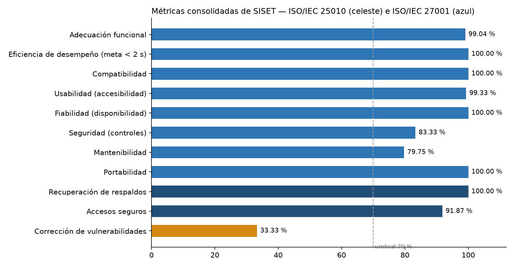

**Cómo leer:** cada barra es una métrica; la línea punteada marca el 70 %. Todas lo superan menos “corrección de
vulnerabilidades” (naranja), porque de las 3 encontradas falta aplicar 2 en el servidor (keepalive y una cabecera
de seguridad llamada HSTS). Cuando se apliquen, llega al 100 %.

**Notas para no equivocarse al explicar:**

- **Seguridad 20 de 24:** faltan 4 controles conocidos: doble verificación por código en el celular (TOTP),
  copia diaria automática, HSTS en la web y cifrado del disco de la base.
- **Mantenibilidad 63 de 79:** de 79 cambios subidos al sistema, 63 pasaron todas las pruebas automáticas al
  primer intento. Los otros 16 se corrigieron (en una mediana de 17 minutos).
- **Accesos seguros 113 de 123:** de 123 intentos de ingreso en el servidor, 113 fueron válidos y los 10 inválidos
  fueron rechazados todos.

**Promedios finales:** ISO/IEC 25010 (calidad) **95,18 % — alto**; ISO/IEC 27001 (seguridad) **77,13 % —
aceptable**, con las mejoras ya identificadas.

---

## 13. Preguntas que podrían hacer en la defensa (y cómo responder)

**¿Por qué no probaron con usuarios reales?**
Las pruebas técnicas se hicieron con usuarios simulados porque se necesitaban cientos a la vez. Con usuarios
reales se hará la encuesta SUS en la capacitación del 28–29 de octubre.

**¿50 usuarios no es poco?**
Es más que todo el personal de las dos sedes. Además, el estrés llegó a 400 usuarios sin pausa (equivale a
muchos más usuarios reales, porque una persona real hace un clic cada varios segundos).

**¿Qué pasa si se corta el internet en Ancocagua?**
En esta versión SISET necesita internet: es un solo servidor al que entran las dos sedes. Si se corta, la
pantalla avisa “No se pudo conectar con el servidor” (sin cerrar la sesión) y se puede reintentar cuando vuelva.
Mientras tanto el trámite sigue en papel y se registra después. Está en la matriz como riesgo medio (R3).

**¿Los datos de las pruebas son reales?**
No. Son datos inventados (“PRB-0001”, CI 8100001…). Los datos reales de estudiantes nunca se subieron a internet.

**¿Por qué el COCOMO dice 13 meses si lo hicieron en 9 días?**
COCOMO es un modelo de 1981 que estima el esfuerzo de un desarrollo tradicional. El proyecto usó herramientas
modernas e inteligencia artificial, por eso fue mucho más rápido. La comparación muestra ese ahorro.

**¿El VAN y la TIR son datos reales?**
Son estimaciones con **supuestos** (sueldos, horas ahorradas) marcados en el informe. Se deben reemplazar por
los datos reales de la escuela.

---

## 14. ¿Qué hay en cada carpeta?

| Carpeta / archivo        | Para qué sirve                                                                                     |
| ------------------------ | -------------------------------------------------------------------------------------------------- |
| `GUIA-ESTUDIANTE.md`     | Esta guía.                                                                                         |
| `README.md`              | Resumen técnico corto y cómo repetir las pruebas.                                                  |
| `informe/`               | **El informe para entregar**: Word, PDF y el Excel de observaciones respondido (con imágenes).     |
| `imagenes/`              | Todas las capturas usadas en esta guía y en el informe.                                            |
| `imagenes/compatibilidad/` | 27 capturas: cada navegador × cada tamaño × cada pantalla.                                       |
| `imagenes/lighthouse/`   | Los informes completos de Lighthouse (se abren con doble clic en el navegador).                    |
| `datos/`                 | Los números “crudos” de cada prueba (para quien quiera verificarlos).                              |
| `scripts/`               | Los programas que hicieron las pruebas; con ellos se pueden repetir (ver `README.md`).             |

## 15. Glosario rápido

| Palabra           | Significado simple                                                                 |
| ----------------- | ---------------------------------------------------------------------------------- |
| **ms**            | Milisegundo: la milésima parte de un segundo.                                      |
| **p95**           | El 95 % de las respuestas tardó menos que este valor.                              |
| **API**           | La parte del sistema que “piensa”: recibe las consultas, aplica reglas y guarda.   |
| **Base de datos** | Donde se guarda todo (PostgreSQL).                                                 |
| **Nginx**         | El “portero”: entrega las páginas y pasa las consultas a la API.                   |
| **Keepalive**     | Reutilizar una conexión en vez de abrir una nueva cada vez.                        |
| **k6**            | Programa que simula muchos usuarios a la vez.                                      |
| **Grafana**       | Programa que dibuja los gráficos de las pruebas en tiempo real.                    |
| **Playwright**    | Robot que maneja navegadores para probar como una persona.                         |
| **Lighthouse**    | Herramienta de Google que califica páginas de 0 a 100.                             |
| **E2E**           | Prueba “de punta a punta”: de abrir la página hasta terminar el trámite.           |
| **Bitácora**      | Registro de quién hizo qué y cuándo; no se puede borrar.                           |
| **bcrypt**        | Forma segura y lenta (a propósito) de guardar contraseñas.                         |
| **HSTS**          | Instrucción que obliga al navegador a usar siempre la conexión segura (https).     |
| **TOTP**          | Código de 6 dígitos en el celular como segunda clave.                              |
| **401 / 403 / 429 / 5xx** | Sin sesión / sin permiso / demasiados intentos / error del servidor.       |
