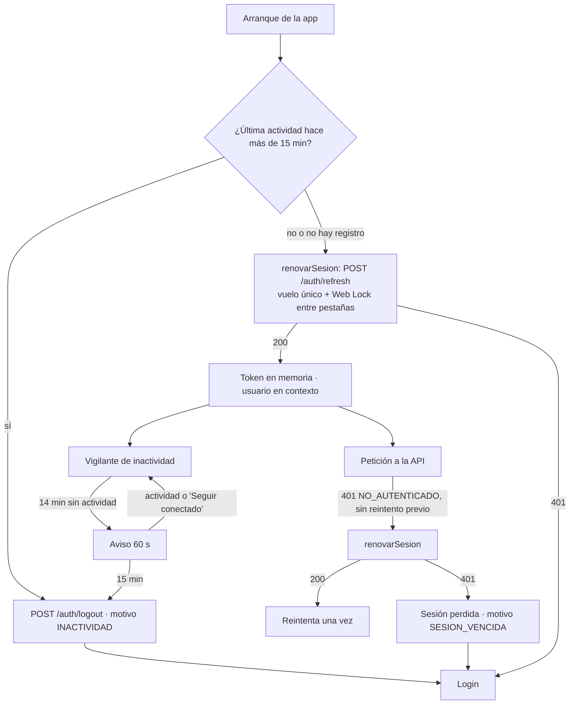

# SDD — S1.10 · Sesión real, refresh automático en Axios y cierre por inactividad

- **Ticket:** ClickUp **S1.10** (`868mh1kwk`, https://app.clickup.com/t/868mh1kwk).
- **Autor:** generado con Claude (Entregable 1).
- **Estado:** Aprobado (2026-10-14)
- **Versión:** 1.0 · **Fecha:** 2026-10-14
- **Rama:** se implementa encima de S1.9, en `feat/S1.9-login-conectado` (comparten `AuthContext`, `auth.*.ts`
  y `Login.tsx`). El ticket nombra `feat/S1.10-sesion-real`; se usa una sola rama para no pelear los mismos
  archivos, y el commit lleva el ID `S1.10 …`.
- **Fuentes de verdad citadas:**
  1. `docs/product/PRD.md` RF-01 CA3 ("la sesión expira tras 15 min sin actividad"), CA4 (logout invalida el refresh), RNF-02
  2. `docs/product/business-rules.md` §Seguridad ("15 min de inactividad = cierre")
  3. `docs/decisions/LOG.md` — DEC-007, DEC-012 #2 ("la inactividad de 15 min la controlan el access de 15 min y la web (S1.10)"; sesión máxima de 8 h), DEC-014 (#1 refresh y logout solo con cookie, #2 hereda el vencimiento y relee rol/sede/`cpw`, #3 **reuso o carrera de dos refresh = se cierran todas las sesiones**, #6 logout siempre 204), DEC-015 #6 (`/auth/mis-permisos` para el menú, S1.11)
  4. `docs/sdd/S1.3/SDD.md` §2.6 (access token solo en memoria), `docs/sdd/S1.5/SDD.md` §2.1–2.2, `docs/sdd/S0.8/SDD.md` §2.1 y §2.5 (cliente Axios, demo solo con todo en mock)
  5. `docs/sdd/S1.9/SDD.md` (base de esta rama: `cambiarPassword`, mensajes del login)
  6. `apps/api/src/modulos/seguridad/auth.controlador.ts` (cookie `siset_refresh`, `Path=/api/v1/auth`)

---

## 1 · Alcance

### Entra

- **Restaurar la sesión al recargar** con `POST /auth/refresh` (la cookie httpOnly), sin guardar el id del usuario
  en `sessionStorage`.
- **Interceptor de Axios**: ante un 401 de una ruta protegida, **un solo refresh en curso** (por pestaña y entre
  pestañas) y reintento único de la petición original. Si el refresh falla, la sesión se pierde y se vuelve al login.
- **Cierre por inactividad de 15 min**, con **aviso 60 s antes** ("Seguir conectado" / "Cerrar sesión"),
  compartido entre pestañas; al vencer, `POST /auth/logout` y login con el motivo.
- Al volver tras más de 15 min sin actividad (pestaña cerrada, equipo suspendido), la sesión **no se restaura**:
  se cierra con `POST /auth/logout`.
- **Contrato público de `useAuth()`** para S1.11, S1.13 y S6.5 (§2.1).
- Vaciar la caché de React Query al iniciar, cerrar o perder la sesión (no se mezclan datos de dos usuarios).

### No entra (a propósito)

- Rutas por rol, menú, 403 y consumir `/auth/mis-permisos` → S1.11 (usa el contrato de §2.1).
- Cambios en la API. La inactividad la controla la web (DEC-012 #2); el refuerzo en el servidor queda como
  propuesta (§6, §7).
- E2E contra el backend real → S1.14. Aquí, E2E del proyecto `api` con la API simulada por `page.route`.
- Renovar el access token **antes** de que venza (por temporizador): no hace falta; el 401 lo cubre (§2.3).
- Sincronizar un **login** entre pestañas (otra pestaña en `/login` no entra sola). Sí se sincroniza el cierre.

### Premisas verificadas (`task-brief`)

| Premisa del ticket                                                                                          | Qué hay de verdad en el repo                                                                                                                                                                                                                                                                                                                                                                                             |
| ----------------------------------------------------------------------------------------------------------- | ------------------------------------------------------------------------------------------------------------------------------------------------------------------------------------------------------------------------------------------------------------------------------------------------------------------------------------------------------------------------------------------------------------------------ |
| "`AuthContext` del prototipo es la base"                                                                    | ✅ Existe, pero guarda el **id** en `sessionStorage` y restaura con `authService.obtener(id)`, que en API lanza `NO_IMPLEMENTADO`. Se reemplaza por `authService.restaurar()` (§2.2).                                                                                                                                                                                                                                    |
| "Al recargar recupera la sesión vía refresh"                                                                | ✅ `POST /auth/refresh` funciona solo con la cookie y devuelve el mismo cuerpo que el login (DEC-014 #1–2). ⚠️ Rota la cookie: **dos refresh simultáneos con la misma cookie = reuso → se cierran todas las sesiones** (DEC-014 #3). Pasa con `StrictMode` (el efecto corre dos veces en desarrollo), con dos 401 a la vez y con dos pestañas. Por eso el refresh es de vuelo único y con bloqueo entre pestañas (§2.3). |
| "Interceptor: ante 401, un solo refresh en curso y reintento"                                               | ✅ `lib/api.ts` solo traduce errores y pone el Bearer; el comentario deja el 401 para S1.10.                                                                                                                                                                                                                                                                                                                             |
| "Cierre por inactividad de 15 min con aviso previo"                                                         | ⚠️ No existe nada. El access dura 15 min pero **no** mide inactividad: un usuario que no hace peticiones sigue con la cookie de 8 h. Sin cambio en la API, la web es la que cierra. El tiempo del aviso no está definido: se decide **60 s** (técnico, §2.4).                                                                                                                                                            |
| "Reabrir el navegador horas después"                                                                        | ⚠️ La cookie dura 8 h desde el login (DEC-012 #2) y sobrevive al cierre del navegador. Sin un registro de la última actividad, recargar restauraría una sesión inactiva. Se guarda la **hora** de la última actividad en `localStorage` (no es un secreto) y se revisa al arrancar (§2.4).                                                                                                                               |
| DoD: "Tests del interceptor (Vitest)"                                                                       | ✅ `lib/api.test.ts` ya prueba con un `adapter` de Axios; se amplía.                                                                                                                                                                                                                                                                                                                                                     |
| DoD: "E2E: recargar con sesión y cierre por inactividad"                                                    | ⚠️ El proyecto `api` de Playwright simula la API (`page.route`); Playwright tiene `page.clock` para adelantar el tiempo. Con backend real → S1.14.                                                                                                                                                                                                                                                                       |
| DoD: "toda escritura y evento de acceso con su evento"                                                      | ✅ El cierre por inactividad llama a `POST /auth/logout`, que registra `LOGOUT` (S1.5). El refresh no es un evento de la lista cerrada (DEC-011 #3). El reuso lo registra la API (`REUSO_SESION`). La web no escribe nada.                                                                                                                                                                                               |
| `useAuth()` lo usan `App`, `ProtectedRoute`, `Header`, `AppLayout`, `Login`, `CambiarClave`, `NoAutorizado` | ✅ Campos en uso: `usuario`, `cargando`, `login`, `logout`, `refrescar`, `cambiarPassword` (S1.9), y los de la demo `verComo`, `version`, `reiniciar`. Se mantienen todos con la misma forma (§2.1).                                                                                                                                                                                                                     |



---

## 2 · Diseño técnico

### 2.1 Contrato público de `useAuth()`

`useAuth()` (en `hooks/index.ts`, sin cambios) devuelve `ApiAuth`, definida en `context/AuthContext.tsx`:

```ts
export type MotivoCierre = 'INACTIVIDAD' | 'SESION_VENCIDA';

export interface ApiAuth {
  /** Usuario de la sesión, o null. Cambia al iniciar, cerrar, perder la sesión o renovarla (rol/sede/cpw frescos). */
  usuario: Usuario | null;
  /** true solo mientras se restaura la sesión al arrancar. Las rutas protegidas esperan con <Cargando />. */
  cargando: boolean;
  /** Inicia sesión. Rechaza con ErrorApi (CREDENCIALES_INVALIDAS, DEMASIADAS_PETICIONES, SIN_CONEXION…). */
  login: (usuario: string, password: string) => Promise<Usuario>;
  /** Cierra sesión. Nunca rechaza: si la API falla, igual limpia la sesión local. */
  logout: () => Promise<void>;
  /** Vuelve a leer el usuario de la sesión (en API: POST /auth/refresh, que relee rol, sede y cpw). */
  refrescar: () => Promise<void>;
  /** Cambia la propia contraseña y se queda con la sesión nueva que devuelve la API (S1.9). */
  cambiarPassword: (passwordActual: string, passwordNueva: string) => Promise<Usuario>;
  /** Por qué terminó la última sesión sin que el usuario la cerrara; null tras un login o un logout manual. */
  motivoCierre: MotivoCierre | null;

  // Solo demo (todo en mock, VITE_DEMO): sin cambios de forma.
  verComo: (id: number) => Promise<void>;
  version: number;
  reiniciar: () => Promise<void>;
}
```

Reglas para quien lo consume:

- **Nunca** se expone el access token. Las peticiones lo llevan solas (`lib/api.ts`).
- Para datos que dependen del usuario (p. ej. `/auth/mis-permisos` en S1.11), usar React Query con una clave que
  incluya `usuario?.id`, y `enabled: Boolean(usuario)`. El contexto **vacía la caché** al iniciar, cerrar o perder
  la sesión, así que no hace falta invalidar a mano.
- `usuario.debeCambiarClave` sigue siendo la señal del `cpw`; `ProtectedRoute` ya redirige a `/cambiar-clave`.
- Un 401 en cualquier llamada ya pasó por el refresh: si llega a la pantalla, la sesión se perdió y el contexto
  ya puso `usuario = null` (las rutas protegidas mandan al login). Las pantallas no manejan el 401.

### 2.2 `authService` (mock y API, misma firma)

```ts
login(usuario: string, password: string): Promise<Usuario>
logout(u: Usuario): Promise<void>
restaurar(): Promise<Usuario | null>          // nuevo: sesión del navegador, o null
cambiarPassword(u: Usuario, passwordActual: string, passwordNueva: string): Promise<Usuario>   // S1.9
verComo(id: number): Promise<Usuario | null>   // reemplaza a obtener(id); solo demo
usuariosDemo(): Usuario[]
```

- **API:** `restaurar()` llama a `renovarSesion()` (§2.3): 200 → `aUsuario`; 401 → `null`; otro error (sin
  conexión) → `null` (el login mostrará el error real al intentar entrar). `logout` borra el token y hace
  `POST /auth/logout`, tragando el error (204 siempre en la API; sin red, la sesión local se limpia igual).
  `verComo` lanza `NO_DISPONIBLE` (la demo nunca corre con la API, S0.8 §2.5).
- **Mock:** la "cookie" de la demo pasa a ser `sessionStorage['siset.sesion']`, ahora **dentro de `auth.mock.ts`**
  (`login` y `verComo` la escriben, `logout` la borra, `restaurar` la lee y devuelve el usuario si sigue activo).
  El contexto ya no sabe de `sessionStorage`.

### 2.3 Refresh: vuelo único, bloqueo entre pestañas e interceptor (`lib/api.ts`)

```ts
/** POST /auth/refresh una sola vez a la vez: en esta pestaña (promesa compartida) y entre pestañas (Web Lock). */
export function renovarSesion(): Promise<RespuestaSesion>;
```

1. Si hay una renovación en curso en la pestaña, devuelve **la misma promesa** (cubre `StrictMode` y N peticiones
   con 401 a la vez).
2. Si no, dentro de `navigator.locks.request('siset-refresh', …)` (si el navegador no tiene Web Locks, sin
   bloqueo) hace `POST /auth/refresh` con `{ _sinReintento: true }`. El bloqueo hace que dos pestañas renueven
   **una después de la otra**: la segunda manda la cookie ya rotada por la primera (el navegador comparte las
   cookies), así que no hay reuso.
3. 200 → `guardarAccessToken`, emite `{ tipo: 'renovada', respuesta }` y resuelve. Error → `borrarAccessToken`,
   rechaza con el `ErrorApi` (`SESION_INVALIDA`). La promesa compartida se limpia en `finally`.

`RespuestaSesion` (el cuerpo de login/refresh/cambiar-password) se mueve a `lib/sesion.ts` para que `lib/api.ts`
no importe de `services/`; `auth.api.ts` la reexporta como `RespuestaLogin` (no rompe su test).

**Interceptor de respuesta** (reemplaza al actual):

```
si es 401
   y la petición NO tiene _sinReintento ni _reintentada
   y la URL no es /auth/login, /auth/refresh ni /auth/logout
   y la petición llevaba Authorization (había sesión):
     try   { await renovarSesion(); reintenta la original una vez con _reintentada = true y el Bearer nuevo }
     catch { emite { tipo: 'perdida' }; rechaza con el ErrorApi del refresh }
si no: rechaza con aErrorApi(e) (como hoy)
```

- Solo se reintenta **una vez**: si la petición reintentada vuelve a dar 401, se rechaza sin otro refresh (sin bucles).
- Un 403 `CAMBIO_PASSWORD_REQUERIDO` no es un 401: pasa tal cual (lo maneja `ProtectedRoute` con `debeCambiarClave`).
- `_sinReintento` y `_reintentada` se declaran ampliando `InternalAxiosRequestConfig` por `declare module 'axios'`
  (tipado, sin `any`).

**Bus de sesión** (`lib/sesion.ts`): `suscribirSesion(fn): () => void` y `emitirSesion(evento)`, con
`EventoSesion = { tipo: 'renovada'; respuesta: RespuestaSesion } | { tipo: 'perdida' }`. `lib/api.ts` emite;
`AuthContext` escucha. Así el contexto recibe el usuario fresco tras un refresh del interceptor (si Kardex le
cambió el rol o la sede, se ve en ≤ 15 min) sin que `lib/` dependa de React.

### 2.4 Inactividad (`lib/inactividad.ts`)

Constantes: `LIMITE_INACTIVIDAD_MS = 15 * 60_000` (RNF-02), `AVISO_ANTES_MS = 60_000`,
`CLAVE_ACTIVIDAD = 'siset.ultimaActividad'` en `localStorage`.

- **Qué es actividad:** `pointerdown`, `keydown`, `wheel`, `touchstart`, `scroll` (en captura) y `mousemove`.
  Las peticiones a la API **no** cuentan (un refresco automático de datos mantendría viva una sesión abandonada).
- **Registro:** la hora (ms) se escribe en `localStorage` como mucho cada 5 s (throttle). Al estar en
  `localStorage`, todas las pestañas comparten la misma "última actividad": trabajar en una mantiene vivas las otras.
- **Revisión:** cada 1 s y en `visibilitychange` (los temporizadores de una pestaña en segundo plano se frenan; por
  eso se compara la hora guardada, no se cuenta con un `setTimeout` de 15 min).
  - `inactivo ≥ 14 min` → `alAvisar(segundosRestantes)`; `inactivo < 14 min` con aviso abierto → `alReanudar()`.
  - `inactivo ≥ 15 min` → `alVencer()` (una sola vez).
- Núcleo puro y probable con reloj falso: `crearVigilante({ ahora, leer, escribir, alAvisar, alReanudar, alVencer })`
  con `registrarActividad()`, `revisar()`, `detener()`. Un adaptador fino `vigilarNavegador(vigilante)` engancha los
  eventos de `window` y el intervalo.
- `localStorage` se usa dentro de `try/catch`; sin almacenamiento, el vigilante funciona solo en memoria (por pestaña).

**En `AuthContext`:**

- Con sesión, arranca el vigilante; sin sesión, lo detiene y borra `siset.ultimaActividad`.
- `alAvisar` → muestra `AvisoInactividad` (modal con cuenta regresiva): **"Seguir conectado"** (registra actividad)
  y **"Cerrar sesión"** (logout manual). Cualquier actividad también lo cierra.
- `alVencer` → `cerrar('INACTIVIDAD')`: `authService.logout` (API: `POST /auth/logout`, que registra `LOGOUT` y
  revoca el refresh), limpia y deja `motivoCierre = 'INACTIVIDAD'`.
- **Al arrancar** (`sesion-inicial.ts`, puro): si hay `siset.ultimaActividad` y pasaron ≥ 15 min →
  `authService.logout` sin usuario conocido (API: `POST /auth/logout` con la cookie; mock: borra su sesión) y
  `motivoCierre = 'INACTIVIDAD'`, **sin** llamar a refresh. Si no, `authService.restaurar()`.
- Rige en mock y en API: la demo muestra el mismo comportamiento que tendrá el sistema.

### 2.5 Sincronización entre pestañas

`BroadcastChannel('siset-sesion')` con `{ tipo: 'cerrada', motivo: MotivoCierre | null }`. La pestaña que cierra
(logout manual, inactividad o sesión perdida) avisa; las demás limpian su estado local **sin** llamar a la API
(la sesión ya está revocada) y van al login con el mismo motivo. Si el navegador no tiene `BroadcastChannel`, cada
pestaña lo descubre en su siguiente 401 o al vencer su propio vigilante.

### 2.6 `AuthContext` (resumen de comportamiento)

| Momento           | Qué hace                                                                                                                                                                                                                |
| ----------------- | ----------------------------------------------------------------------------------------------------------------------------------------------------------------------------------------------------------------------- |
| Montaje           | `cargando = true`; `sesionInicial()` (§2.4); `usuario` y `motivoCierre` según el resultado; `cargando = false`. Protegido contra el doble efecto de `StrictMode` (el vuelo único de §2.3 hace que no haya dos refresh). |
| `login`           | `authService.login`; `queryClient.clear()`; registra actividad; `motivoCierre = null`.                                                                                                                                  |
| `logout`          | `authService.logout` (sin propagar error); limpia; `motivoCierre = null`; avisa a las pestañas.                                                                                                                         |
| Evento `renovada` | `setUsuario(aUsuario(respuesta.usuario))`.                                                                                                                                                                              |
| Evento `perdida`  | Limpia; `motivoCierre = 'SESION_VENCIDA'`; avisa a las pestañas.                                                                                                                                                        |
| `refrescar`       | API: `authService.restaurar()` (refresh); `null` → como `perdida`. Mock: relee el usuario.                                                                                                                              |
| `cambiarPassword` | Como en S1.9.                                                                                                                                                                                                           |
| "Limpia"          | `borrarAccessToken`, `usuario = null`, detiene el vigilante, borra `siset.ultimaActividad`, `queryClient.clear()`.                                                                                                      |

`AuthProvider` ya está dentro de `QueryClientProvider` (`main.tsx`), así que usa `useQueryClient()`.

### 2.7 P-01 con el motivo y la ruta de origen

- Si `motivoCierre` es `INACTIVIDAD`: `Alerta` informativa _"Tu sesión se cerró tras 15 minutos sin actividad.
  Vuelve a ingresar."_; si es `SESION_VENCIDA`: _"Tu sesión terminó. Vuelve a ingresar."_ Se oculta al escribir.
- Tras el login, si `location.state.desde` (lo pone `ProtectedRoute`) es una ruta interna que empieza con `/` y no es
  `/login`, y el usuario no debe cambiar la contraseña, vuelve allí; si no, `rutaInicio(rol)`. Si esa ruta no le
  corresponde al rol, S1.11 muestra el 403 como en cualquier otra navegación.

---

## 3 · Cambios por archivo/módulo

| Archivo                                                       | Cambio                                                                                                                                        |
| ------------------------------------------------------------- | --------------------------------------------------------------------------------------------------------------------------------------------- |
| `apps/web/src/lib/sesion.ts`                                  | + `RespuestaSesion`, `EventoSesion`, `suscribirSesion`, `emitirSesion` (§2.3). El token sigue solo en memoria.                                |
| `apps/web/src/lib/api.ts`                                     | + `renovarSesion` (vuelo único + Web Lock); interceptor 401 con reintento único; `declare module 'axios'` para las banderas (§2.3).           |
| `apps/web/src/lib/inactividad.ts`                             | **Nuevo**: constantes, `crearVigilante`, `vigilarNavegador`, lectura/escritura segura de `siset.ultimaActividad` (§2.4).                      |
| `apps/web/src/context/sesion-inicial.ts`                      | **Nuevo**: `sesionInicial({ ahora, ultimaActividad, restaurar, cerrar })` → `{ usuario, motivo }` (§2.4), puro.                               |
| `apps/web/src/context/AuthContext.tsx`                        | Contrato de §2.1; sin `sessionStorage`; bus de sesión, vigilante, `BroadcastChannel`, `queryClient.clear()`, `AvisoInactividad` (§2.5–2.6).   |
| `apps/web/src/components/sesion/AvisoInactividad.tsx`         | **Nuevo**: modal con `Modal` de `components/ui`, cuenta regresiva y los dos botones. Carpeta nueva para no tocar `components/layout` (S1.11). |
| `apps/web/src/services/auth.api.ts`                           | + `restaurar`, `verComo` (lanza); − `obtener`; `logout` traga el error; `RespuestaLogin` = `RespuestaSesion`.                                 |
| `apps/web/src/services/auth.mock.ts`                          | + `restaurar`, `verComo`; la sesión simulada en `sessionStorage` vive aquí; − `obtener`.                                                      |
| `apps/web/src/pages/publicas/Login.tsx`                       | Alerta por `motivoCierre`; vuelta a `state.desde` (§2.7).                                                                                     |
| `apps/web/src/lib/api.test.ts`                                | Casos del interceptor y de `renovarSesion` (§4).                                                                                              |
| `apps/web/src/lib/inactividad.test.ts`                        | **Nuevo** (§4).                                                                                                                               |
| `apps/web/src/context/sesion-inicial.test.ts`                 | **Nuevo** (§4).                                                                                                                               |
| `apps/web/src/services/auth.api.test.ts`, `auth.mock.test.ts` | `restaurar`, `logout` sin red, `verComo` (§4).                                                                                                |
| `apps/web/e2e/modo-api-sesion.spec.ts`                        | **Nuevo**, proyecto `api` (§4).                                                                                                               |

No se tocan: `hooks/index.ts` (`useAuth` ya devuelve `ApiAuth`), `components/layout/*` (los campos que usa
`Header` —`logout`, `verComo`, `reiniciar`— y `AppLayout` —`version`— no cambian), `config/permisos.ts`,
`App.tsx`, la API.

---

## 4 · Plan de tests

| Caso                                                                                                                                                                                                                                  | Nivel              | Cubre            |
| ------------------------------------------------------------------------------------------------------------------------------------------------------------------------------------------------------------------------------------- | ------------------ | ---------------- |
| 401 en `GET /x` con sesión → un `POST /auth/refresh`, reintento con el **Bearer nuevo**, la pantalla recibe la respuesta del reintento                                                                                                | Unit (adapter)     | §2.3             |
| Tres peticiones con 401 a la vez → **un solo** refresh y tres reintentos                                                                                                                                                              | Unit               | §2.3, DEC-014 #3 |
| Dos llamadas seguidas a `renovarSesion()` (simula `StrictMode`) → un solo `POST /auth/refresh`                                                                                                                                        | Unit               | §2.3             |
| Refresh 401 → evento `perdida`, token borrado, rechaza con `SESION_INVALIDA`; sin reintento                                                                                                                                           | Unit               | §2.3             |
| El reintento vuelve a dar 401 → se rechaza sin un segundo refresh                                                                                                                                                                     | Unit               | §2.3             |
| 401 de `/auth/login`, `/auth/refresh`, `/auth/logout` o de una petición sin `Authorization` → no hay refresh                                                                                                                          | Unit               | §2.3             |
| 403 `CAMBIO_PASSWORD_REQUERIDO` → pasa tal cual                                                                                                                                                                                       | Unit               | DEC-015 #4       |
| Refresh 200 → evento `renovada` con el usuario de la respuesta                                                                                                                                                                        | Unit               | §2.3             |
| Con `navigator.locks` presente, el refresh corre dentro de `request('siset-refresh')`; sin él, igual funciona                                                                                                                         | Unit (doble)       | §2.3             |
| Vigilante con reloj falso: 13:59 sin aviso; 14:00 avisa con 60 s; actividad a los 14:30 → reanuda; 15:00 vence **una vez**; escribir actividad respeta el throttle de 5 s; la hora escrita por "otra pestaña" posterga el vencimiento | Unit (fake timers) | §2.4, RNF-02     |
| `sesionInicial`: actividad de hace 16 min → cierra sin refresh, motivo `INACTIVIDAD`; de hace 2 min → `restaurar`; sin registro → `restaurar`; `restaurar` null → sin usuario y sin motivo                                            | Unit               | §2.4             |
| `authApi.restaurar`: 200 → usuario y token; 401 → `null`; sin red → `null`                                                                                                                                                            | Unit               | §2.2             |
| `authApi.logout` sin red → resuelve y borra el token                                                                                                                                                                                  | Unit               | §2.1             |
| `authMock.restaurar` / `verComo` / `logout` con la sesión simulada en `sessionStorage` (doble en memoria)                                                                                                                             | Unit               | §2.2             |
| E2E: login → recargar → `POST /auth/refresh` (simulado 200) → sigue en su inicio, sin pasar por el login                                                                                                                              | E2E `api`          | ticket           |
| E2E: recargar con refresh 401 → `/login` sin mensaje                                                                                                                                                                                  | E2E `api`          | ticket           |
| E2E: en P-03, `cambiar-password` responde 401 una vez → la web llama a refresh y reintenta; la segunda llega con el Bearer nuevo                                                                                                      | E2E `api`          | §2.3             |
| E2E (`page.clock`): tras el login, adelantar 14:01 → aviso visible; "Seguir conectado" lo cierra; adelantar 15:01 → `POST /auth/logout` llamado y `/login` con el mensaje de inactividad                                              | E2E `api`          | RF-01 CA3        |
| E2E (`page.clock`): login, adelantar 16 min con la página cerrada (nueva página del mismo contexto) → no llama a refresh, llama a logout y muestra el mensaje                                                                         | E2E `api`          | §2.4             |
| E2E mock existentes (`flujos`, `recorrido`, "Ver como", reinicio) siguen verdes                                                                                                                                                       | E2E `mock`         | demo             |

**No se prueba aquí:** el reuso real de la API con dos pestañas (lo prueba S1.5 en la API; aquí se prueba que la
web no lo provoca), el backend real (S1.14), el `BroadcastChannel` entre pestañas en E2E (se prueba con un doble en
unit; el E2E multi-pestaña es frágil y la API ya revoca la sesión de todos modos).

---

## 5 · Definition of Done

- [ ] SDD en `docs/sdd/S1.10/SDD.md`, Estado = Aprobado.
- [ ] Recargar con sesión vigente no pide login; no queda ningún id ni token en `sessionStorage`/`localStorage` (solo la hora de la última actividad).
- [ ] Ningún flujo de la web dispara dos refresh con la misma cookie (tests del §4).
- [ ] 15 min sin actividad cierran la sesión con aviso a los 14 min, también tras cerrar y reabrir el navegador.
- [ ] El contrato de §2.1 publicado y compatible con los consumidores actuales.
- [ ] El cierre por inactividad deja `LOGOUT` en la bitácora (lo registra la API).
- [ ] Tests del §4 en verde; quality gate en verde.
- [ ] Commit `S1.10 …` en `feat/S1.9-login-conectado` (encima de S1.9).

---

## 6 · Riesgos

| Riesgo                                                                                                                                        | Gravedad | Mitigación                                                                                                                                                                                                                                             |
| --------------------------------------------------------------------------------------------------------------------------------------------- | -------- | ------------------------------------------------------------------------------------------------------------------------------------------------------------------------------------------------------------------------------------------------------ |
| Dos refresh simultáneos cierran todas las sesiones del usuario (DEC-014 #3)                                                                   | Alta     | Vuelo único por pestaña + Web Lock entre pestañas (§2.3), con tests. Web Locks está en todos los navegadores actuales; sin él, el riesgo queda solo entre pestañas que vencen en el mismo instante.                                                    |
| La inactividad la controla solo la web: quien borre `localStorage` a mano en un equipo compartido podría recuperar una sesión de menos de 8 h | Media    | Requiere acceso físico al navegador y herramientas de desarrollo. Mitigación de fondo **en la API** (propuesta, §7): registrar el último uso del refresh y rechazarlo tras 15 min, con un latido de la web cuando hay actividad. Fuera de este ticket. |
| Pestaña en segundo plano: el navegador frena los temporizadores y el cierre llega tarde                                                       | Baja     | Se compara la hora guardada (no se cuenta tiempo) y se revisa en `visibilitychange`; al volver, cierra de inmediato.                                                                                                                                   |
| Leer un documento largo sin tocar nada cierra la sesión                                                                                       | Baja     | Es lo que pide RNF-02; el aviso de 60 s permite seguir. `mousemove` y `scroll` cuentan como actividad.                                                                                                                                                 |
| La demo se cierra si nadie la toca 15 min durante una presentación                                                                            | Baja     | Es el comportamiento real; basta volver a entrar (la demo muestra los usuarios de prueba).                                                                                                                                                             |
| Caché de React Query con datos del usuario anterior                                                                                           | Media    | `queryClient.clear()` en login, logout y sesión perdida (§2.6).                                                                                                                                                                                        |

---

## 7 · Preguntas abiertas

- **Para la escuela:** ninguna. Los 15 min vienen de RNF-02; el aviso de 60 s y los textos son de UI.
- **Para el responsable (técnica, no bloquea):** abrir un ticket de API para controlar la inactividad también en el
  servidor (§6). Se propone para después del piloto; con la cookie httpOnly y `SameSite=Strict`, el riesgo actual es bajo.
- **DEC-021 (va a `LOG.md` al aprobar S1.9 y S1.10):**
  1. La sesión se restaura con `POST /auth/refresh` al arrancar; la web no guarda ni el id ni el token (solo la hora
     de la última actividad, en `localStorage`).
  2. El refresh es de vuelo único por pestaña y usa un Web Lock entre pestañas, para no disparar el reuso de DEC-014 #3.
  3. Un 401 reintenta una sola vez; si el refresh falla, la sesión se pierde y se vuelve al login con el motivo.
  4. Inactividad: 15 min (RNF-02), aviso 60 s antes, compartida entre pestañas, revisada también al arrancar. Las
     peticiones a la API no cuentan como actividad. El cierre usa `POST /auth/logout` (`LOGOUT` en la bitácora).
  5. Contrato de `useAuth()` de §2.1, con `cambiarPassword` y `motivoCierre`; el contexto vacía la caché de React Query.
  6. Lo de S1.9 (§7 de su SDD): sin "cuenta bloqueada" en la web, P-03 pide la actual, `cambiarPassword`.
