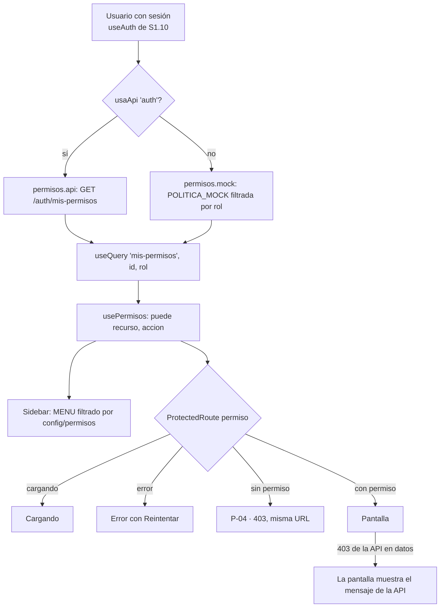

# SDD — S1.11 · Rutas protegidas por rol, menú lateral dinámico y vista 403

- **Ticket:** ClickUp **S1.11** (`868mh1kwp`, https://app.clickup.com/t/868mh1kwp).
- **Autor:** generado con Claude (Entregable 1).
- **Estado:** Borrador
- **Versión:** 1.0 · **Fecha:** 2026-10-14
- **Fuentes de verdad citadas:**
  1. `docs/product/PRD.md` RF-02 (CA1 el menú muestra solo los módulos del rol; CA2 la API responde 403 aunque se llame por URL directa)
  2. `docs/decisions/LOG.md` — DEC-015 (política del PRD, no `PERMISOS_RUTA`; EGRESADO sin permisos; `GET /auth/mis-permisos` es la fuente del menú), DEC-018 #3 (D-08), DEC-019 #5 (D-13b)
  3. `docs/product/dudas.md` D-08 (egresados sin cuenta), D-11 (el Coordinador solo firma), D-16 (la matriz la validan Coordinación y Kardex)
  4. `docs/adr/0002-autorizacion-casbin.md` (una sola política; la web no la duplica), `docs/sdd/S1.6/SDD.md` §2.5 (contrato de `mis-permisos`)
  5. `docs/sdd/S0.8/SDD.md` §2.3 (interruptor mock/API por servicio, `VITE_USAR_API`)
  6. `docs/product/prototipo-pantallas.md` §3 (mapa de navegación por rol) y P-04 (pantalla 403/404)
  7. `apps/api/src/modulos/seguridad/autorizacion.politica.ts` (la `POLITICA` vigente)

---

## 1 · Alcance

### Entra

- La web decide **qué rutas abre y qué ve en el menú** con la matriz recurso × acción que devuelve `GET /api/v1/auth/mis-permisos`, en vez de la lista de roles por ruta del prototipo (`PERMISOS_RUTA`).
- Un **mapa ruta → permiso** (`config/permisos.ts`) que traduce cada pantalla a un par `{ recurso, accion }` de la política (§2.2).
- Un **servicio** (`services/permisos.*`) y un **hook** (`usePermisos`) para leer los permisos, con su versión mock (§2.3).
- `ProtectedRoute`, `Sidebar` y `usePermiso` pasan a usar la matriz. La vista **P-04 (403)** se muestra cuando el permiso falta, sin cambiar la URL.
- Qué hace la web con un **403 de la API** en una llamada de datos (§2.5).

### No entra (a propósito)

- **Inicios por rol** (P-10 a P-15) y su contenido → S1.12. El componente `Inicio` de `App.tsx` (rol exacto) queda como está.
- Restaurar la sesión al recargar, el refresh automático, el 401 y el 403 `CAMBIO_PASSWORD_REQUERIDO` en el cliente HTTP → S1.9/S1.10 (dueños de `AuthContext`, `lib/api.ts`, `lib/sesion.ts`, `auth.api.ts`).
- Ocultar los requisitos del file a SEC_DIR (DEC-015 #1) → lo hace el detalle del file conectado (S2.10); hoy es una pestaña dentro de una pantalla, no una ruta.
- Cambiar la política de la API. S1.11 solo la **lee**.
- Pruebas exhaustivas de 403 por URL directa para cada rol → S1.14. Acá solo las mínimas (§4).

### Premisas verificadas (heredadas de `task-brief`)

| Premisa del ticket / backlog                     | Qué hay de verdad en el repo                                                                                                                                                                                                                                                  |
| ------------------------------------------------ | ----------------------------------------------------------------------------------------------------------------------------------------------------------------------------------------------------------------------------------------------------------------------------- |
| "Hecho en prototipo; solo verificar contra API"  | ⚠️ Solo a medias. `ProtectedRoute`, `Sidebar`, P-04 y `usePermiso` existen, pero deciden con `PERMISOS_RUTA` (roles por ruta, **escritos a mano en la web**). DEC-015 pide que la fuente sea la política de la API. Hay que cambiar el criterio, no solo conectar.            |
| "`GET /auth/mis-permisos` existe"                | ✅ `auth.rutas.ts:38`, solo `autenticar` (responde también con `cpw`). Devuelve `{ rol, permisos: [{ recurso, accion }] }` filtrado de `POLITICA`.                                                                                                                            |
| "El menú del prototipo coincide con la política" | ⚠️ No del todo (DEC-015 #1). Con el mapa de §2.2 el menú queda **igual al prototipo para el personal y el estudiante**. Cambia para **EGRESADO**, que se queda sin "Mi file" ni "Mis trámites" (D-08). "Firma y entrega" no tiene permiso propio todavía (§2.2, pregunta P1). |
| "Hay un interruptor mock/API"                    | ✅ `services/_modo.ts` (`usaApi(servicio)`). No existe un servicio `permisos`: se ata al de `auth` (§2.3), porque sin login real no hay token para pedirlos.                                                                                                                  |
| "Hay librería de consultas"                      | ✅ TanStack Query ya está montado (`main.tsx`, `lib/consultas.ts`). Se usa para cachear los permisos por sesión.                                                                                                                                                              |
| "Se puede testear el componente"                 | ⚠️ No hay Testing Library en `apps/web`. Se prueba la lógica pura con Vitest y el comportamiento en pantalla con Playwright (§4); no se agrega una dependencia nueva por un ticket de 4 h.                                                                                    |
| Usos de los permisos del prototipo               | `puedeVer` (en `ProtectedRoute` y `usePermiso`), `MENU[].roles` (en `Sidebar`), `usePermiso('nueva-hr')` (en `HojasRuta.tsx`), `puedeEditarFiles(rol)` (en `Files.tsx` y `DetalleFile.tsx`). Todos se migran (§3).                                                            |

---

## 2 · Diseño técnico

### Flujo



### 2.1 Principio: la web pregunta, no decide

La web **no guarda roles por pantalla**. Guarda solo qué permiso de la política necesita cada pantalla (§2.2). Quién tiene ese permiso lo dice la API (ADR-0002, DEC-015 #6). Así, si Coordinación y Kardex cambian la matriz (D-16), se cambia una línea en `autorizacion.politica.ts` y el menú y las rutas se ajustan solos.

El filtro de la web es **solo de experiencia de uso** (no mostrar lo que no se puede usar). La seguridad real sigue en la API: cada ruta tiene su `autorizar` y responde 403 (RF-02 CA2).

### 2.2 Mapa ruta → permiso (`config/permisos.ts`)

```ts
export type Recurso = 'usuarios' | 'files' | 'requisitos' | 'hojas-ruta' | 'pases' | 'dictamenes' | 'documentos' | 'reportes' | 'auditoria';
export type Accion = 'crear' | 'leer' | 'leer_propio' | 'editar';
export interface Permiso { recurso: Recurso; accion: Accion }

/** Permiso que exige cada pantalla. Sin entrada = basta con tener sesión (Inicio, Mi perfil). */
export const PERMISO_RUTA: Record<IdRuta, Permiso> = { … };
```

Los tipos `Recurso` y `Accion` repiten los de la API; un test de paridad (§4) falla si se desalinean.

| Id de ruta                             | Ruta(s)                                         | Permiso exigido                    | Quién lo tiene hoy (POLITICA)           | ¿Igual al prototipo?   |
| -------------------------------------- | ----------------------------------------------- | ---------------------------------- | --------------------------------------- | ---------------------- |
| `inicio`, `perfil`                     | `/<rol>`, `/perfil`                             | — (solo sesión)                    | todos                                   | ✅                     |
| `mi-file`                              | `/mi-file`                                      | `files / leer_propio`              | ESTUDIANTE                              | ⚠️ sin EGRESADO (D-08) |
| `mis-tramites`                         | `/mis-tramites`, `/mis-tramites/:nro`           | `hojas-ruta / leer_propio`         | nadie                                   | ⚠️ sin EGRESADO (D-08) |
| `nueva-hr`                             | `/hojas-ruta/nueva`                             | `hojas-ruta / crear`               | SEC_DIR                                 | ✅                     |
| `hojas-ruta`, `detalle-hr`, `caratula` | `/hojas-ruta`, `/hojas-ruta/:nro`, `…/caratula` | `hojas-ruta / leer`                | SEC_DIR, SEC_COORD, COORDINADOR, KARDEX | ✅                     |
| `pases`                                | `/pases`                                        | `pases / crear`                    | SEC_DIR, SEC_COORD, KARDEX              | ✅                     |
| `entregas`                             | `/entregas`                                     | `hojas-ruta / crear` (provisional) | SEC_DIR                                 | ✅ (ver P1)            |
| `files`, `detalle-file`                | `/files`, `/files/:id`                          | `files / leer`                     | SEC_DIR, SEC_COORD, COORDINADOR, KARDEX | ✅                     |
| `nuevo-file`                           | `/files/nuevo`                                  | `files / crear`                    | KARDEX                                  | ✅                     |
| `editar-file`                          | `/files/:id/editar`                             | `files / editar`                   | KARDEX                                  | ✅                     |
| `revision`                             | `/revision`                                     | `hojas-ruta / editar`              | KARDEX                                  | ✅                     |
| `dictamenes`, `emitir-dictamen`        | `/dictamenes`, `/dictamenes/:nro`               | `dictamenes / crear`               | COORDINADOR                             | ✅                     |
| `emision`                              | `/emision`                                      | `documentos / crear`               | KARDEX                                  | ✅                     |
| `carga`                                | `/carga-masiva`                                 | `files / crear`                    | KARDEX                                  | ✅                     |
| `reportes`                             | `/reportes`                                     | `reportes / leer`                  | SEC_DIR, COORDINADOR, KARDEX            | ✅                     |
| `usuarios`                             | `/usuarios`                                     | `usuarios / leer`                  | KARDEX                                  | ✅                     |
| `bitacora`                             | `/bitacora`                                     | `auditoria / leer`                 | KARDEX                                  | ✅                     |

Criterios para elegir el permiso (decisiones técnicas, no reglas de negocio nuevas):

- **Una bandeja de trabajo exige la acción que se hace en ella, no solo leer.** La bandeja de pases sirve para recibir y derivar → `pases/crear`. Por eso COORDINADOR, que en la política solo **lee** pases (DEC-015 #1), no ve la bandeja; sí ve los pases dentro del detalle de la hoja de ruta, que es lo que su `leer` le permite. Lo mismo con Dictámenes (`crear`, no `leer`: Kardex lee dictámenes en el detalle, pero no tiene bandeja).
- **Una pantalla de alta o edición exige `crear` o `editar`**, no la lectura de la lista.
- **El detalle hereda el permiso de su lista** (igual que en el prototipo).
- **"Firma y entrega"** no tiene todavía un permiso propio: DEC-015 #1 dice que se modelará como `hojas-ruta/editar` en S3.x, pero hoy ese permiso es solo de KARDEX y la pantalla es de SEC_DIR. Mientras S3.x no lo resuelva, se usa `hojas-ruta/crear`, el permiso que solo tiene SEC_DIR, para **no cambiar quién ve la pantalla**. Es un puente, no una regla: queda anotado en P1 y en `PERMISO_RUTA` con un comentario que apunta a S3.x.
- **Mis trámites** exige `hojas-ruta/leer_propio`, que hoy nadie tiene. No se inventa un permiso para el egresado: D-08 dice que no tiene cuenta, y su seguimiento es público (`/seguimiento`).

`MENU` conserva su orden, etiqueta, icono y ruta, y cambia `roles: Rol[]` por el id de ruta; el permiso sale de `PERMISO_RUTA`. Se borran `PERMISOS_RUTA`, `puedeVer`, `puedeEditarFiles` y las listas `TODOS`/`PERSONAL_FILES`. `ROLES` y `rutaInicio` se quedan (los usan el header, el breadcrumb y S1.12).

### 2.3 Servicio y hook

```ts
// services/permisos.service.ts — mock o API según usaApi('auth')
export interface MisPermisos {
  rol: Rol;
  permisos: Permiso[];
}
export const permisosService: { misPermisos(u: Usuario): Promise<MisPermisos> };
```

- **`permisos.api.ts`:** `GET /auth/mis-permisos` con el cliente `api` (que ya manda el token). Ignora el argumento: el rol lo saca la API del token. Valida la forma mínima de la respuesta y descarta pares que la web no conoce (si la API agrega un recurso nuevo, la web no se rompe; simplemente no lo usa).
- **`permisos.mock.ts`:** filtra `POLITICA_MOCK` (en `mocks/politica.ts`, copia literal de la `POLITICA` de la API) por `u.rol`, con la latencia simulada de siempre.
- **El modo sigue al de `auth`** y no se agrega un servicio `permisos` a `NombreServicio`: los permisos de la API exigen un token, y el token solo existe si el login es real. Mezclar login mock con permisos de API daría 401 siempre.
- **Mock y API usan la misma matriz.** En modo demo el menú es el mismo que verá el piloto. Un test de paridad compara `POLITICA_MOCK` con la `POLITICA` de la API (§4).

```ts
// hooks/usePermisos.ts
export function usePermisos(): {
  cargando: boolean;
  error: string | null;
  reintentar: () => void;
  puede: (p: Permiso) => boolean;
  puedeAbrir: (idRuta: IdRuta) => boolean;
};
```

- `useQuery({ queryKey: ['mis-permisos', usuario.id, usuario.rol], enabled: !!usuario, staleTime: Infinity })`. La clave incluye el rol: si Kardex cambia el rol de alguien, el siguiente login trae la matriz nueva. Se piden **una vez por sesión** (también al recargar la página, porque la caché vive en memoria).
- Sin usuario, `puede` devuelve siempre `false`.
- `usePermiso(idRuta)` (de `hooks/index.ts`) se mantiene con la misma firma y pasa a delegar en `usePermisos().puedeAbrir`; así `HojasRuta.tsx` no cambia.
- La lógica pura (`cumple`, `puedeAbrirRuta`, `itemsDelMenu`) vive en `lib/permisos.ts`, sin React, para testearla con Vitest.

### 2.4 `ProtectedRoute`, menú y P-04

`ProtectedRoute` (misma API: `permiso?: IdRuta`, `children`), en este orden:

1. `cargando` de la sesión → `Cargando`.
2. Sin usuario → `/login` con `state.desde` (igual que hoy).
3. `debeCambiarClave` → `/cambiar-clave` (igual que hoy).
4. Sin `permiso` → la pantalla.
5. Permisos cargando → `Cargando`. Error al pedirlos → mensaje "No se pudieron cargar tus permisos." con **Reintentar** (se falla cerrado: sin permisos no se abre ninguna pantalla protegida).
6. `!puedeAbrir(permiso)` → **P-04 en la misma URL** (no se redirige: el botón Atrás funciona y la URL sirve para reportar el problema).

**Menú (`Sidebar`):** muestra Inicio y Mi perfil siempre, y el resto de `MENU` filtrado por `puedeAbrir`. Mientras cargan los permisos, solo Inicio y Mi perfil (sin parpadeo de ítems que luego desaparecen). Si fallan, lo mismo; el error se ve al abrir una pantalla protegida.

**P-04 (`NoAutorizado`):** se conserva el diseño. "Volver a mi inicio" sigue usando `rutaInicio(rol)`. No se agrega texto por motivo: el mensaje genérico basta y no revela qué permiso falta.

### 2.5 Qué hace la web con un 403 de la API

- **En una llamada de datos o una acción** (la pantalla ya pasó el filtro de la web, pero la API dice que no — por ejemplo, un file ajeno con `leer_propio`, o un cambio de política): la pantalla **no** navega a P-04. Muestra el mensaje de la API en su estado de error o en el toast, como cualquier otro `ErrorApi`. Es lo que ya hacen `useAsync`/`useAccion`; no hay código nuevo.
- **Para no repetir el 403**, `lib/permisos.ts` exporta `esAccesoDenegado(e)` (`ErrorApi` con `estado === 403` y código distinto de `CAMBIO_PASSWORD_REQUERIDO`). S1.11 no lo engancha en el cliente HTTP (es de S1.10); queda disponible para que las pantallas conectadas (S1.13, S6.5, S2.x) muestren P-04 en vez de un toast si lo prefieren.
- **403 `CAMBIO_PASSWORD_REQUERIDO`:** lo resuelve S1.10 (la sesión pasa a `debeCambiarClave` y `ProtectedRoute` manda a `/cambiar-clave`).

### 2.6 Trazabilidad (DEC-007)

S1.11 no escribe datos de negocio ni genera eventos de acceso: leer los permisos no es un evento, y las denegaciones de la API ya van al log de pino (DEC-015 #5). No hay `registrarEvento` que agregar.

---

## 3 · Cambios por archivo/módulo

| Archivo                                                                                        | Cambio                                                                                                                                                                                              |
| ---------------------------------------------------------------------------------------------- | --------------------------------------------------------------------------------------------------------------------------------------------------------------------------------------------------- |
| `apps/web/src/config/permisos.ts`                                                              | Tipos `Recurso`, `Accion`, `Permiso`, `IdRuta`; `PERMISO_RUTA` (§2.2); `MENU` con id de ruta en vez de roles. Se borran `PERMISOS_RUTA`, `puedeVer`, `puedeEditarFiles`, `TODOS`, `PERSONAL_FILES`. |
| `apps/web/src/lib/permisos.ts`                                                                 | **Nuevo.** `cumple`, `puedeAbrirRuta`, `itemsDelMenu`, `esAccesoDenegado` (puras).                                                                                                                  |
| `apps/web/src/mocks/politica.ts`                                                               | **Nuevo.** `POLITICA_MOCK`, copia literal de la de la API.                                                                                                                                          |
| `apps/web/src/services/permisos.{api,mock,service}.ts`                                         | **Nuevos** (§2.3).                                                                                                                                                                                  |
| `apps/web/src/hooks/usePermisos.ts`                                                            | **Nuevo** (§2.3).                                                                                                                                                                                   |
| `apps/web/src/hooks/index.ts`                                                                  | `usePermiso` delega en `usePermisos`; se quita el import de `puedeVer`; se re-exporta `usePermisos`. **Solo esas líneas** (el archivo también tiene `useAuth`; coordinar con S1.10).                |
| `apps/web/src/components/layout/ProtectedRoute.tsx`                                            | Pasos 5–6 de §2.4.                                                                                                                                                                                  |
| `apps/web/src/components/layout/Sidebar.tsx`                                                   | Filtra con `itemsDelMenu(permisos)`.                                                                                                                                                                |
| `apps/web/src/App.tsx`                                                                         | Ids de ruta nuevos: `/files/nuevo` → `nuevo-file`, `/files/:id/editar` → `editar-file`. Nada más.                                                                                                   |
| `apps/web/src/pages/kardex/Files.tsx`, `DetalleFile.tsx`                                       | `puedeEditarFiles(u.rol)` → `usePermiso('editar-file')` / `usePermiso('nuevo-file')` (una línea cada uno).                                                                                          |
| `apps/web/src/pages/publicas/NoAutorizado.tsx`                                                 | Sin cambios de diseño (se revisa solo el import de `rutaInicio`).                                                                                                                                   |
| `apps/web/src/lib/permisos.test.ts`, `services/permisos.api.test.ts`, `mocks/politica.test.ts` | **Nuevos** (§4).                                                                                                                                                                                    |
| `apps/web/e2e/permisos.spec.ts`                                                                | **Nuevo** (§4).                                                                                                                                                                                     |
| `docs/product/prototipo-pantallas.md` §3                                                       | La tabla de menú: EGRESADO sin "Mi file" ni "Mis trámites" (D-08), con nota a DEC-015.                                                                                                              |
| `docs/decisions/LOG.md`                                                                        | DEC nueva (§7), con el número libre al aprobar.                                                                                                                                                     |

---

## 4 · Plan de tests

| Caso                                                                                                                                                                                                                   | Nivel                                          | Cubre             |
| ---------------------------------------------------------------------------------------------------------------------------------------------------------------------------------------------------------------------- | ---------------------------------------------- | ----------------- |
| Con la `POLITICA_MOCK`, el menú de cada uno de los 6 roles es exactamente la columna esperada de la tabla de §2.2 (tabla de verdad rol × ítem)                                                                         | Unit (Vitest)                                  | RF-02 CA1, §2.2   |
| `puedeAbrirRuta` para cada id de ruta y cada rol; sin entrada en `PERMISO_RUTA` → `true` con sesión; lista vacía (EGRESADO) → solo Inicio y Mi perfil                                                                  | Unit                                           | §2.2              |
| Cada ruta de `App.tsx` con `P(...)` usa un id que existe en `PERMISO_RUTA` (lista declarada en el test; si se agrega una ruta sin permiso, falla)                                                                      | Unit                                           | §2.2              |
| **Paridad:** `POLITICA_MOCK` es igual a la `POLITICA` de `apps/api` (el test importa el archivo de la API por ruta relativa; solo en test, nunca en el bundle) y los tipos `Recurso`/`Accion` coinciden                | Unit                                           | ADR-0002, DEC-015 |
| `permisos.api`: llama a `GET /auth/mis-permisos`; traduce la respuesta; descarta un recurso desconocido; un 401/500 se propaga como `ErrorApi`                                                                         | Unit (axios mockeado, como `auth.api.test.ts`) | §2.3              |
| `esAccesoDenegado`: 403 `PROHIBIDO` → sí; 403 `CAMBIO_PASSWORD_REQUERIDO`, 401, 404, error de red → no                                                                                                                 | Unit                                           | §2.5              |
| Modo mock: SEC_COORD escribe `/usuarios` → "Acceso denegado" y la URL no cambia; COORDINADOR no ve "Bandeja de pases"; ESTUDIANTE ve "Mi file académico"                                                               | e2e (Playwright)                               | RF-02 CA1, P-04   |
| Modo API (`VITE_USAR_API=auth`, `page.route` simula login y `mis-permisos` de KARDEX): el menú muestra Usuarios y Bitácora; si `mis-permisos` responde 500, "No se pudieron cargar tus permisos" y Reintentar funciona | e2e                                            | §2.3, §2.4        |
| El recorrido existente (`recorrido.spec.ts`) sigue en verde para los 6 roles (recorre el menú que se genera)                                                                                                           | e2e                                            | regresión         |

**No se testea acá:** el 403 de la API por URL directa contra la API real (es de S1.14 y de los tests de S1.6), ni el comportamiento de `ProtectedRoute` como componente aislado (no hay Testing Library; lo cubre el e2e).

---

## 5 · Definition of Done

- [ ] SDD en `docs/sdd/S1.11/SDD.md`, Estado = Aprobado.
- [ ] La web no tiene ninguna lista de roles por pantalla: `rg "roles:" apps/web/src/config` vacío; `puedeVer` y `PERMISOS_RUTA` borrados.
- [ ] Menú y rutas salen de `mis-permisos` en modo API y de la misma matriz en modo mock; test de paridad en verde.
- [ ] URL directa sin permiso → P-04 en la misma URL (e2e).
- [ ] Error al cargar permisos → falla cerrado con Reintentar.
- [ ] `prototipo-pantallas.md` §3 y la DEC nueva actualizados.
- [ ] Quality gate en verde (lint, typecheck, Vitest, Playwright).
- [ ] Commit `S1.11 …` en `feat/S1.11-rutas-por-rol`.

---

## 6 · Riesgos

| Riesgo                                                                                        | Gravedad | Mitigación                                                                                                                                                    |
| --------------------------------------------------------------------------------------------- | -------- | ------------------------------------------------------------------------------------------------------------------------------------------------------------- |
| La copia mock de la política se desalinea de la API                                           | Media    | Test de paridad que falla en CI.                                                                                                                              |
| S1.10 cambia `useAuth` (forma de `usuario`, `cargando`) mientras se implementa S1.11          | Media    | S1.11 depende solo de `usuario.id`, `usuario.rol`, `usuario.debeCambiarClave` y `cargando` (§7, contrato). Se implementa después de que S1.10 esté en `main`. |
| Con login real, al recargar la página se piden los permisos antes de recuperar el token → 401 | Media    | `enabled: !!usuario` y el contrato con S1.10: `usuario` solo aparece cuando el token ya está en memoria.                                                      |
| Kardex cambia el rol de alguien con la sesión abierta                                         | Baja     | El menú se corrige en el siguiente login; mientras tanto la API manda (403 en datos). No se agrega sondeo.                                                    |
| "Firma y entrega" con un permiso prestado (`hojas-ruta/crear`)                                | Baja     | Comentario en `PERMISO_RUTA` que apunta a S3.x y pregunta P1; si la política agrega el permiso correcto, se cambia una línea.                                 |
| La demo del tutor (S0.13) muestra al EGRESADO con un menú casi vacío                          | Baja     | Es la consecuencia de D-08. Pregunta P2.                                                                                                                      |
| `hooks/index.ts` lo tocan S1.10 y S1.11 a la vez                                              | Baja     | S1.11 cambia solo `usePermiso` y un re-export; el hook nuevo vive en su propio archivo.                                                                       |

---

## 7 · Preguntas abiertas

### Lo que S1.11 necesita de S1.10 (contrato de `useAuth`)

- `useAuth()` sigue devolviendo `{ usuario: Usuario | null, cargando, login, logout, refrescar }`, con `usuario.id`, `usuario.rol` y `usuario.debeCambiarClave`.
- `cargando` es `true` hasta que se sabe si hay sesión; **`usuario` solo es no nulo cuando el access token ya está en memoria** (si no, `mis-permisos` daría 401 al recargar).
- Un 403 `CAMBIO_PASSWORD_REQUERIDO` deja `usuario.debeCambiarClave = true` (S1.11 no lo maneja).
- En modo mock se conservan `version`, `verComo` y `reiniciar` (los usan `AppLayout` y el header de la demo); si `version` desaparece, `AppLayout` deja de usarlo.

### Para el responsable (flujo)

- **P1 — "Firma y entrega":** el prototipo la da a SEC_DIR (La Paz), pero DEC-015 #1 la anota como `hojas-ruta/editar`, que hoy solo tiene KARDEX. ¿Quién firma y entrega? Propuesta: **SEC_DIR**, como en el prototipo; en S3.x se agrega a la política un permiso para SEC_DIR (no se toca ahora). Mientras tanto la web usa `hojas-ruta/crear` como puente.
- **P2 — EGRESADO en la demo:** por D-08 el egresado no tiene cuenta, así que en la web queda solo con Inicio y Mi perfil, también en la demo. ¿Se acepta así para la demo del tutor, o se quita el usuario EGRESADO de los usuarios de prueba? Propuesta: aceptarlo ahora y quitar el usuario de prueba y su inicio en S1.12.

### DEC nueva (va a `LOG.md`)

1. La web no guarda roles por pantalla: cada ruta declara el permiso `{ recurso, accion }` que exige, y quién lo tiene lo dice `GET /auth/mis-permisos`.
2. Una bandeja de trabajo exige la acción que se hace en ella (`pases/crear`, `dictamenes/crear`); el detalle hereda el permiso de su lista.
3. Mock y API usan la misma matriz; un test de paridad lo garantiza. El modo de los permisos sigue al de `auth`.
4. Sin permiso → P-04 en la misma URL; si no se pueden cargar los permisos, se falla cerrado.
5. Un 403 de la API en una llamada de datos se muestra como error de la pantalla, no navega a P-04.
6. "Firma y entrega" usa `hojas-ruta/crear` como puente hasta S3.x (P1).
