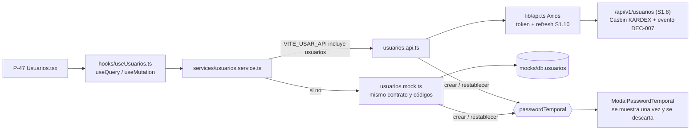

# SDD — S1.13 · Pantalla de usuarios (P-47) conectada a la API

- **Ticket:** ClickUp **S1.13** (`868mh1kwv`, https://app.clickup.com/t/868mh1kwv).
- **Autor:** generado con Claude (Entregable 1).
- **Estado:** Aprobado (2026-10-14)
- **Versión:** 1.1 · **Fecha:** 2026-10-14
  - 1.1 (al implementar):
    - El paginador y `Pagina<T>` son los compartidos con S6.5 (`components/ui/Paginacion.tsx`, `types/pagina.ts`, rama `chore/paginacion-compartida`), no uno propio.
    - `Modal` suma la prop opcional `cerrable` (por defecto `true`); con `false` no muestra la X ni cierra con Esc o con un clic afuera. La usa el modal de la temporal.
    - Las mutaciones usan `gcTime: 0` además de `reset()`, para que la temporal no quede en el caché de mutaciones.
    - `erroresPorCampo` pasa a llamarse `erroresDelFormulario` y devuelve `{ campos, general }`; también ubica `USUARIO_EXISTENTE` y `SEDE_INEXISTENTE`.
    - En la propia fila se deshabilita cambiar el rol (no solo quitarse KARDEX), como hace la API (`No puede cambiar su propio rol`).
    - La decisión es DEC-023. Las preguntas del §7 se cerraron con la propuesta.
- **Fuentes de verdad citadas:**
  1. `docs/product/PRD.md` RF-03 (CA1 crea, edita, da de baja y reactiva; CA2 baja lógica; CA3 CI único; CA4 el reseteo obliga a cambiar la contraseña)
  2. `docs/product/prototipo-pantallas.md` §P-47 (tabla, filtros, modal, texto de la confirmación de baja)
  3. `docs/decisions/LOG.md` — DEC-007 (bitácora), DEC-009 (piloto con el personal), DEC-011 (política de contraseña), DEC-017 (paginación), DEC-020 (API de usuarios del personal)
  4. `docs/product/dudas.md` — D-08 (egresados sin cuenta), D-14 / D-14b (Kardex restablece), D-24 (una sede por persona del personal), D-25 (CI como usuario), D-27 (Kardex administra)
  5. `docs/sdd/S1.8/SDD.md` v1.2 §2.1–§2.5 (contrato de `/api/v1/usuarios`; **no se repite acá, se cita**)
  6. `docs/sdd/S0.8/SDD.md` §2.1–§2.5 (cliente Axios, `ErrorApi`, interruptor mock/API `VITE_USAR_API`, TanStack Query)
  7. `apps/api/src/modulos/seguridad/usuarios.esquemas.ts` (Zod: largos, mensajes y forma de `UsuarioDetalle`)

---

## 1 · Alcance

### Entra

P-47 (`/usuarios`, solo KARDEX) habla el contrato de S1.8, tanto con la API real como con el mock:

- **Listado paginado en el servidor** con filtros: texto (CI o nombre), rol, sede y estado (`ACTIVO`/`INACTIVO`/`BLOQUEADO`).
- **Crear** con nombres y apellidos separados, CI + complemento, correo, celular, rol y sede. Al guardar, la **contraseña temporal generada por el servidor se muestra una sola vez** en un modal propio.
- **Editar** los mismos datos menos el CI y el complemento (DEC-020 #3), mandando solo lo que cambió.
- **Dar de baja**, **reactivar**, **restablecer la contraseña** (muestra la nueva temporal una vez) y **desbloquear** (acción nueva en la pantalla).
- **Errores de la API en el formulario**: los de validación (`VALIDACION`, con `detalles[].ruta`) debajo de cada campo; los de negocio (`USUARIO_EXISTENTE`, `SEDE_INEXISTENTE`, `OPERACION_SOBRE_SI_MISMO`, `ULTIMO_KARDEX`, `ESTADO_SIN_CAMBIO`) como aviso.
- **El mock imita el contrato de la API** (mismos tipos, mismos códigos de error, misma paginación), así la pantalla es una sola y no sabe de dónde vienen los datos.
- Primera pantalla con **TanStack Query** (`useQuery`/`useMutation`), como pide el ticket y prevé S0.8 §2.5.

### No entra (a propósito)

- **Cuentas de estudiantes** (crearlas o editarlas): llegan con el file y la doble verificación (S2.x, DEC-020 #1). El formulario ofrece solo los 4 roles del personal.
- **Login, sesión, refresh automático y cambio de contraseña**: S1.9 / S1.10. Esta pantalla asume que `lib/api.ts` manda el access token y renueva la sesión.
- **Rutas por rol y menú**: S1.11 (`/usuarios` ya está restringida a KARDEX en `config/permisos.ts`).
- **La pantalla de bitácora**: S6.5. Los eventos los escribe la API (S1.8); el mock sigue llamando a `auditar()`.
- **Endpoint de sedes**: no existe; se usa el catálogo `SEDES` de `config/catalogos.ts` (§6).
- **Enviar la contraseña por correo**: Kardex la entrega en persona (D-14b, DEC-020 #2).

### Premisas verificadas (`task-brief`)

| Premisa del ticket                                             | Qué hay de verdad en el repo                                                                                                                                                                                                                                                                                                                                 |
| -------------------------------------------------------------- | ------------------------------------------------------------------------------------------------------------------------------------------------------------------------------------------------------------------------------------------------------------------------------------------------------------------------------------------------------------ |
| "`usuarios.service.ts` con la API de S1.8"                     | ⚠️ Hoy es **solo mock** y con otro modelo: `usuario`, `nombre` en un solo campo, `correo`, estados `'Activo'/'Inactivo'/'Bloqueado'`, paginación y filtro en el cliente, sin desbloquear, y "resetear" no muestra ninguna contraseña. Se parte en `usuarios.mock.ts` + `usuarios.api.ts` + selector, como `auth.*` (S0.8 §2.3).                              |
| "(TanStack Query)"                                             | ✅ Instalado y con `QueryClientProvider` en `main.tsx` (`lib/consultas.ts`), pero **ninguna pantalla lo usa todavía** (todas usan `useAsync`). P-47 es la primera; las claves quedan en un hook propio (§2.5).                                                                                                                                               |
| "Alta, edición, baja, reactivar, resetear clave y desbloquear" | ⚠️ La pantalla no tiene **desbloquear**, y el reseteo del prototipo no genera contraseña. Se agregan los dos (§2.4).                                                                                                                                                                                                                                         |
| "Errores de validación de la API en el formulario"             | ✅ `ErrorApi.detalles` ya trae lo que manda la API: `[{ ruta: 'body.ci', mensaje }]` (`compartido/http/validar.ts`). Falta traducirlo a errores por campo (§2.6).                                                                                                                                                                                            |
| P-47: "Modal: nombre, CI, correo, rol, sede"                   | ⚠️ El modelo real (S1.8) separa **nombres, apellido paterno, apellido materno**, agrega **complemento** y **celular**, y el CI no se edita. El modal cambia en eso; el resto de P-47 se respeta.                                                                                                                                                             |
| DoD: "E2E: Kardex crea un usuario y ese usuario entra"         | ⚠️ El job `e2e` de CI corre **solo contra mocks** (y el proyecto `api` solo con respuestas simuladas de `/auth`); no hay E2E contra la API real. Se cubre así: E2E en modo mock (crea → ve la temporal → entra con ella → le pide cambiarla), tests de `usuarios.api.ts` contra el contrato, y una prueba manual en el stack Docker que queda en el PR (§4). |
| DoD: "Toda escritura registra su evento (DEC-007)"             | ✅ Lo hace la API (S1.8). La pantalla no escribe eventos; el mock sigue llamando a `auditar()` para que la bitácora de la demo no quede vacía.                                                                                                                                                                                                               |
| Tamaño: 3 h (roadmap) vs. 6 h (backlog)                        | ⚠️ Con el cambio de modelo, el mock nuevo y la temporal, se estima **6 h**.                                                                                                                                                                                                                                                                                  |
| El mock de usuarios es compartido                              | ⚠️ `db.usuarios` lo leen también `auth.mock.ts` (S1.9) y `files.service.ts`. Por eso el tipo `Usuario` **no cambia**: el mock le agrega campos opcionales en un subtipo propio (§2.3) y `auth.mock.ts` no se toca.                                                                                                                                           |

### Diagrama



---

## 2 · Diseño técnico

### 2.1 Tipos (`types/usuarios.ts`, nuevo)

Copian el contrato de S1.8 §2.2 (no se importa nada de `apps/api`: son dos paquetes y el web no depende del api).

```ts
export type RolPersonal = 'SEC_DIR' | 'SEC_COORD' | 'COORDINADOR' | 'KARDEX';
export const ROLES_PERSONAL: readonly RolPersonal[];
export type EstadoUsuario = 'ACTIVO' | 'INACTIVO' | 'BLOQUEADO';

export interface UsuarioDetalle {
  id: number;
  usuario: string;
  ci: string;
  complemento: string;
  nombres: string;
  apellidoPaterno: string | null;
  apellidoMaterno: string | null;
  nombre: string;
  email: string | null;
  celular: string | null;
  rol: Rol; // la lista puede traer otras cuentas (estudiantes); el formulario solo ofrece RolPersonal
  sedeId: number | null;
  activo: boolean;
  estado: EstadoUsuario;
  bloqueadoHasta: string | null;
  debeCambiarPassword: boolean;
  ultimoAcceso: string | null;
}
export interface DatosCrearUsuario {
  ci: string;
  complemento: string;
  nombres: string;
  apellidoPaterno: string | null;
  apellidoMaterno: string | null;
  email: string | null;
  celular: string | null;
  rol: RolPersonal;
  sedeId: number;
}
export type CambiosUsuario = Partial<Omit<DatosCrearUsuario, 'ci' | 'complemento'>>;
export interface FiltrosUsuarios {
  texto?: string;
  rol?: RolPersonal;
  sedeId?: number;
  estado?: EstadoUsuario;
  pagina: number;
  porPagina: number;
}
export interface Pagina<T> {
  datos: T[];
  pagina: number;
  porPagina: number;
  total: number;
}
export interface UsuarioConPassword {
  usuario: UsuarioDetalle;
  passwordTemporal: string;
}
```

Va en un archivo propio y no en `types/index.ts` para no chocar con los cambios en paralelo de S1.9/S1.10 sobre `Usuario`. `Pagina<T>` se define acá porque el web no la tiene; si S6.5 la necesita, la importa de aquí.

### 2.2 Servicio: una interfaz, dos implementaciones (patrón S0.8 §2.3)

```ts
// services/usuarios.service.ts — lo único que importa la pantalla
export const usuariosService: ServicioUsuarios = usaApi('usuarios') ? usuariosApi : usuariosMock;

interface ServicioUsuarios {
  listar(f: FiltrosUsuarios): Promise<Pagina<UsuarioDetalle>>;
  obtener(id: number): Promise<UsuarioDetalle>;
  crear(d: DatosCrearUsuario, actor: Usuario): Promise<UsuarioConPassword>;
  editar(id: number, c: CambiosUsuario, actor: Usuario): Promise<UsuarioDetalle>;
  darDeBaja(id: number, actor: Usuario): Promise<UsuarioDetalle>;
  reactivar(id: number, actor: Usuario): Promise<UsuarioDetalle>;
  restablecerPassword(id: number, actor: Usuario): Promise<UsuarioConPassword>;
  desbloquear(id: number, actor: Usuario): Promise<UsuarioDetalle>;
}
```

- **`actor`**: la API lo ignora (el autor sale del token, S1.5); el mock lo necesita para `auditar()` y para la regla "sobre sí mismo". Es el mismo arreglo que `authApi.logout(_u)`.
- **`usuariosApi`**: una llamada por método (`GET /usuarios` con `params` sin claves vacías, `GET /usuarios/:id`, `POST /usuarios`, `PATCH /usuarios/:id`, `POST /usuarios/:id/{baja,reactivar,restablecer-password,desbloquear}`). Las respuestas ya tienen la forma de los tipos: no hay traducción. Para restablecer, la API devuelve `{ usuario, passwordTemporal }` (S1.8 §2.1). Los errores ya llegan como `ErrorApi` por el interceptor de `lib/api.ts`.
- **Modo mixto**: `VITE_USAR_API=usuarios` sin `auth` no sirve (la API pide un token que el mock no tiene). Se documenta en el JSDoc de `usuarios.service.ts` (no en `_modo.ts`, que comparten otros tickets): usar `auth,usuarios` o `true`.

### 2.3 Mock con el contrato de la API (`usuarios.mock.ts`)

Hoy `usuarios.service.ts` es el mock; se mueve a `usuarios.mock.ts` y se adapta:

- **Datos personales**: `mocks/usuarios.ts` exporta `UsuarioMock = Usuario & { ci?, complemento?, nombres?, apellidoPaterno?, apellidoMaterno?, celular? }` y el seed del personal los trae (por ejemplo, `kardex` → CI `4812345`, "María" / "Quispe" / "Mamani"). `mocks/db.ts` solo cambia el tipo de `usuarios` a `UsuarioMock[]`. Como los campos son opcionales, `auth.mock.ts` y `files.service.ts` compilan sin cambios. Para una cuenta sin esos campos (estudiantes del seed o creadas por `files.service`), el mock deriva `ci = usuario` y `nombres = nombre`.
- **`aDetalle(u)`** arma el `UsuarioDetalle`: `correo` → `email`, `estado` con la misma regla que la API (S1.8 §2.5), `nombre` = nombres + apellidos.
- **Usuarios de la demo**: los nombres `kardex`, `secdir`… se quedan como `usuario` en el mock (los usan los botones de la demo de `auth.mock.ts`, que es de S1.9). Las cuentas **creadas** en la pantalla usan `usuario = CI` o `CI-COMPLEMENTO`, como la API (D-25).
- **Contraseña temporal en el mock = `CLAVE_DEMO`**. `auth.mock.ts` acepta `CLAVE_DEMO` para cualquier cuenta sin contraseña cambiada, y no se puede tocar sin pisar a S1.9. Así el E2E de modo mock "crea y entra" funciona de verdad. El modal lo dice igual que con la API; en la demo el valor es `demo123`. La API real genera una distinta cada vez (DEC-020 #2). Límite conocido de la demo: si la persona ya había cambiado su contraseña en esa sesión del navegador, `auth.mock.ts` la sigue recordando y el restablecimiento del mock no la pisa (se arregla recargando la página).
- **Mismas reglas y códigos que la API**, lanzando `ErrorApi(mensaje, código, estado, detalles)` (es `ErrorNegocio`, así que `useAccion` y los toasts no cambian):
  - CI + complemento repetido → 409 `USUARIO_EXISTENTE`.
  - Validación con la misma función que el formulario (§2.6) → 400 `VALIDACION` con `detalles` en el formato de la API.
  - Sede fuera del catálogo → 422 `SEDE_INEXISTENTE`.
  - Darse de baja o quitarse KARDEX → 422 `OPERACION_SOBRE_SI_MISMO`; dejar sin KARDEX activo → 422 `ULTIMO_KARDEX`; baja de inactivo, reactivar activo, desbloquear sin bloqueo → 422 `ESTADO_SIN_CAMBIO`; id inexistente → 404 `NO_ENCONTRADO`.
  - Restablecer: `debeCambiarClave = true`, quita el bloqueo y los intentos. Desbloquear: quita el bloqueo y los intentos.
- **Filtro y paginación en el mock**, con la misma regla que la API: texto en `usuario` o `nombre` sin distinguir mayúsculas, orden por apellido paterno y nombres, `slice` por página.
- `auditar()` con los mismos nombres de acción que hoy más `'Desbloquear cuenta'`. `EDITAR` guarda solo los campos que cambiaron (DEC-020 #5).

### 2.4 Pantalla P-47

**Filtros** (fila arriba de la tabla): Buscar (CI o nombre, con espera de 300 ms antes de pedir), Rol (los 4 del personal), Sede (`SEDES`), Estado (Activo/Inactivo/Bloqueado ↔ `ACTIVO`/`INACTIVO`/`BLOQUEADO`). Cambiar un filtro vuelve a la página 1. Un texto vacío no se manda (la API pide mínimo 1 carácter).

**Tabla** (`DataTable` sin buscador propio y con `pageSize = porPagina`, porque la página ya viene cortada del servidor): CI / Usuario · Nombre · Rol · Sede · Estado (badge con los 3 colores de hoy) · Último acceso · Acciones. El subtítulo dice `total` usuarios. Debajo, el **paginador** de servidor compartido (`components/ui/Paginacion.tsx`, v1.1); `porPagina = 20`. Mientras llega la página siguiente se mantiene la anterior (`placeholderData: keepPreviousData`).

**Acciones por fila:**

| Acción                 | Cuándo se muestra                                                                      | Confirmación                                                                                                                  | Resultado            |
| ---------------------- | -------------------------------------------------------------------------------------- | ----------------------------------------------------------------------------------------------------------------------------- | -------------------- |
| Editar                 | rol del personal                                                                       | —                                                                                                                             | modal de edición     |
| Restablecer contraseña | siempre                                                                                | "Se generará una contraseña temporal para **X**; deberá cambiarla en su próximo ingreso y se cerrarán sus sesiones abiertas." | modal de la temporal |
| Desbloquear            | `estado = BLOQUEADO`                                                                   | "**X** podrá volver a intentar ingresar."                                                                                     | toast                |
| Dar de baja            | `activo`; deshabilitada en la propia fila (título "No puede darse de baja a sí mismo") | texto de P-47: "El usuario no podrá ingresar. Sus registros se conservan."                                                    | toast                |
| Reactivar              | `!activo`                                                                              | "**X** podrá volver a ingresar al sistema."                                                                                   | toast                |

Editar se oculta para cuentas que no son del personal porque la API solo acepta roles del personal (DEC-020 #1). Hoy en la base no hay cuentas de estudiantes; en el mock sí, y para ellas quedan restablecer, desbloquear y baja/reactivar, que la API también acepta.

**Modal Crear / Editar** (`components/usuarios/ModalUsuario.tsx`): Nombres · Apellido paterno · Apellido materno · CI · Complemento · Correo · Celular · Rol · Sede. Al editar, CI y complemento se ven **deshabilitados** con la ayuda "El CI no se edita: si está mal, dé de baja la cuenta y cree otra" (DEC-020 #3), y en la propia fila el rol está deshabilitado (no puede quitarse KARDEX). Editar manda **solo los campos que cambiaron**; si no cambió nada, cierra con "Sin cambios" sin llamar a la API. Sede por defecto: la del Kardex que crea (D-24: el personal es de una sede).

**Modal de la contraseña temporal** (`components/usuarios/ModalPasswordTemporal.tsx`), después de crear y de restablecer:

- Muestra usuario (CI) y contraseña en letra monoespaciada, con botón **Copiar** (`navigator.clipboard`; si falla, el texto queda seleccionable).
- Aviso: "Anótela y entréguela a la persona. No se volverá a mostrar. Deberá cambiarla en su primer ingreso."
- Se cierra solo con "Ya la entregué / anoté" (sin cerrar al hacer clic afuera ni con Escape, para que no se pierda por accidente).
- **Nunca se guarda**: vive en el estado del componente; al cerrar se descarta y se llama `mutation.reset()` para que no quede en el caché de TanStack Query. No se escribe en `localStorage`, ni en la URL, ni en `console`.

### 2.5 TanStack Query (`hooks/useUsuarios.ts`, nuevo)

```ts
export const claveUsuarios = ['usuarios'] as const;
useUsuarios(filtros); // useQuery({ queryKey: [...claveUsuarios, filtros], placeholderData: keepPreviousData })
useAccionesUsuario(); // useMutation por acción; onSuccess → invalidateQueries({ queryKey: claveUsuarios }) + avisarCambio()
```

- Reintentos y errores ya están en `lib/consultas.ts` (S0.8 §2.5): no se reintenta un 4xx.
- Los errores de las mutaciones se muestran con el toast de siempre, salvo los del formulario (§2.6).
- Va en un hook propio y no en `hooks/index.ts` para no chocar con otros tickets; la pantalla sigue importando datos solo a través de `services/` (el hook es una capa fina encima del servicio).

### 2.6 Validación y errores del formulario (`lib/usuarios.ts`, nuevo)

- `validarDatosUsuario(d, modo)` repite las reglas de `usuarios.esquemas.ts` con los mismos mensajes: CI de 4 a 15 dígitos; complemento hasta 5 letras o dígitos (se pasa a mayúsculas); nombres obligatorios (≤ 80); al menos un apellido (≤ 60 cada uno); correo válido (≤ 120); celular ≤ 20; sede obligatoria. Devuelve `Partial<Record<Campo, string>>`. La usan el formulario (antes de enviar) y el mock (para responder `VALIDACION` igual que la API).
- `erroresDelFormulario(e)` (v1.1; antes `erroresPorCampo`): si `codigo === 'VALIDACION'` y `detalles` es un arreglo de `{ ruta, mensaje }`, toma el último tramo de `ruta` (`body.apellidoPaterno` → `apellidoPaterno`) y lo pone debajo de ese campo; lo que no corresponde a un campo va al aviso general del modal.
- Errores de negocio en el modal: `USUARIO_EXISTENTE` se pone debajo del CI; `SEDE_INEXISTENTE` debajo de la sede; `OPERACION_SOBRE_SI_MISMO` y `ULTIMO_KARDEX` como aviso arriba (el mensaje de la API se muestra tal cual, ya está en español). Fuera del modal (baja, reactivar, desbloquear), toast con el mensaje.
- La validación del cliente es una ayuda; la que manda es la de la API.

---

## 3 · Cambios por archivo/módulo

| Archivo                                                                                  | Cambio                                                                              |
| ---------------------------------------------------------------------------------------- | ----------------------------------------------------------------------------------- |
| `apps/web/src/types/usuarios.ts`                                                         | **Nuevo** (§2.1).                                                                   |
| `apps/web/src/services/usuarios.service.ts`                                              | Pasa a ser solo el selector mock/API + la interfaz `ServicioUsuarios` (§2.2).       |
| `apps/web/src/services/usuarios.mock.ts`                                                 | **Nuevo**: el mock actual adaptado al contrato (§2.3).                              |
| `apps/web/src/services/usuarios.api.ts`                                                  | **Nuevo** (§2.2).                                                                   |
| `apps/web/src/mocks/usuarios.ts`                                                         | `UsuarioMock` y datos personales en el seed del personal. `CLAVE_DEMO` sigue igual. |
| `apps/web/src/mocks/db.ts`                                                               | Solo el tipo: `usuarios: UsuarioMock[]`.                                            |
| `apps/web/src/lib/usuarios.ts`                                                           | **Nuevo** (§2.6).                                                                   |
| `apps/web/src/hooks/useUsuarios.ts`                                                      | **Nuevo** (§2.5).                                                                   |
| `apps/web/src/pages/kardex/Usuarios.tsx`                                                 | Reescrita con TanStack Query, filtros de servidor, nuevas acciones (§2.4).          |
| `apps/web/src/components/usuarios/{ModalUsuario,ModalPasswordTemporal}.tsx`    | **Nuevos** (salen de la página para que quede corta). Paginador: el compartido (v1.1). `components/ui/Modal.tsx`: + prop `cerrable` (v1.1). |
| `apps/web/src/services/usuarios.{api,mock}.test.ts`, `apps/web/src/lib/usuarios.test.ts` | **Nuevos** (§4).                                                                    |
| `apps/web/e2e/usuarios.spec.ts`                                                          | **Nuevo** (§4).                                                                     |
| `docs/decisions/LOG.md`                                                                  | Una DEC al aprobar (§7).                                                            |

**No se tocan**: `auth.*`, `context/AuthContext.tsx`, `lib/api.ts`, `lib/sesion.ts`, `Login`/`CambiarClave` (S1.9/S1.10); `components/layout`, `config/permisos.ts` (S1.11); bitácora (S6.5); `types/index.ts`; `_modo.ts` (ya incluye `'usuarios'`); `components/ui/DataTable.tsx`; nada de `apps/api`.

---

## 4 · Plan de tests

| Caso                                                                                                                                                                                                                                                                                              | Nivel  | Cubre                   |
| ------------------------------------------------------------------------------------------------------------------------------------------------------------------------------------------------------------------------------------------------------------------------------------------------- | ------ | ----------------------- |
| `usuariosApi`: cada método llama al verbo y la ruta correctos; `listar` no manda filtros vacíos y manda `pagina`/`porPagina`; `crear` y `restablecerPassword` devuelven `passwordTemporal`; un 409 llega como `ErrorApi('USUARIO_EXISTENTE', 409)` (adaptador de Axios, como `auth.api.test.ts`)  | Unit   | §2.2                    |
| `usuariosMock.listar`: filtra por texto (CI y nombre, sin mayúsculas), rol, sede y estado (incluye `BLOQUEADO` por `bloqueadoHasta`); pagina y devuelve `total`                                                                                                                                   | Unit   | §2.3                    |
| `usuariosMock.crear`: `usuario = CI-COMP`, `debeCambiarClave`, devuelve `{ usuario, passwordTemporal }`; CI repetido → `USUARIO_EXISTENTE`; datos inválidos → `VALIDACION` con `detalles` en formato API; sede inexistente → `SEDE_INEXISTENTE`                                                   | Unit   | RF-03 CA1, CA3          |
| `usuariosMock`: baja de sí mismo y quitarse KARDEX → `OPERACION_SOBRE_SI_MISMO`; baja del último KARDEX activo → `ULTIMO_KARDEX`; repetir baja/reactivar/desbloquear → `ESTADO_SIN_CAMBIO`; restablecer limpia bloqueo e intentos y pide cambiar; cada escritura deja su registro con `auditar()` | Unit   | RF-03 CA2, CA4; DEC-020 |
| `usuariosMock.editar` con `ci` en los cambios → `VALIDACION`; solo cambia lo enviado                                                                                                                                                                                                              | Unit   | DEC-020 #3              |
| Todo `UsuarioDetalle` que devuelve el mock tiene exactamente las claves del contrato de la API (sin `correo`, sin `debeCambiarClave`)                                                                                                                                                             | Unit   | §2.1                    |
| `validarDatosUsuario`: cada regla con su mensaje (CI con letras, complemento largo, sin apellidos, correo inválido, sin sede)                                                                                                                                                                     | Unit   | §2.6                    |
| `erroresDelFormulario`: `body.ci` → `ci`; ruta desconocida → aviso general; error que no es `VALIDACION` → vacío                                                                                                                                                                                       | Unit   | §2.6                    |
| **E2E (mock)**: Kardex entra → `/usuarios` → "Nuevo usuario" → llena el formulario → ve el modal con la temporal → sale → entra con el CI y la temporal → lo manda a cambiar la contraseña                                                                                                        | E2E    | DoD del ticket          |
| **E2E (mock)**: filtrar por estado Bloqueado → desbloquear → el estado pasa a Activo; restablecer muestra la temporal; dar de baja pide la confirmación de P-47                                                                                                                                   | E2E    | §2.4                    |
| **Prueba manual en el stack Docker** (`VITE_USAR_API=true`): Kardex del seed crea un usuario, la persona entra con la temporal y cambia la contraseña; la bitácora tiene `CREAR` y el cambio. Se deja el paso a paso y el resultado en el PR                                                      | Manual | DoD (API real)          |

**Lo que no se testea a propósito:** un E2E automático contra la API real (CI no levanta API para Playwright y montarlo excede este ticket; si se quiere, es un ticket aparte con un ADR del job); los permisos 401/403 (los cubre S1.8 en la API); el refresh del token (S1.10).

---

## 5 · Definition of Done

- [ ] SDD en `docs/sdd/S1.13/SDD.md`, Estado = Aprobado.
- [ ] La pantalla funciona igual con `VITE_USAR_API=false` y con `auth,usuarios`/`true`.
- [ ] Crear y restablecer muestran la temporal **una sola vez**; no queda en caché, almacenamiento ni consola.
- [ ] Desbloquear disponible; CI no editable; errores de la API debajo de cada campo.
- [ ] Ninguna pantalla importa `mocks/` ni `usuarios.mock.ts`/`usuarios.api.ts` directo (solo `usuarios.service.ts`).
- [ ] Tests del §4 en verde, incluido el E2E "crea y entra" (mock) y la prueba manual con la API documentada en el PR.
- [ ] Eventos de bitácora: los escribe la API (S1.8); verificado en la prueba manual.
- [ ] TypeScript estricto sin `any`; quality gate (`calidad`, `base-de-datos`, `e2e`, `docker`) en verde.
- [ ] DEC nueva en `LOG.md`.
- [ ] Commit `S1.13 …` en la rama `feat/S1.13-pantalla-usuarios`.

---

## 6 · Riesgos

| Riesgo                                                                                                                          | Gravedad | Mitigación                                                                                                                                                       |
| ------------------------------------------------------------------------------------------------------------------------------- | -------- | ---------------------------------------------------------------------------------------------------------------------------------------------------------------- |
| S1.10 (token y refresh en `lib/api.ts`) no está mergeado cuando se implementa esto: en modo API la sesión se pierde al recargar | Media    | La pantalla no depende de cómo se renueva el token; se prueba con la API después de S1.10. Si se adelanta, la prueba manual se hace sin recargar la página.      |
| Los ids de `SEDES` del web (1 La Paz, 2 Ancocagua) no coinciden con los de la base                                              | Baja     | El seed crea las sedes en ese orden; la API responde `SEDE_INEXISTENTE` si no existe. Si algún día cambia, se agrega `GET /catalogos/sedes` en un ticket aparte. |
| S6.5 (bitácora) también necesita un paginador de servidor y hace otro                                                           | Baja     | El de acá vive en `components/usuarios/`; si los dos sirven, se unifica en `components/ui/` en el que llegue segundo.                                            |
| La temporal se pierde porque Kardex cerró el modal antes de anotarla                                                            | Baja     | El modal solo se cierra con el botón explícito; si igual pasa, restablece otra vez (S1.8 §6).                                                                    |
| La temporal queda en el caché de TanStack Query o en las devtools                                                               | Baja     | `mutation.reset()` al cerrar; no se usa `useQuery` para ese dato.                                                                                                |
| El mock usa `demo123` como temporal y alguien cree que la API hace lo mismo                                                     | Muy baja | Solo existe en modo demo (`todoMock`); el JSDoc y el texto del SDD lo dicen; la API genera una distinta (DEC-020 #2).                                            |
| Choques de merge con S1.9/S1.10/S1.11/S6.5                                                                                      | Media    | Archivos nuevos propios (§3); no se toca `types/index.ts`, `hooks/index.ts`, `_modo.ts`, `lib/api.ts` ni `auth.*`. `mocks/db.ts` cambia una línea.               |

---

## 7 · Preguntas abiertas

- **Para la escuela:** ninguna nueva. Lo que esta pantalla necesitaba ya está cerrado: Kardex administra (D-27) y restablece (D-14b), usuario = CI (D-25), una sede por persona (D-24), egresados sin cuenta (D-08).
- **Para el responsable (decisión de flujo, con propuesta):**
  1. **Cuentas de estudiantes en la lista de P-47.** La API lista todas las cuentas; hoy en la base solo hay personal, pero cuando lleguen las de estudiantes (S2.x) aparecerán acá. Propuesta: se listan, sin "Editar" (sus datos se corrigen desde el file), con restablecer/desbloquear/baja disponibles para Kardex (D-14b). Si se prefiere que P-47 sea solo del personal, se agrega un filtro fijo y nada más cambia.
  2. **Correo institucional del Ministerio (D-14).** Hoy el correo es opcional (como en la API). Propuesta: sigue opcional hasta que haya recuperación por correo; no bloquea el piloto.
- **Cerradas con la propuesta (2026-10-14):** las cuentas de estudiantes, cuando lleguen en S2.x, aparecerán en P-47 sin "Editar", y Kardex podrá restablecer, desbloquear y dar de baja (hoy no se implementa nada más); el correo sigue opcional.
- **DEC-023 (en `LOG.md`):**
  1. El mock de cada servicio que pasa a la API imita su contrato (tipos, códigos de error, paginación); la pantalla es una sola.
  2. P-47 muestra la contraseña temporal una sola vez, en un modal que solo se cierra explícitamente, y no la guarda en ningún lado. En modo demo la temporal es `CLAVE_DEMO`.
  3. P-47 es la primera pantalla con TanStack Query: claves por recurso (`['usuarios', filtros]`), invalidación al escribir, `keepPreviousData` para la paginación de servidor.
  4. Los errores `VALIDACION` de la API se muestran debajo de cada campo usando `detalles[].ruta`.
