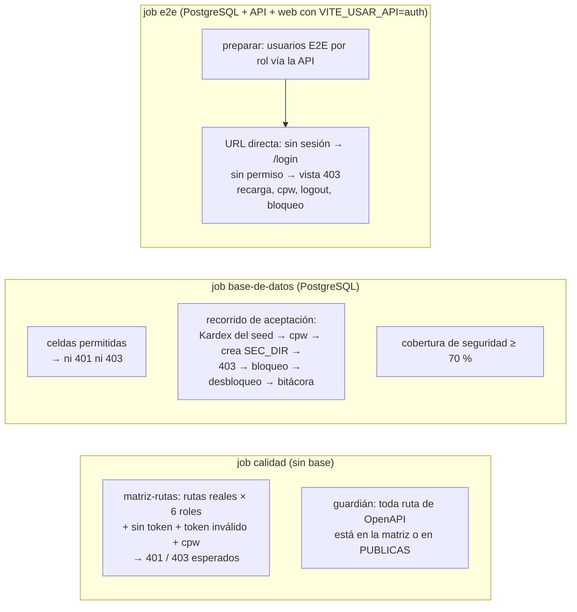

# SDD — S1.14 · Pruebas de acceso: login, 403 por rol y URL directa

- **Ticket:** ClickUp **S1.14** (`868mh1kwy`, https://app.clickup.com/t/868mh1kwy).
- **Autor:** generado con Claude (Entregable 1).
- **Estado:** Borrador
- **Versión:** 1.0 · **Fecha:** 2026-10-14
- **Fuentes de verdad citadas:**
  1. `docs/product/PRD.md` §6 (riesgo R6 "acceso indebido vía URL o IDs" → "pruebas E2E por rol"; DoD: pruebas de API en CI, cobertura del servicio ≥ 70 %, permisos verificados por rol con prueba negativa)
  2. `docs/product/business-rules.md` §Seguridad y acceso (5 intentos → 15 min, rate limit 10/min, "propio" en backend)
  3. `docs/decisions/LOG.md` — DEC-012 (401 genérico, cookie del refresh), DEC-013 (bloqueo y rate limit), DEC-014 (refresh, logout, `autenticar` sin consultar la base), DEC-015 (matriz del PRD §2, `cpw` → 403, lo ajeno → 403, `mis-permisos` es la fuente del menú), DEC-018 #1 (doble verificación desde el sistema completo, no en el piloto), DEC-020 (la API crea solo cuentas del personal)
  4. `docs/product/dudas.md` D-03 (MFA, respondida → DEC-018), D-08 (egresados sin cuenta), D-25 (CI como usuario)
  5. `docs/sdd/S0.5/SDD.md` (CI), `docs/sdd/S0.8/SDD.md` §2.3–2.6 (`VITE_USAR_API`, proyectos de Playwright), `docs/sdd/S1.6/SDD.md` §4 (matriz de 216 combinaciones), `docs/sdd/S1.8/SDD.md`
  6. Ticket: `docs/planning/2026-10-13-tickets/S1.14-pruebas-auth.json`

---

## 0 · Preguntas que el ticket pidió cerrar

| #   | Pregunta del ticket                                    | Respuesta                                                                                                                                                                                                                     |
| --- | ------------------------------------------------------ | ----------------------------------------------------------------------------------------------------------------------------------------------------------------------------------------------------------------------------- |
| 1   | Supertest: login ok/fallido/bloqueo, refresh, logout   | **Ya cubierto** por S1.3–S1.5 (tabla de §1). Se agrega solo un **recorrido de aceptación** que los encadena con el seed real (§2.2).                                                                                          |
| 2   | Matriz rol × endpoint con 403 esperados                | La matriz de **Casbin** (216) ya existe; falta la de **HTTP**: cada ruta real × 6 roles + sin token + token inválido + `cpw`, y un guardián que falla si aparece una ruta que no está en la matriz (§2.1).                    |
| 3   | Acceso a recurso ajeno por ID → 403/404                | Cubierto a nivel de `autorizar` con una ruta de prueba (S1.6). **No hay todavía ningún endpoint real con "propio"** (llegan con el file, S2.x): la prueba real va en S2.14. Aquí: "ajeno" = rol sin permiso sobre un id real. |
| 4   | E2E Playwright de los roles del personal (URL directa) | Nuevo proyecto `api-real` de Playwright contra la API y PostgreSQL reales, en el job `e2e` de CI (§2.3–§2.5). Se implementa **después** de S1.10 y S1.11.                                                                     |

---

## 1 · Alcance

### Entra

- **API, sin base (job `calidad`):** matriz HTTP de denegaciones (401/403) sobre todas las rutas reales y el guardián "toda ruta documentada está en la matriz".
- **API, con base (job `base-de-datos`):** las celdas permitidas de esa matriz (no dan 401/403) y un recorrido de aceptación de punta a punta con el Kardex del seed.
- **Cobertura** del módulo `seguridad` medida en CI con umbral de 70 % (DoD del PRD §6), con `@vitest/coverage-v8`.
- **E2E web contra la API real (job `e2e`):** URL directa sin sesión → `/login`; con sesión y sin permiso → vista 403; recarga en una ruta protegida; `cpw` → `/cambiar-clave`; logout; login fallido y bloqueo vistos desde la pantalla. Para SEC_DIR, SEC_COORD, COORDINADOR y KARDEX.
- Cambios de CI: PostgreSQL, migraciones y seed en el job `e2e`.

### No entra (a propósito)

- **Código de producto** (web ni API). Si una prueba encuentra un error, se abre un ticket o se avisa al dueño (S1.9/S1.10/S1.11/S1.13/S6.5); este ticket no lo corrige.
- **Pruebas unitarias de la web** de login, sesión y rutas: son de S1.9, S1.10 y S1.11 (sus propios tests).
- **"Propio" sobre un endpoint real** → S2.14 (todavía no existe un endpoint con `leer_propio`).
- **Doble verificación (MFA)**: CPA-01 la menciona, pero DEC-018 #1 la exige desde el sistema completo (S2.15), no en el piloto.
- **Cierre por 15 min de inactividad en el navegador**: esperar 15 min en E2E no es viable; lo prueba S1.10 con temporizadores falsos.
- **ESTUDIANTE y EGRESADO en E2E**: no tienen cuenta en el piloto (DEC-020 #1, D-08). Se prueban en la API con tokens firmados.
- No se tocan los tests existentes de S1.2–S1.8 ni la política (`do-not-touch.md`).

### Premisas verificadas (heredadas de `task-brief`)

| Premisa del ticket                                               | Qué hay de verdad en el repo                                                                                                                                                                                                                                                                                                                |
| ---------------------------------------------------------------- | ------------------------------------------------------------------------------------------------------------------------------------------------------------------------------------------------------------------------------------------------------------------------------------------------------------------------------------------- |
| Cubre **PI-01** y **CPA-01**                                     | ⚠️ El texto de PI-01 y CPA-01 **no está en el repo** (viene de la tesis). Solo hay referencias en el plan y en D-03 (CPA-01 menciona MFA). Se infiere del ticket: login, bloqueo, 403 por rol y URL directa. Pregunta abierta 1.                                                                                                            |
| "Supertest: login ok/fallido/bloqueo"                            | ✅ Ya existe: `test/bd/auth-login.test.ts` (ok, contraseña incorrecta, CI inexistente, inactiva, bloqueada, bitácora, cookie, JWT), `auth-bloqueo.test.ts` (5.º error, durante el bloqueo, vencido, parámetros, atómico), `test/http/rate-limit-login.test.ts` (429).                                                                       |
| "refresh, logout"                                                | ✅ Ya existe: `auth-refresh.test.ts` (rotación, reuso, simultáneos, vencido, baja), `auth-logout.test.ts`, `auth-cambiar-password.test.ts`, `seguridad-autenticar.test.ts` (sin header, vencido, otro secreto, otro emisor, `alg: none`).                                                                                                   |
| "Matriz rol × endpoint con 403"                                  | ⚠️ Parcial. `seguridad-politica.test.ts` cubre las 216 combinaciones **de Casbin**, no de HTTP. En HTTP, `usuarios.test.ts` y `auditoria-consulta.test.ts` prueban solo SEC_DIR (403), sin token (401) y KARDEX con `cpw` (403). Faltan SEC_COORD, COORDINADOR, ESTUDIANTE y EGRESADO, y nada impide que una ruta nueva olvide `autorizar`. |
| "Acceso a recurso ajeno por ID → 403/404"                        | ⚠️ Solo con una ruta de prueba (`seguridad-autorizar.test.ts`, "URL directa a un recurso ajeno"). No hay endpoints reales con "propio" hasta S2.x.                                                                                                                                                                                          |
| "E2E Playwright de los 3 roles del personal"                     | ⚠️ El personal son **4** roles (SEC_DIR, SEC_COORD, COORDINADOR, KARDEX; DEC-020 #1). Se prueban los 4. Hoy el E2E corre **solo con mocks**: `modo-api.spec.ts` intercepta `/api/v1/auth/login` con `page.route`. No hay E2E contra la API real.                                                                                            |
| "Acceso por URL directa" en la web                               | ⚠️ Hoy `ProtectedRoute` decide con `config/permisos.ts` del prototipo y la sesión vive en `sessionStorage` con el id del mock (`AuthContext.tsx`). La versión real depende de **S1.10** (sesión con refresh) y **S1.11** (permisos desde `/auth/mis-permisos`), en diseño en paralelo.                                                      |
| "Corre en CI (`calidad`, `e2e`)"                                 | ⚠️ El job `e2e` no tiene PostgreSQL ni API: construye la web con `vite preview` (mock en 4180, `VITE_USAR_API=auth` en 4181). El job `docker` levanta el stack completo, pero **sin seed** y con la web en modo mock (`VITE_USAR_API=false`), y lo usa para la suite mock contra Nginx.                                                     |
| DoD del PRD: "cobertura del servicio ≥ 70 %"                     | ❌ No se mide: no hay `@vitest/coverage-*` ni script de cobertura.                                                                                                                                                                                                                                                                          |
| "Toda escritura y evento de acceso registra su evento (DEC-007)" | ✅ Este ticket no escribe nada de producto. El recorrido de §2.2 verifica la secuencia de eventos en `/auditoria`.                                                                                                                                                                                                                          |

### Flujo



---

## 2 · Diseño técnico

No se agregan módulos ni rutas: solo pruebas y configuración de pruebas/CI.

### 2.1 Matriz HTTP de rutas (`apps/api/test/http/matriz-rutas.test.ts` + `test/bd/matriz-rutas.test.ts`)

**Por qué en HTTP si ya está la de Casbin:** la de Casbin prueba la política; esta prueba que **cada ruta real** está conectada a `autenticar` + `autorizar` con el recurso y la acción correctos. Es lo que mitiga R6: una ruta que olvide `autorizar` pasa la matriz de Casbin y falla aquí.

**Tabla escrita a mano** (igual que S1.6: si alguien cambia un permiso, el test obliga a cambiarlo aquí también), en `test/matriz-rutas.ts` para que la compartan los dos archivos:

```ts
// método, ruta (con un id de ejemplo), roles que pasan; el resto → 403.
type FilaRuta = {
  metodo: 'get' | 'post' | 'patch';
  ruta: string;
  documentada: string;
  permitidos: CodigoRol[] | 'cualquier-sesion';
};
```

| Ruta                                                                   | Pasa                                                    |
| ---------------------------------------------------------------------- | ------------------------------------------------------- |
| `GET /usuarios`, `GET /usuarios/:id`                                   | KARDEX                                                  |
| `POST /usuarios`, `PATCH /usuarios/:id`                                | KARDEX                                                  |
| `POST /usuarios/:id/{baja,reactivar,restablecer-password,desbloquear}` | KARDEX                                                  |
| `GET /auditoria`                                                       | KARDEX                                                  |
| `GET /auth/mis-permisos`                                               | cualquier sesión, aun con `cpw` (DEC-015 #6, S1.6 §2.5) |
| `POST /auth/cambiar-password`                                          | cualquier sesión, aun con `cpw`                         |

Rutas **públicas** (lista `PUBLICAS`, sin token): `GET /health`, `POST /auth/login`, `POST /auth/refresh`, `POST /auth/logout`.

**Sin base (`calidad`)** — `appDePrueba()` con `bdFalsa`: `autenticar` no consulta la base (DEC-014 #5) y `autorizar` rechaza antes del controlador, así que las denegaciones no necesitan PostgreSQL. Por cada fila protegida:

- sin token → 401 `NO_AUTENTICADO`; token firmado con otro secreto → 401;
- cada rol de `ROLES` que no está en `permitidos` → 403 `PROHIBIDO` (incluye ESTUDIANTE y EGRESADO);
- un rol permitido con `cpw: true` → 403 `CAMBIO_PASSWORD_REQUERIDO` (salvo las dos de "cualquier sesión").

Tokens con `firmarAccessToken` y `SECRETO_JWT_DE_PRUEBA`, como en `seguridad-autorizar.test.ts`.

**Guardián:** pide `GET /api/v1/openapi.json` a la misma app y comprueba que **cada `método + path` documentado** está en la tabla o en `PUBLICAS`, y al revés. Se apoya en que toda ruta se documenta en OpenAPI (DoD del PRD). Así, cuando S2.x agregue `/files`, este test falla hasta que alguien agregue su fila con los roles esperados. Lo que no se documente en OpenAPI escapa al guardián (riesgo en §6).

**Con base (`base-de-datos`)** — las celdas **permitidas** con la app real sobre la base de test: el rol permitido sin `cpw` **no** recibe 401 ni 403. Para no escribir nada: ids inexistentes (`999999` → 404) y cuerpos inválidos en `POST`/`PATCH` (→ 400, `validar` va después de `autorizar`). `cambiar-password` con una contraseña actual incorrecta (→ 422). Solo se afirma "ni 401 ni 403"; el comportamiento de cada ruta ya lo prueban sus tests.

### 2.2 Recorrido de aceptación (`apps/api/test/bd/aceptacion-acceso.test.ts`)

Un solo test, en orden, con la app real y el **Kardex del seed** (`KARDEX_DE_PRUEBA`, que nace con `debeCambiarPassword: true`). No repite casos: los **encadena** para dejar evidencia de PI-01 de punta a punta y verifica que la bitácora cuente la historia completa.

1. Kardex entra con la contraseña del seed → 200 con `cpw: true`; `GET /usuarios` → 403 `CAMBIO_PASSWORD_REQUERIDO`; `GET /auth/mis-permisos` → 200.
2. Cambia la contraseña → sesión nueva con `cpw: false`; `GET /usuarios` → 200.
3. Crea un SEC_DIR → recibe la temporal. El SEC_DIR entra (`cpw: true`), la cambia y entra de nuevo.
4. SEC_DIR: `GET /usuarios`, `GET /usuarios/:idKardex`, `GET /auditoria` → 403 `PROHIBIDO` (URL directa a un recurso de otro).
5. SEC_DIR se equivoca 5 veces → 401 genérico; con la correcta → 401 igual (bloqueado).
6. Kardex lo desbloquea → el SEC_DIR entra con la correcta.
7. SEC_DIR cierra sesión → su refresh da 401.
8. Kardex consulta `GET /auditoria?usuarioId=<SEC_DIR>` y encuentra, en orden: `LOGIN`, `CAMBIAR_PASSWORD`, `LOGIN`, 5 × `LOGIN_FALLIDO` (`PASSWORD_INCORRECTA`), `BLOQUEO_CUENTA`, `LOGIN_FALLIDO` (`CUENTA_BLOQUEADA`), `LOGIN`, `LOGOUT` (y los de Kardex a su nombre: `CREAR`, `DESBLOQUEAR_CUENTA`). Ningún `datos_*` contiene la contraseña.

El conteo exacto de eventos se ajusta a lo que hoy registra cada caso de uso (p. ej. si el login bloqueado con la correcta anota otro `LOGIN_FALLIDO`); si no coincide con DEC-011/013/014, es un hallazgo para el dueño, no se cambia el producto.

### 2.3 Cobertura del módulo `seguridad`

- `@vitest/coverage-v8` (MIT), en la versión que corresponde a `vitest` 5.0.x (DEC-004).
- `apps/api/vitest.cobertura.config.ts`: incluye `test/**/*.test.ts` (unitarios + `bd`), con el `globalSetup` de `preparar-bd.ts` y `fileParallelism: false`; `coverage.include: ['src/modulos/seguridad/**']`; `thresholds: { lines: 70, statements: 70, functions: 70, branches: 70 }`.
- Script `test:cobertura` en `apps/api/package.json`. En CI **reemplaza** el paso "Tests de base de datos" del job `base-de-datos` (corre los mismos tests más los unitarios), para no correr la base dos veces.
- **Por qué solo `seguridad`:** el DoD habla del servicio del RF; este ticket es de auth. Los demás módulos se suman al `include` en sus tickets.

### 2.4 E2E contra la API real: proyecto `api-real` de Playwright

**Cómo se levanta** (en `playwright.config.ts`, solo si `E2E_API_REAL=1`; sin esa variable `npm run e2e` sigue igual y no necesita base):

| Proceso | Comando                                                                                                                                       | Puerto |
| ------- | --------------------------------------------------------------------------------------------------------------------------------------------- | ------ |
| API     | `npm run start:e2e -w @siset/api` → `tsx src/servidor.ts` (sin build)                                                                         | 3000   |
| Web     | `vite build --outDir dist-e2e-api-real` con `VITE_USAR_API=auth` (o la lista que fijen S1.10/S1.11) y `VITE_DEMO=false`, luego `vite preview` | 4182   |

`vite preview` hereda `server.proxy` (`/api` → `http://localhost:3000`), así que la web y la API quedan en el **mismo origen** y la cookie `siset_refresh` (`SameSite=Strict`, `Path=/api/v1/auth`) viaja como en producción. Chrome acepta cookies `Secure` en `http://localhost`.

Variables de la API en E2E: `DATABASE_URL` (la de CI), `JWT_SECRET`, `CORS_ORIGEN=http://localhost:4182` y **`LOGIN_LIMITE_POR_MINUTO=1000`**: todas las pruebas salen de 127.0.0.1 y el límite de 10/min (DEC-013 #4) las cortaría. El rate limit ya tiene su propia prueba.

**Preparación** (`e2e/api-real/preparar.setup.ts`, proyecto `preparar-api-real` del que depende `api-real`): con `request` de Playwright contra la API, **idempotente** (la base local sobrevive entre corridas):

1. Entra como el Kardex del seed (`SEED_KARDEX_CI`); si tiene `cpw`, cambia a la contraseña E2E; si ya la tenía, entra con ella.
2. Crea, si no existen, un usuario por rol: `E2E_SEC_DIR`, `E2E_SEC_COORD`, `E2E_COORDINADOR`, `E2E_BLOQUEO` (SEC_DIR, para bloquearlo) y `E2E_TEMPORAL` (SEC_DIR, se deja con `cpw`). Si existen (409), los **restablece**. CIs fijos en un rango que no choca con el seed (p. ej. `8800001`–`8800005`).
3. Cada uno entra con la temporal y la cambia a la contraseña E2E (salvo `E2E_TEMPORAL`). `E2E_BLOQUEO` se desbloquea.
4. Deja CIs y contraseñas en `e2e/.auth/usuarios.json` (ignorado por git), que leen las pruebas.

Contraseñas E2E: se generan en cada corrida y cumplen DEC-011; nunca van al repo.

### 2.5 Casos E2E (`e2e/api-real/url-directa.spec.ts`, `e2e/api-real/sesion.spec.ts`)

Selectores por rol y nombre accesible (como `utilidades.ts`), nunca por clases. La tabla **ruta → ¿pasa?** se escribe a mano desde DEC-015 para las rutas del piloto; su lista exacta se completa con el mapeo ruta → permiso que fije S1.11 (si cambia, versión 1.1 de este SDD):

| URL           | Permiso (DEC-015)   |   SEC_DIR   |  SEC_COORD  | COORDINADOR | KARDEX |
| ------------- | ------------------- | :---------: | :---------: | :---------: | :----: |
| `/usuarios`   | `usuarios`/`leer`   |     403     |     403     |     403     |   ✔    |
| `/bitacora`   | `auditoria`/`leer`  |     403     |     403     |     403     |   ✔    |
| `/files`      | `files`/`leer`      |      ✔      |      ✔      |      ✔      |   ✔    |
| `/reportes`   | `reportes`/`leer`   |      ✔      |     403     |      ✔      |   ✔    |
| `/dictamenes` | `dictamenes`/`leer` |     403     |     403     |      ✔      |   ✔    |
| `/kardex`     | inicio de otro rol  | → su inicio | → su inicio | → su inicio |   ✔    |

Casos:

| #   | Caso                                                                                                                                              |
| --- | ------------------------------------------------------------------------------------------------------------------------------------------------- |
| E1  | **Sin sesión**, URL directa a `/usuarios`, `/bitacora`, `/files`, `/kardex` → termina en `/login`, sin pantalla protegida visible.                |
| E2  | **Con sesión**, por rol y por cada fila: ✔ → se ve la pantalla (encabezado); 403 → vista "Acceso denegado" y la URL no cambia.                    |
| E3  | El menú lateral no muestra las entradas que dan 403 (fuente: `/auth/mis-permisos`, DEC-015 #6).                                                   |
| E4  | **Recarga** (F5) en una ruta permitida → sigue en ella con sesión; en una prohibida → sigue la vista 403 (no hay atajo al recargar).              |
| E5  | Sin la cookie del refresh (se borran las cookies) y recarga → `/login`.                                                                           |
| E6  | `E2E_TEMPORAL` entra y escribe `/usuarios` o `/files` → `/cambiar-clave`.                                                                         |
| E7  | Logout → URL directa a una ruta protegida o "Atrás" del navegador → `/login`.                                                                     |
| E8  | Login con contraseña incorrecta → mensaje genérico (`role="alert"`), sigue en `/login`.                                                           |
| E9  | `E2E_BLOQUEO`: 5 errores y luego la correcta → el mismo mensaje genérico (no revela el bloqueo, DEC-012); el `afterAll` lo desbloquea por la API. |

### 2.6 CI: el job `e2e` con PostgreSQL

Se cambia el job `e2e` (no se crea otro: los checks requeridos siguen siendo `calidad`, `base-de-datos`, `e2e`, `docker`):

- `services.postgres` igual que en `base-de-datos`.
- `env`: `DATABASE_URL`, `JWT_SECRET`, `SEED_KARDEX_CI`, `SEED_KARDEX_PASSWORD` (valores del runner efímero, no secretos) y `E2E_API_REAL: '1'`.
- Pasos nuevos antes de "E2E": `npm run bd:desplegar -w @siset/api` y `npm run bd:seed -w @siset/api`.
- La API corre con el dueño (`siset`), como en `base-de-datos`; el rol `siset_app` ya lo prueba el job `docker`.
- `timeout-minutes`: de 15 a 20 (un build más de la web).

El job `docker` **no cambia**: corre la suite mock contra Nginx (con `E2E_BASE_URL` el proyecto `api-real` no se crea).

Local: `docker compose up -d db`, migraciones y seed con `SEED_KARDEX_*`, luego `E2E_API_REAL=1 npm run e2e`. Se documenta en el `README.md` de la raíz (sección de pruebas).

### 2.7 Qué asume este SDD de S1.10 y S1.11

Si alguna no se cumple, se versiona este SDD, no se adapta el producto.

**S1.10 (sesión real):**

1. El access vive en memoria y el refresh en la cookie; al cargar la app, `AuthContext` intenta `POST /auth/refresh` y mientras tanto `cargando = true` (no redirige a `/login` antes de saber).
2. Si el refresh falla (sin cookie, vencido, reusado), queda sin sesión y `ProtectedRoute` manda a `/login`.
3. Logout llama a `POST /auth/logout` y limpia el estado; "Atrás" no muestra datos protegidos.
4. El formulario conserva los nombres accesibles de hoy ("CI o usuario", "Contraseña", botón "Ingresar"/"Iniciar") y muestra los errores en un `role="alert"`.
5. Con `debeCambiarClave`, toda ruta protegida lleva a `/cambiar-clave` (como hoy).
6. Con `VITE_DEMO=false` no aparecen "usuarios de prueba" ni "Ver como".

**S1.11 (rutas por rol):**

1. `ProtectedRoute` decide con los permisos de `GET /auth/mis-permisos`, no con la tabla del prototipo.
2. Sin permiso muestra `NoAutorizado` ("Acceso denegado", encabezado `h1`) **sin cambiar la URL**; una ruta inexistente muestra 404.
3. El menú lateral solo lista lo permitido.
4. El inicio de otro rol (`/kardex` siendo SEC_DIR) redirige al propio (como hoy `Inicio`).
5. El mapeo ruta → (recurso, acción) vive en `config/permisos.ts` y respeta DEC-015; la tabla de §2.5 se cruza con él al implementar.

**Valor de `VITE_USAR_API`:** el que dejen S1.10/S1.11 para que login, sesión y permisos vayan a la API (hoy `auth`). Las pantallas de negocio pueden seguir en mock: E2 solo mira el encabezado.

---

## 3 · Cambios por archivo/módulo

| Archivo/módulo                                       | Cambio                                                                                                                                                                                                                      |
| ---------------------------------------------------- | --------------------------------------------------------------------------------------------------------------------------------------------------------------------------------------------------------------------------- |
| `apps/api/test/matriz-rutas.ts` (nuevo)              | Tabla de rutas protegidas y `PUBLICAS` (§2.1), compartida por los dos tests.                                                                                                                                                |
| `apps/api/test/http/matriz-rutas.test.ts` (nuevo)    | Denegaciones (401/403, `cpw`) y guardián contra OpenAPI, sin base.                                                                                                                                                          |
| `apps/api/test/bd/matriz-rutas.test.ts` (nuevo)      | Celdas permitidas: ni 401 ni 403.                                                                                                                                                                                           |
| `apps/api/test/bd/aceptacion-acceso.test.ts` (nuevo) | Recorrido de §2.2.                                                                                                                                                                                                          |
| `apps/api/vitest.cobertura.config.ts` (nuevo)        | Cobertura de `src/modulos/seguridad/**` con umbral 70 %.                                                                                                                                                                    |
| `apps/api/package.json`                              | `@vitest/coverage-v8` (dev); scripts `test:cobertura` y `start:e2e` (`tsx src/servidor.ts`).                                                                                                                                |
| `apps/web/playwright.config.ts`                      | Con `E2E_API_REAL=1`: proyectos `preparar-api-real` y `api-real` (puerto 4182) y los `webServer` de la API y de la web; los proyectos mock e `api` no ignoran `api-real/` hoy → se agrega `testIgnore: /api-real/` a ambos. |
| `apps/web/e2e/api-real/preparar.setup.ts` (nuevo)    | Usuarios E2E vía la API (§2.4).                                                                                                                                                                                             |
| `apps/web/e2e/api-real/utilidades.ts` (nuevo)        | Lee `.auth/usuarios.json`; `entrarComo(page, rol)`.                                                                                                                                                                         |
| `apps/web/e2e/api-real/url-directa.spec.ts` (nuevo)  | E1–E4, E6.                                                                                                                                                                                                                  |
| `apps/web/e2e/api-real/sesion.spec.ts` (nuevo)       | E5, E7–E9.                                                                                                                                                                                                                  |
| `.gitignore`                                         | `apps/web/e2e/.auth/`.                                                                                                                                                                                                      |
| `.github/workflows/ci.yml`                           | Job `e2e` con PostgreSQL, migraciones, seed y `E2E_API_REAL=1` (§2.6); `base-de-datos` corre `test:cobertura` en lugar de `test:bd`.                                                                                        |
| `README.md` (raíz)                                   | Cómo correr el E2E contra la API en local.                                                                                                                                                                                  |

---

## 4 · Plan de tests

| Caso                                                                                                              | Nivel                    | Cubre                                     |
| ----------------------------------------------------------------------------------------------------------------- | ------------------------ | ----------------------------------------- |
| Cada ruta protegida: sin token y token de otro secreto → 401                                                      | API sin base (`calidad`) | PI-01, R6                                 |
| Cada ruta × roles no permitidos (los 6 roles) → 403 `PROHIBIDO`                                                   | API sin base             | CPA-01, R6, DoD "prueba negativa por rol" |
| Cada ruta con rol permitido y `cpw` → 403 `CAMBIO_PASSWORD_REQUERIDO` (salvo `mis-permisos` y `cambiar-password`) | API sin base             | DEC-015 #4                                |
| Guardián: OpenAPI = tabla + `PUBLICAS`                                                                            | API sin base             | R6 (rutas futuras)                        |
| Celdas permitidas: ni 401 ni 403                                                                                  | API con base             | Matriz completa                           |
| Recorrido de aceptación (§2.2)                                                                                    | API con base             | PI-01, DEC-007                            |
| Cobertura de `seguridad` ≥ 70 %                                                                                   | API con base             | DoD PRD §6                                |
| E1–E9                                                                                                             | E2E contra la API real   | PI-01, CPA-01, R6                         |

**Deliberadamente sin test (aquí):**

- Login ok/fallido/bloqueo, refresh, reuso, logout, tokens manipulados, rate limit: ya probados en S1.3–S1.5 (§1). No se duplican.
- "Propio" en un endpoint real: no existe aún → S2.14.
- Inactividad de 15 min en el navegador → tests de S1.10.
- MFA → S2.15 (DEC-018 #1).
- Un usuario dado de baja conserva su access hasta 15 min (`autenticar` no consulta la base, DEC-014 #5): es una decisión aceptada, no un caso a probar como error.

---

## 5 · Definition of Done

- [ ] SDD en `docs/sdd/S1.14/SDD.md`, Estado = Aprobado.
- [ ] La matriz HTTP cubre todas las rutas de `/api/v1` (el guardián lo asegura) para los 6 roles, sin token, token inválido y `cpw`.
- [ ] Recorrido de aceptación en verde, con la secuencia de eventos en la bitácora.
- [ ] Cobertura de `src/modulos/seguridad` ≥ 70 % en CI.
- [ ] E1–E9 en verde contra la API real en el job `e2e` (después de S1.10 y S1.11).
- [ ] `npm run e2e` sin `E2E_API_REAL` y el job `docker` siguen iguales.
- [ ] Sin cambios en código de producto; hallazgos reportados a su dueño.
- [ ] Quality gate: `calidad`, `base-de-datos`, `e2e`, `docker` en verde.
- [ ] Commit `S1.14 …` en `feat/S1.14-pruebas-auth`.

---

## 6 · Riesgos

| Riesgo                                                                   | Gravedad | Mitigación                                                                                                                         |
| ------------------------------------------------------------------------ | -------- | ---------------------------------------------------------------------------------------------------------------------------------- |
| S1.10/S1.11 cambian nombres accesibles, la vista 403 o el mapeo de rutas | Media    | §2.7 deja escritas las suposiciones; la parte E2E se implementa después de esos tickets y, si difieren, se versiona este SDD.      |
| Una ruta nueva sin documentar en OpenAPI escapa al guardián              | Media    | El DoD del PRD exige OpenAPI; la revisión de PR lo controla. Si hace falta, más adelante se puede recorrer el router de Express.   |
| E2E inestable por el rate limit o por bcrypt (costo 12)                  | Media    | `LOGIN_LIMITE_POR_MINUTO=1000` solo en E2E; un login por prueba con `storageState` por rol si el tiempo crece.                     |
| La base local acumula usuarios E2E                                       | Baja     | Preparación idempotente (crear o restablecer). CIs en un rango propio.                                                             |
| Cookie `Secure` en `http://localhost`                                    | Baja     | Chrome la acepta en localhost; si falla, se corre el preview con HTTPS (`ignoreHTTPSErrors` ya existe).                            |
| El job `e2e` tarda más (build extra + base)                              | Baja     | Un solo build adicional; timeout a 20 min.                                                                                         |
| La cobertura de `seguridad` no llega a 70 % con los tests actuales       | Baja     | Se mide primero; si falta, se agregan unitarios de las ramas sin cubrir (dentro de las 6 h) o se informa antes de bajar el umbral. |

---

## 7 · Preguntas abiertas

1. **Texto de PI-01 y CPA-01.** No está en el repo (es de la tesis). Este SDD infiere del ticket: login ok/fallido/bloqueo, 403 por rol y URL directa. ¿Puede el responsable pegar el texto literal (o confirmar la inferencia)? Si CPA-01 pide algo más que no sea MFA, entra en la versión 1.1. La MFA queda fuera por DEC-018 #1.
2. _(Técnica, decidida aquí, se informa)_ El job `e2e` pasa a necesitar PostgreSQL. No cambia el nombre de los checks requeridos.

Al aprobar, se registra en `docs/decisions/LOG.md` un DEC con: la matriz HTTP y su guardián, la cobertura de `seguridad` en CI y el job `e2e` contra la API real.
