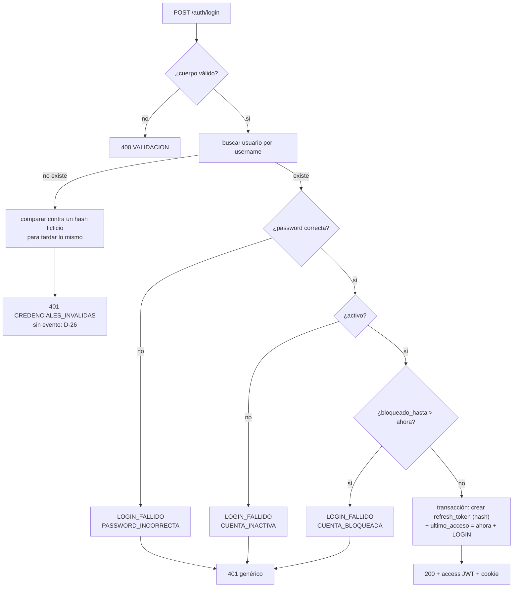

# SDD — S1.3 · `POST /auth/login` con CI y contraseña

- **Ticket:** ClickUp **S1.3** (`868mh1kv5`, https://app.clickup.com/t/868mh1kv5).
- **Autor:** generado con Claude (Entregable 1).
- **Estado:** Aprobado (2026-10-13)
- **Versión:** 1.0 · **Fecha:** 2026-10-13
- **Fuentes de verdad citadas:**
  1. `docs/product/PRD.md` RF-01 (CA1, CA4), §5 (API `/api/v1`, `POST /auth/login · /auth/refresh · /auth/logout`, error único), RNF-01, RNF-02, RNF-10
  2. `docs/product/business-rules.md` §Seguridad (login con CI; access JWT 15 min; refresh rotado en cookie httpOnly/Secure/SameSite=Strict)
  3. `docs/decisions/LOG.md` — DEC-007, DEC-008 #3 (`JWT_SECRET` llega en S1.x), DEC-010 (refresh y auditoría en el caso de uso; duración pendiente), DEC-011 (eventos de acceso, campos `password…`)
  4. `docs/adr/0001-monolito-modular.md` (módulo dueño de cada tabla), `docs/adr/0002-autorizacion-casbin.md` (el rol sale del token, nunca del cliente)
  5. `docs/product/dudas.md` D-14, D-25 (se entra con el CI, provisional), D-26 (CI inexistente no se anota), D-24
  6. `docs/sdd/S0.7/SDD.md` (patrón de módulo HTTP, `validar`, errores, contexto), `docs/sdd/S0.8/SDD.md` §2.4 (`auth.api.ts`), `docs/sdd/S1.1/SDD.md`, `docs/sdd/S1.2-S1.7/SDD.md`
  7. `docs/do-not-touch.md` (auth: se crea con este SDD; cambios posteriores exigen ADR)

---

## 1 · Alcance

### Entra

- `POST /api/v1/auth/login` en el módulo `seguridad`: valida usuario y contraseña, crea la sesión (refresh token, S1.1), registra `LOGIN` o `LOGIN_FALLIDO` (S1.7) y actualiza `ultimo_acceso`, todo en una transacción.
- Access JWT de 15 min (HS256, librería `jose`) en el cuerpo de la respuesta. Refresh token en una cookie httpOnly.
- `JWT_SECRET` obligatorio en la configuración, en `.env.example`, Docker Compose, la CI y el script de staging.
- Módulo `personas` mínimo: solo la lectura del nombre para la respuesta del login (§2.5).
- Contrato en OpenAPI.
- Web: `auth.api.ts` usa el contrato definitivo y guarda el access token en memoria; el cliente Axios lo manda en `Authorization`.

### No entra (a propósito)

- **Contador de intentos y bloqueo** (sumar `intentos_fallidos`, bloquear 15 min, volver a 0 al entrar bien) y el rate limit de 10/min → **S1.4**. Aquí un usuario ya bloqueado se rechaza, pero no se cuenta nada.
- `/auth/refresh` (rotación, detección de reuso) y `/auth/logout` → **S1.5**. Ahí se agrega la lectura de cookies.
- Middleware que valida el access token en las demás rutas y obliga a cambiar la contraseña → **S1.6**. Aquí solo se emite el token, con los datos que ese middleware va a necesitar (§2.3).
- Endpoint para cambiar la contraseña → S1.9. Refresh automático en la web, `AuthContext` real e inactividad → S1.10.

### Premisas verificadas (heredadas de `task-brief`)

| Premisa del ticket                                                            | Qué hay de verdad en el repo                                                                                                                                                                                              |
| ----------------------------------------------------------------------------- | ------------------------------------------------------------------------------------------------------------------------------------------------------------------------------------------------------------------------- |
| La web usa de forma provisional `{usuario, clave}` en `auth.api.ts`           | ✅ También el E2E `modo-api.spec.ts` y `auth.api.test.ts`. **Cambia a `{usuario, password}`**: por DEC-011 #5 los campos de contraseña se llaman `password…`, y así los tapa la redacción del logger y de la bitácora.    |
| `JWT_SECRET` "validado en `config.ts`"                                        | ⚠️ No existe todavía (DEC-008 #3). Se agrega como obligatorio, y además hay que pasarlo a Docker Compose (servicio `api`), la CI (jobs `base-de-datos` y `docker`) y `scripts/desplegar-staging.sh`, o la API no arranca. |
| Hay una librería de JWT y de cookies                                          | ❌ No hay ninguna. Para firmar se agrega **`jose` 6.2.12** (MIT, sin dependencias, publicada hace más de 2 semanas). Para escribir la cookie alcanza `res.cookie` de Express. La lectura de cookies llega con S1.5.       |
| "Usuario inactivo o bloqueado → mismo error genérico"                         | ✅ Se respeta. Además, el CI inexistente da el mismo error y tarda lo mismo (§2.2).                                                                                                                                       |
| Evento LOGIN / LOGIN_FALLIDO en la misma transacción                          | ✅ Funciones de S1.7 (`eventos-acceso.ts`).                                                                                                                                                                               |
| Devolver `debeCambiarPassword` y el nombre                                    | ⚠️ El nombre está en `persona`, cuyo dueño es el módulo `personas`, que no tiene código (ADR-0001: `seguridad` no puede leer esa tabla directo). Se crea `personas` con una sola función pública (§2.5).                  |
| "Login ok, clave mala, usuario inexistente e inactivo probados con Supertest" | ✅ Supertest ya está. Como necesitan PostgreSQL, van en `test/bd/` (corren con `npm run test:bd`).                                                                                                                        |
| La duración del refresh la cierra este SDD (DEC-010 #3)                       | ✅ Se decide aquí (§2.3): 8 h desde el login.                                                                                                                                                                             |

---

## 2 · Diseño técnico

### Módulos del monolito (ADR-0001)

| Módulo      | Rol en este ticket       | API pública (`index.ts`)                   | Tablas propias que toca                                                            |
| ----------- | ------------------------ | ------------------------------------------ | ---------------------------------------------------------------------------------- |
| `seguridad` | dueño                    | **agrega** `crearModuloAuth` (módulo HTTP) | `usuario` (lee; actualiza `ultimo_acceso`), `rol` (lee), `refresh_token` (inserta) |
| `personas`  | dueño, **carpeta nueva** | **agrega** `buscarNombreCompleto`          | `persona` (lee)                                                                    |
| `auditoria` | consumido                | `registrarEvento` (vía S1.7)               | `log_auditoria` (inserta)                                                          |

### 2.1 Contrato

`POST /api/v1/auth/login`

```jsonc
// Petición
{ "usuario": "1234567-1A", "password": "abc123.!" }

// 200
{
  "accessToken": "<JWT>",
  "expiraEn": "2026-10-14T12:15:00.000Z",      // vencimiento del access token
  "usuario": {
    "id": 3, "usuario": "1234567-1A", "nombre": "Ana Mamani Quispe",
    "rol": "KARDEX", "sedeId": 2, "activo": true,
    "debeCambiarPassword": false, "ultimoAcceso": "2026-10-13T08:02:11.000Z"  // el acceso ANTERIOR, o null
  }
}
// + Set-Cookie: siset_refresh=<token>; HttpOnly; Secure; SameSite=Strict; Path=/api/v1/auth; Max-Age=28800

// 401 (CI inexistente, contraseña incorrecta, cuenta inactiva o bloqueada: siempre igual)
{ "error": { "code": "CREDENCIALES_INVALIDAS", "message": "CI o contraseña incorrectos." } }

// 400: cuerpo inválido (formato único de VALIDACION de S0.7)
```

**Validación de la petición (Zod):**

- `usuario`: texto, sin espacios a los lados, de 1 a 40 caracteres (el largo de `usuario.username`), y en mayúsculas para que `1234567-1a` encuentre `1234567-1A`.
- `password`: texto de 1 a 200 caracteres. **Aquí no se aplica la política de DEC-011**: una contraseña creada antes de la regla, o temporal, tiene que poder entrar. El tope de 200 evita que alguien mande un texto enorme para hacer trabajar a bcrypt.

**Por qué `ultimoAcceso` devuelve el acceso anterior:** así la pantalla puede mostrar "Último ingreso: …", que es lo útil para detectar un ingreso ajeno. El de ahora ya lo sabe el usuario.

### 2.2 Flujo del caso de uso (`auth.servicio.ts`)



- **Siempre se compara la contraseña primero**, también para cuentas inactivas o bloqueadas. Así el tiempo de respuesta no revela el estado de la cuenta. El hash ficticio se calcula una vez al arrancar el módulo (`hashPassword` de un texto aleatorio).
- **Orden de los motivos:** primero la contraseña. Un `CUENTA_BLOQUEADA` o `CUENTA_INACTIVA` en la bitácora significa que la contraseña era correcta, y eso es lo que Kardex necesita saber para ayudar al usuario. Con una contraseña incorrecta en una cuenta bloqueada se anota `PASSWORD_INCORRECTA`.
- **`LOGIN_FALLIDO` usa el cliente normal, sin transacción:** no hay operación que acompañar (S0.7 §2.10). S1.4 lo meterá en la transacción del contador.
- **`intentosFallidos` en el evento** lleva el valor actual de la columna, sin sumar: contar es de S1.4.
- **El reloj se inyecta** (`ahora: () => Date`) para poder probar el bloqueo y los vencimientos.

### 2.3 Tokens

|                          | Access token                                                                | Refresh token                                                                |
| ------------------------ | --------------------------------------------------------------------------- | ---------------------------------------------------------------------------- |
| Qué es                   | JWT HS256 firmado con `JWT_SECRET` (`jose`)                                 | 32 bytes aleatorios (`randomBytes`) en base64url                             |
| Dónde viaja              | Cuerpo de la respuesta → memoria de la web → header `Authorization: Bearer` | Cookie `siset_refresh`                                                       |
| Dura                     | 15 min (business-rules)                                                     | **8 h desde el login** (decisión de este SDD, DEC-012)                       |
| Qué se guarda en la base | Nada                                                                        | Solo el hash SHA-256 (`hashDeToken`, S1.1), con IP y user agent del contexto |

**Contenido del access token:** `sub` (id del usuario, como texto), `rol` (código), `sede` (id o `null`), `cpw` (`true` si debe cambiar la contraseña), `iss: "siset"`, `iat` y `exp`. El rol y la sede van en el token porque ADR-0002 exige tomar el rol del token y nunca del cliente. `cpw` es para que S1.6 bloquee todo menos el cambio de contraseña sin consultar la base en cada petición.

**Por qué 8 h fijas desde el login:** es una jornada de trabajo del personal (los únicos usuarios del piloto, DEC-009). La rotación de S1.5 **no extiende** ese plazo: el token nuevo hereda el `expira_en` del anterior. Así, una sesión robada no se puede estirar para siempre. La inactividad de 15 min la sigue controlando la web (S1.10) y el access de 15 min.

**Cookie:** `HttpOnly` (JavaScript no la lee), `Secure` (los navegadores la aceptan también en `http://localhost`), `SameSite=Strict` (no viaja en peticiones de otros sitios) y `Path=/api/v1/auth` (solo viaja a login, refresh y logout, no a cada petición). La web y la API comparten origen gracias al proxy de Nginx y de Vite (DEC-008 #1), así que no hace falta `SameSite=None`.

**`JWT_SECRET`:** obligatorio en todos los entornos, con un mínimo de 32 caracteres (lo que pide HS256 para ser seguro). Si falta, la API no arranca y el error nombra la variable sin mostrar su valor (patrón de S0.7). En los tests se usa un valor fijo de prueba. El logger ya redacta `authorization` (S0.7).

### 2.4 Capas del módulo `seguridad`

| Archivo                  | Qué hace                                                                                                                                                                                                |
| ------------------------ | ------------------------------------------------------------------------------------------------------------------------------------------------------------------------------------------------------- |
| `auth.esquemas.ts`       | Zod de la petición y de la respuesta (con `.meta` para OpenAPI).                                                                                                                                        |
| `auth.rutas.ts`          | `POST /auth/login` con `validar({ body })`, y el objeto OpenAPI.                                                                                                                                        |
| `auth.controlador.ts`    | Llama al servicio, escribe la cookie y responde 200.                                                                                                                                                    |
| `auth.servicio.ts`       | El flujo de §2.2. Recibe `bd`, `config`, `ahora` y la función de nombre de `personas`.                                                                                                                  |
| `usuario.repositorio.ts` | `buscarUsuarioParaLogin(cliente, username)` (id, hash, activo, bloqueo, intentos, `debeCambiarPassword`, `ultimoAcceso`, `personaId`, `sedeId`, código de rol) y `registrarAcceso(cliente, id, ahora)`. |
| `jwt.ts`                 | `firmarAccessToken(datos, secreto, ahora)`; la verificación llega con S1.6.                                                                                                                             |
| `index.ts`               | Exporta `crearModuloAuth` además de lo de S1.2.                                                                                                                                                         |

`app.ts` monta `crearModuloAuth({ bd, config, nombreDe: buscarNombreCompleto })`. La raíz de composición es la que une `seguridad` con `personas`, así `seguridad` no importa a `personas`.

### 2.5 Módulo `personas` (mínimo)

```ts
// personas/persona.repositorio.ts + personas/index.ts
/** "Nombres ApellidoPaterno ApellidoMaterno", sin los apellidos que falten. */
export function buscarNombreCompleto(cliente: ClienteBd | TransaccionBd, personaId: number): Promise<string>;
```

No se agregan rutas ni servicio: llegan con su primer caso de uso real (S2.x).

### 2.6 Web

- `auth.api.ts`: `login(usuario, clave)` manda `{ usuario, password: clave }`, guarda `accessToken` y `expiraEn` con `guardarAccessToken` y devuelve el `Usuario` de la web. `debeCambiarPassword` se traduce a `debeCambiarClave`, que es el campo que ya usan las pantallas.
- `lib/sesion.ts` (**nuevo**): guarda el access token en una variable del módulo (nunca en `localStorage`, para que un XSS no lo pueda leer después) y lo expone a `api.ts`.
- `lib/api.ts`: un interceptor de petición agrega `Authorization: Bearer` cuando hay token. El 401 y el refresh automático son de S1.10.
- Las pantallas no cambian: siguen usando `authService`.

---

## 3 · Cambios por archivo/módulo

| Archivo/módulo                                                                                                        | Cambio                                                                                                                                                    |
| --------------------------------------------------------------------------------------------------------------------- | --------------------------------------------------------------------------------------------------------------------------------------------------------- |
| `apps/api/package.json`, `package-lock.json`                                                                          | + `jose` 6.2.12 (versión exacta).                                                                                                                         |
| `apps/api/src/compartido/config.ts`                                                                                   | + `JWT_SECRET` (mínimo 32) → `config.jwtSecreto`.                                                                                                         |
| `apps/api/src/compartido/errores/errores.ts`                                                                          | Nada: `ErrorNoAutenticado` acepta mensaje; se le agrega un parámetro opcional `codigo` (por defecto `NO_AUTENTICADO`) para usar `CREDENCIALES_INVALIDAS`. |
| `apps/api/src/modulos/seguridad/{auth.esquemas,auth.rutas,auth.controlador,auth.servicio,usuario.repositorio,jwt}.ts` | **Nuevos** (§2.4).                                                                                                                                        |
| `apps/api/src/modulos/seguridad/index.ts`                                                                             | + `crearModuloAuth`.                                                                                                                                      |
| `apps/api/src/modulos/personas/{persona.repositorio,index}.ts`                                                        | **Nuevos** (§2.5).                                                                                                                                        |
| `apps/api/src/app.ts`                                                                                                 | Monta el módulo de auth.                                                                                                                                  |
| `apps/api/.env.example`, `.env.example` (raíz)                                                                        | + `JWT_SECRET` con un valor de desarrollo y la instrucción para generar uno (`openssl rand -base64 48`).                                                  |
| `docker-compose.yml`                                                                                                  | `api.environment.JWT_SECRET: ${JWT_SECRET:?Falta JWT_SECRET en .env}`.                                                                                    |
| `.github/workflows/ci.yml`                                                                                            | `JWT_SECRET` de CI en los jobs que levantan la API.                                                                                                       |
| `scripts/desplegar-staging.sh`                                                                                        | Genera `JWT_SECRET` aleatorio la primera vez, igual que `POSTGRES_PASSWORD`.                                                                              |
| `apps/api/test/http/utilidades.ts`                                                                                    | `configDePrueba` con un `jwtSecreto` de prueba.                                                                                                           |
| `apps/api/test/bd/auth-login.test.ts`                                                                                 | **Nuevo** (§4).                                                                                                                                           |
| `apps/api/test/compartido.test.ts` (config)                                                                           | Casos de `JWT_SECRET` faltante o corto.                                                                                                                   |
| `apps/api/test/seguridad-jwt.test.ts`                                                                                 | **Nuevo**: contenido y vencimiento del token.                                                                                                             |
| `apps/web/src/lib/sesion.ts`, `lib/api.ts`, `services/auth.api.ts` (+ tests)                                          | §2.6.                                                                                                                                                     |
| `apps/web/e2e/modo-api.spec.ts`                                                                                       | Espera `{ usuario, password }`.                                                                                                                           |
| `docs/decisions/LOG.md`                                                                                               | DEC-012 (§7).                                                                                                                                             |

---

## 4 · Plan de tests

| Caso                                                                                                                                                                                                          | Nivel          | Cubre                      |
| ------------------------------------------------------------------------------------------------------------------------------------------------------------------------------------------------------------- | -------------- | -------------------------- |
| Login correcto: 200, `usuario` con nombre, rol, sede y `debeCambiarPassword`; `ultimoAcceso` es el anterior (null la primera vez)                                                                             | BD + Supertest | Contrato §2.1              |
| La cookie `siset_refresh` es `HttpOnly`, `Secure`, `SameSite=Strict`, `Path=/api/v1/auth`, `Max-Age=28800`, y en `refresh_token` está su hash (nunca el token) con IP, user agent y `expira_en` = ahora + 8 h | BD + Supertest | §2.3, RNF-01               |
| El access token se verifica con `JWT_SECRET`: `sub`, `rol`, `sede`, `cpw`, `iss`, y `exp` = ahora + 15 min                                                                                                    | BD + Supertest | §2.3                       |
| Login correcto deja `LOGIN` en la bitácora y actualiza `ultimo_acceso`                                                                                                                                        | BD + Supertest | DEC-007                    |
| Contraseña incorrecta: 401 `CREDENCIALES_INVALIDAS` + `LOGIN_FALLIDO` `PASSWORD_INCORRECTA`; no se crea sesión                                                                                                | BD + Supertest | §2.2                       |
| CI inexistente: el mismo 401 y **ningún** evento nuevo en la bitácora                                                                                                                                         | BD + Supertest | D-26                       |
| Cuenta inactiva con contraseña correcta: el mismo 401 + `CUENTA_INACTIVA`                                                                                                                                     | BD + Supertest | §2.2                       |
| Cuenta bloqueada (`bloqueado_hasta` en el futuro) con contraseña correcta: el mismo 401 + `CUENTA_BLOQUEADA`; con `bloqueado_hasta` en el pasado entra                                                        | BD + Supertest | §2.2                       |
| El cuerpo de las cuatro respuestas 401 es idéntico                                                                                                                                                            | BD + Supertest | Sin enumeración de cuentas |
| Usuario en minúsculas (`9000002-1a`) encuentra `9000002-1A`                                                                                                                                                   | BD + Supertest | §2.1                       |
| Cuerpo sin `password`, con `password` de 201 caracteres o con `usuario` vacío: 400 `VALIDACION`                                                                                                               | Supertest      | §2.1                       |
| Si falla la creación de la sesión, no quedan `LOGIN` ni `ultimo_acceso` nuevos (transacción)                                                                                                                  | BD             | D-17                       |
| `cargarConfig` falla sin `JWT_SECRET` o con menos de 32 caracteres, y el mensaje no muestra el valor                                                                                                          | Unit           | §2.3                       |
| `buscarNombreCompleto` arma el nombre sin apellidos vacíos                                                                                                                                                    | BD             | §2.5                       |
| `auth.api.login` manda `{ usuario, password }`, guarda el token y traduce `debeCambiarPassword`                                                                                                               | Unit (web)     | §2.6                       |
| `api.ts` agrega `Authorization` cuando hay token y no lo agrega cuando no hay                                                                                                                                 | Unit (web)     | §2.6                       |
| E2E `modo-api`: el cuerpo es `{ usuario, password }`                                                                                                                                                          | E2E            | Contrato en la web         |
| El documento OpenAPI tiene `POST /api/v1/auth/login` con 200, 400 y 401                                                                                                                                       | Supertest      | DoD                        |

**Deliberadamente sin test:**

- La igualdad exacta de tiempos entre un CI inexistente y uno existente: medir tiempos en la CI da resultados inestables. Se garantiza por diseño (siempre hay una comparación bcrypt) y se revisa en el código.
- El bloqueo por intentos: es S1.4.

---

## 5 · Definition of Done

- [ ] SDD en `docs/sdd/S1.3/SDD.md`, Estado = Aprobado.
- [ ] Contrato documentado en §2.1 y en OpenAPI.
- [ ] La web (`auth.api.ts`) usa el contrato definitivo; el E2E `modo-api` lo verifica.
- [ ] Login correcto, contraseña incorrecta, CI inexistente, cuenta inactiva y bloqueada probados con Supertest.
- [ ] `LOGIN` y `LOGIN_FALLIDO` verificados en test; ningún evento para el CI inexistente.
- [ ] El refresh token solo se guarda como hash.
- [ ] `JWT_SECRET` en config, `.env.example`, Compose, CI y script de staging; la API no arranca sin él.
- [ ] DEC-012 en `LOG.md`.
- [ ] Quality gate en verde: `calidad`, `base-de-datos`, `e2e`, `docker`.
- [ ] Commit `S1.3 …` en la rama `feat/S1.3-login`.

---

## 6 · Riesgos

| Riesgo                                                                                       | Gravedad                                                             | Mitigación                                                                                                                                                               |
| -------------------------------------------------------------------------------------------- | -------------------------------------------------------------------- | ------------------------------------------------------------------------------------------------------------------------------------------------------------------------ |
| Sin el contador de S1.4, la contraseña se puede probar sin límite                            | Media, pero solo hasta S1.4 (la semana siguiente y antes del piloto) | S1.4 es la siguiente tarea del Sprint 1 y el piloto no arranca sin ella. No hay despliegue con datos reales antes.                                                       |
| `JWT_SECRET` obligatorio rompe entornos que hoy arrancan sin él (Compose local, CI, staging) | Media                                                                | Se actualizan los cuatro en este mismo PR; el job `docker` de la CI lo comprueba.                                                                                        |
| Un `JWT_SECRET` débil o filtrado permite fabricar tokens                                     | Alta                                                                 | Mínimo de 32 caracteres, generado con `openssl` en staging, nunca en el repo, `.env` con permisos 600 (S0.9). Cambiarlo invalida todas las sesiones, que es lo esperado. |
| El access token en memoria se pierde al recargar la página                                   | Baja (conocido)                                                      | S1.10 lo recupera con el refresh de la cookie. Hasta entonces, en modo API, recargar pide volver a entrar.                                                               |
| bcrypt costo 12 en JavaScript: cada login tarda unos 250 ms y ocupa el hilo                  | Baja con el personal del piloto                                      | El rate limit de S1.4 evita abusos. Si hiciera falta, se pasa a `bcrypt` nativo con un ADR.                                                                              |

---

## 7 · Preguntas abiertas

Ninguna para la escuela. Las decisiones técnicas van a `LOG.md` como **DEC-012**:

1. Contrato del login con `{ usuario, password }` y respuesta `{ accessToken, expiraEn, usuario }`; el mismo 401 genérico para los cuatro casos de rechazo.
2. Refresh de **8 h desde el login**, sin extenderse al rotar (cierra DEC-010 #3); cookie `siset_refresh` con `Path=/api/v1/auth`.
3. Access JWT HS256 con `jose`; contenido `sub`, `rol`, `sede`, `cpw`; `JWT_SECRET` obligatorio de 32 caracteres o más.
4. Módulo `personas` con `buscarNombreCompleto` como única API pública; la raíz de composición lo conecta con `seguridad`.
