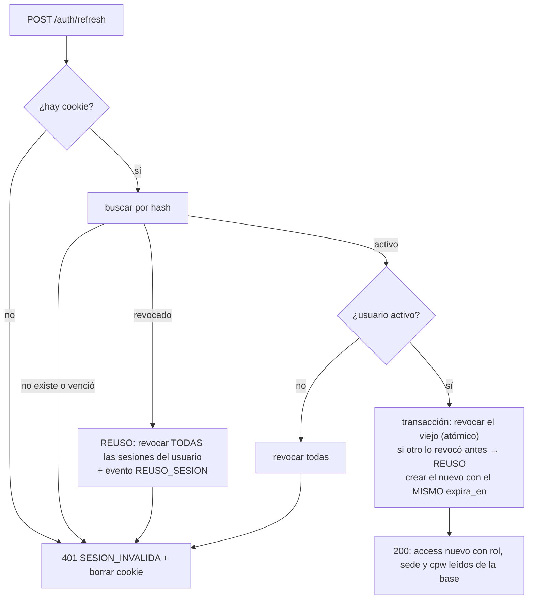

# SDD — S1.5 · Refresh con rotación, logout y cambio de contraseña

- **Ticket:** ClickUp **S1.5** (`868mh1kvq`, https://app.clickup.com/t/868mh1kvq).
- **Autor:** generado con Claude (Entregable 1).
- **Estado:** Aprobado (2026-10-13)
- **Versión:** 1.0 · **Fecha:** 2026-10-13
- **Fuentes de verdad citadas:**
  1. `docs/product/PRD.md` RF-01 CA3–CA4 (inactividad; el logout invalida el refresh), RF-03 CA4 (el reseteo obliga a cambiar la contraseña), §5 (`/auth/refresh`, `/auth/logout`)
  2. `docs/product/business-rules.md` §Seguridad
  3. `docs/decisions/LOG.md` — DEC-007, DEC-010 #2 (la rotación no se audita; el reuso sí), DEC-011 (política y eventos), DEC-012 (contrato del login, 8 h que la rotación no extiende, JWT y `cpw`), DEC-013
  4. `docs/sdd/S1.1/SDD.md` §2.3 (`revocarRefreshToken` atómico, base de la detección de reuso), `docs/sdd/S1.3/SDD.md`, `docs/sdd/S1.4/SDD.md`
  5. `docs/sdd/S0.7/SDD.md` §2.10 (las acciones de la bitácora se amplían con un PR, nunca con texto libre)
  6. `docs/adr/0002-autorizacion-casbin.md` (el rol sale del token)

---

## 1 · Alcance

### Entra

- `POST /auth/refresh`: valida la cookie, rota el token (revoca el viejo y emite uno nuevo que hereda el vencimiento) y devuelve un access token nuevo. Si llega un token ya revocado, se revocan **todas** las sesiones del usuario.
- `POST /auth/logout`: revoca el refresh de la cookie, la borra y registra `LOGOUT`.
- `POST /auth/cambiar-password`: exige el access token y la contraseña actual, aplica la política de DEC-011, quita `debe_cambiar_password`, cierra las demás sesiones y registra `CAMBIAR_PASSWORD`.
- Middleware **`autenticar`**: verifica el access token (`Authorization: Bearer`) y pone el usuario en el contexto de la petición. Lo necesita el cambio de contraseña, y S1.6 lo reutiliza en todas las rutas.
- Lectura de cookies con `cookie-parser`.

### No entra (a propósito)

- Autorización por rol (Casbin) y obligar a cambiar la contraseña en las demás rutas (`cpw`) → **S1.6**. Aquí `autenticar` solo identifica al usuario.
- La web: pantalla de cambio de contraseña conectada → S1.9; refresh automático, recuperar la sesión al recargar e inactividad → S1.10.
- Limpieza de filas vencidas de `refresh_token` → §6.

### Premisas verificadas (heredadas de `task-brief`)

| Premisa del ticket                                         | Qué hay de verdad en el repo                                                                                                                                                                                    |
| ---------------------------------------------------------- | --------------------------------------------------------------------------------------------------------------------------------------------------------------------------------------------------------------- |
| "Valida la cookie"                                         | ❌ La API no lee cookies: Express 5 no las parsea. Se agrega **`cookie-parser` 1.4.7** (MIT; sus dependencias ya están en el árbol por Express).                                                                |
| Ruta `POST /auth/cambiar-clave`                            | ⚠️ Se llama **`/auth/cambiar-password`**: los campos del cuerpo son `passwordActual` y `passwordNueva`, y por DEC-011 #5 todo lo de contraseñas se nombra `password…` para que lo tape la redacción.            |
| El cambio de contraseña "quita `debe_cambiar_password`"    | ✅, pero el access token del usuario sigue diciendo `cpw: true` hasta vencer. Por eso el cambio **emite una sesión nueva** (access + cookie) con `cpw: false`. Si no, S1.6 lo seguiría bloqueando hasta 15 min. |
| El cambio de contraseña necesita saber quién es el usuario | ❌ No hay nada que verifique el access token: S1.3 solo lo firma. Se agrega `autenticar` (§2.4). Es el mismo que usará S1.6.                                                                                    |
| "Reutilizar un token revocado revoca toda la familia"      | ✅ `revocarRefreshTokensDeUsuario` (S1.1). Como no hay "familias" en la tabla, la familia es **todas las sesiones del usuario**, como dice el ticket.                                                           |
| Evento CAMBIO_CLAVE                                        | ⚠️ Se llama `CAMBIAR_PASSWORD` desde S0.7 (DEC-011 #3).                                                                                                                                                         |
| Evento para el reuso detectado (DEC-010 #2)                | ❌ No existe la acción. Se agrega **`REUSO_SESION`** a `AccionAuditoria`: S0.7 prevé ampliar la lista con un PR. No cambia la tabla ni la redacción.                                                            |

---

## 2 · Diseño técnico

### Módulos del monolito (ADR-0001)

| Módulo      | Rol en este ticket            | API pública (`index.ts`)                                             | Tablas propias que toca                                                         |
| ----------- | ----------------------------- | -------------------------------------------------------------------- | ------------------------------------------------------------------------------- |
| `seguridad` | dueño                         | **agrega** `autenticar` y `sesionDe` (para S1.6 y los demás módulos) | `refresh_token` (rota, revoca), `usuario` (contraseña, `debe_cambiar_password`) |
| `auditoria` | dueño de la lista de acciones | `AccionAuditoria` + `REUSO_SESION`                                   | `log_auditoria`                                                                 |

### 2.1 Contratos

Todas las rutas viven bajo `/api/v1/auth`, así que la cookie `siset_refresh` (`Path=/api/v1/auth`) viaja a las tres.

**`POST /auth/refresh`** (sin cuerpo; usa la cookie)

- 200: el mismo cuerpo que el login (`{ accessToken, expiraEn, usuario }`) y una cookie nueva cuyo `Max-Age` es **el tiempo que le queda a la sesión**, no 8 h. Se devuelve `usuario` para que la web (S1.10) recupere la sesión al recargar con una sola llamada.
- 401 `SESION_INVALIDA` ("Su sesión terminó. Vuelva a iniciar sesión.") cuando no hay cookie, el token no existe, venció, ya estaba revocado (reuso) o el usuario está inactivo. En todos los casos se responde también `Set-Cookie` para borrar la cookie.

**`POST /auth/logout`** (sin cuerpo)

- 204 **siempre**, aunque no haya cookie o el token no sirva: el resultado que el usuario espera (no tener sesión) se cumple igual. Borra la cookie.
- No exige access token: tiene que funcionar aunque el access ya haya vencido.

**`POST /auth/cambiar-password`** (`Authorization: Bearer`)

```jsonc
{ "passwordActual": "temporal-1", "passwordNueva": "nueva.clave-2" }
```

- 200: el mismo cuerpo que el login, con `debeCambiarPassword: false`, y una cookie nueva de 8 h.
- 400 `VALIDACION`: `passwordNueva` no cumple la política (con los mensajes de DEC-011) o es igual a la actual ("La nueva contraseña debe ser distinta de la actual").
- 401 `NO_AUTENTICADO`: falta el access token o no es válido.
- 422 `PASSWORD_ACTUAL_INCORRECTA` ("La contraseña actual no es correcta.").
- 429: el mismo rate limit del login (10/min por IP), con su propio conteo. Así, alguien con un access token robado no puede probar contraseñas actuales sin límite.

### 2.2 Refresh y reuso (`auth.servicio.ts → refrescar`)



- **El vencimiento se hereda** (DEC-012 #2): la sesión dura 8 h desde el login, por más que se rote.
- **Rol, sede y `cpw` se leen de la base en cada refresh**, no se copian del token viejo. Si Kardex cambia el rol de alguien, el cambio llega en el siguiente refresh (como máximo en 15 min).
- **Usuario inactivo:** sus sesiones se revocan en el refresh. Así, dar de baja a alguien lo saca del sistema en 15 min como máximo, aunque S1.8 no revoque nada. **Bloqueado por intentos:** el refresh sigue funcionando. El bloqueo frena a quien adivina contraseñas, no a quien ya entró con la correcta.
- **Carrera:** si dos pestañas rotan el mismo token a la vez, `revocarRefreshToken` deja ganar a una sola y la otra se trata como reuso, así que se cierran todas las sesiones. Es el comportamiento seguro. La web lo evita con un solo refresh en curso (S1.10, §6).
- **Bitácora:** la rotación normal no se audita (DEC-010 #2). El reuso registra `REUSO_SESION` a nombre del dueño del token, con `{ sesionesRevocadas }` en `datos_despues`. Ese evento es la señal de que alguien copió una cookie.

### 2.3 Logout y cambio de contraseña

**Logout:** si la cookie corresponde a una sesión activa, se revoca y se registra `LOGOUT` en la misma transacción. Si ya estaba revocada, vencida o no existe, no se hace nada más. Siempre se borra la cookie (`res.clearCookie` con el mismo `Path`).

**Cambio de contraseña**, todo en una transacción:

1. `autenticar` identifica al usuario. Se carga su hash y se compara con `passwordActual`. Si no coincide, 422. No suma al contador de S1.4: el usuario ya está autenticado, y el rate limit acota los intentos.
2. Se valida `passwordNueva` con `esquemaPassword` (en la ruta) y se verifica que sea distinta de la actual.
3. `password_hash = hashPassword(nueva)` y `debe_cambiar_password = false`.
4. Se **revocan todas** las sesiones del usuario, incluida la actual. Así, si alguien conocía la contraseña vieja, pierde su sesión.
5. Se crea una sesión nueva de 8 h y se firma un access con `cpw: false`.
6. `registrarCambioPassword` (S1.7).

### 2.4 `autenticar` (`seguridad/autenticar.ts`)

```ts
export interface SesionUsuario { usuarioId: number; rol: string; sedeId: number | null; debeCambiarPassword: boolean }

/** Verifica el Bearer (HS256, iss "siset", vencimiento) y deja la sesión en res.locals y el usuario en el contexto. */
export const crearAutenticar = (jwtSecreto: string): RequestHandler
export const sesionDe = (res: Response): SesionUsuario   // lanza si la ruta no pasó por autenticar
```

- Falta el header, la firma es inválida o el token venció → 401 `NO_AUTENTICADO` ("Necesita iniciar sesión."). La web, ante cualquier 401, intenta un refresh (S1.10).
- Se usa `jwtVerify` de `jose` con `algorithms: ['HS256']`, para que nadie pueda colar un token con otro algoritmo.
- Pone `usuarioId` en el contexto de la petición (S0.7): desde ahí, cada `registrarEvento` guarda quién hizo la acción sin pasarlo a mano.
- **No consulta la base:** el token dura 15 min y el refresh revisa el estado del usuario. S1.6 agrega la autorización encima.
- `verificarAccessToken` va en `jwt.ts`, junto a `firmarAccessToken`.

### 2.5 Cookies

- `cookie-parser` se monta en `app.ts`, antes de las rutas, sin firma: la cookie ya es un valor aleatorio de 256 bits.
- `opcionesCookieRefresh(maxAgeMs)` de S1.3 se reutiliza; `borrarCookieRefresh(res)` usa las mismas opciones sin `maxAge`.

---

## 3 · Cambios por archivo/módulo

| Archivo/módulo                                                                                  | Cambio                                                                                                               |
| ----------------------------------------------------------------------------------------------- | -------------------------------------------------------------------------------------------------------------------- |
| `apps/api/package.json`, `package-lock.json`                                                    | + `cookie-parser` 1.4.7 y `@types/cookie-parser` (versiones exactas).                                                |
| `apps/api/src/app.ts`                                                                           | Monta `cookieParser()`.                                                                                              |
| `apps/api/src/modulos/auditoria/auditoria.esquemas.ts`                                          | + `'REUSO_SESION'` en `AccionAuditoria`.                                                                             |
| `apps/api/src/modulos/seguridad/eventos-acceso.ts`                                              | + `registrarReusoSesion(c, usuarioId, sesionesRevocadas)`.                                                           |
| `apps/api/src/modulos/seguridad/jwt.ts`                                                         | + `verificarAccessToken`.                                                                                            |
| `apps/api/src/modulos/seguridad/autenticar.ts`                                                  | **Nuevo** (§2.4).                                                                                                    |
| `apps/api/src/modulos/seguridad/auth.servicio.ts`                                               | + `refrescar`, `cerrarSesion`, `cambiarPassword`; se extrae lo común con el login (emitir sesión, armar el usuario). |
| `apps/api/src/modulos/seguridad/usuario.repositorio.ts`                                         | + `buscarUsuarioParaSesion(id)` y `actualizarPassword(id, hash)`.                                                    |
| `apps/api/src/modulos/seguridad/auth.esquemas.ts`, `auth.rutas.ts`, `auth.controlador.ts`       | Las tres rutas, sus esquemas Zod y OpenAPI (§2.1).                                                                   |
| `apps/api/src/modulos/seguridad/index.ts`                                                       | + `crearAutenticar`, `sesionDe`, `type SesionUsuario`.                                                               |
| `apps/api/test/bd/auth-refresh.test.ts`, `auth-logout.test.ts`, `auth-cambiar-password.test.ts` | **Nuevos** (§4).                                                                                                     |
| `apps/api/test/seguridad-autenticar.test.ts`                                                    | **Nuevo**: middleware sin base de datos.                                                                             |
| `docs/decisions/LOG.md`                                                                         | DEC-014 (§7).                                                                                                        |

---

## 4 · Plan de tests

| Caso                                                                                                                                                                                                         | Nivel          | Cubre          |
| ------------------------------------------------------------------------------------------------------------------------------------------------------------------------------------------------------------ | -------------- | -------------- |
| Refresh con la cookie del login: 200 con access nuevo y usuario; cookie nueva distinta; el token viejo queda revocado; el nuevo hereda `expira_en`; `Max-Age` = lo que queda                                 | BD + Supertest | §2.1, §2.2     |
| El access del refresh lleva el rol y `cpw` **actuales** de la base (se cambia el rol entre login y refresh)                                                                                                  | BD + Supertest | §2.2           |
| Reusar el token viejo: 401 `SESION_INVALIDA`, cookie borrada, **todas** las sesiones del usuario revocadas (también la rotada) y `REUSO_SESION` en la bitácora                                               | BD + Supertest | DoD            |
| Dos refresh simultáneos con el mismo token: uno gana, el otro termina en reuso                                                                                                                               | BD + Supertest | Carrera        |
| Sin cookie, con un token inventado o vencido: 401 `SESION_INVALIDA` y ningún evento                                                                                                                          | BD + Supertest | §2.1           |
| Usuario dado de baja: el refresh da 401 y revoca sus sesiones                                                                                                                                                | BD + Supertest | §2.2           |
| Usuario bloqueado por intentos con una sesión abierta: el refresh funciona                                                                                                                                   | BD + Supertest | §2.2           |
| La rotación normal no deja eventos en la bitácora                                                                                                                                                            | BD + Supertest | DEC-010 #2     |
| Logout: 204, revoca la sesión de la cookie, la borra (`Set-Cookie` con fecha pasada) y registra `LOGOUT`; un refresh después da 401                                                                          | BD + Supertest | DoD, RF-01 CA4 |
| Logout sin cookie o con un token ya revocado: 204 y ningún evento                                                                                                                                            | BD + Supertest | §2.3           |
| Cambio de contraseña correcto: 200 con `debeCambiarPassword: false`, access con `cpw: false`, la sesión vieja revocada, la contraseña nueva entra por login y la vieja no; `CAMBIAR_PASSWORD` en la bitácora | BD + Supertest | DoD            |
| Cambio con la contraseña actual incorrecta: 422 `PASSWORD_ACTUAL_INCORRECTA` y nada cambia                                                                                                                   | BD + Supertest | §2.3           |
| Cambio con una nueva que no cumple la política (`abc12345`) o igual a la actual: 400 con su mensaje                                                                                                          | BD + Supertest | DEC-011        |
| Cambio sin access token o con uno inválido: 401 `NO_AUTENTICADO`                                                                                                                                             | BD + Supertest | §2.4           |
| `autenticar`: token válido deja la sesión y el `usuarioId` en el contexto; vencido, mal firmado, con otro emisor, con `alg: none` o sin header → 401                                                         | Unit           | §2.4           |
| OpenAPI tiene las tres rutas con sus respuestas                                                                                                                                                              | Supertest      | DoD            |

**Deliberadamente sin test:**

- La limpieza de filas vencidas: no entra (§6).
- La web: es S1.9 y S1.10.

---

## 5 · Definition of Done

- [ ] SDD en `docs/sdd/S1.5/SDD.md`, Estado = Aprobado.
- [ ] Tests de rotación, reuso detectado, logout y cambio de contraseña en verde.
- [ ] `LOGOUT`, `CAMBIAR_PASSWORD` y `REUSO_SESION` en la misma transacción que su operación (DEC-007).
- [ ] La sesión nunca pasa de 8 h desde el login.
- [ ] `autenticar` exportado para S1.6.
- [ ] DEC-014 en `LOG.md`.
- [ ] Quality gate en verde: `calidad`, `base-de-datos`, `e2e`, `docker`.
- [ ] Commit `S1.5 …` en la rama `feat/S1.5-refresh-logout`.

---

## 6 · Riesgos

| Riesgo                                                                                             | Gravedad                                      | Mitigación                                                                                                                                                     |
| -------------------------------------------------------------------------------------------------- | --------------------------------------------- | -------------------------------------------------------------------------------------------------------------------------------------------------------------- |
| Dos pestañas que refrescan a la vez disparan un "reuso" y cierran todas las sesiones del usuario   | Media (molesto, no inseguro)                  | S1.10 hace un solo refresh en curso por pestaña. Si en el piloto pasa entre pestañas, se agrega un margen de gracia de unos segundos con una revisión del SDD. |
| `refresh_token` crece: una fila por login y una por cada rotación (cada ≤15 min por sesión activa) | Baja: con 10 personas, unas 300 filas por día | Una tarea programada que borre lo vencido o revocado hace más de 30 días. Se anota para S6.x; en el piloto no hace falta.                                      |
| El access token sigue sirviendo hasta 15 min después del logout o de la baja                       | Baja (conocido y aceptado por diseño)         | Es el costo de no consultar la base en cada petición. El refresh ya no funciona, así que la sesión termina sola.                                               |
| Agregar `REUSO_SESION` toca la lista de acciones de la bitácora (`do-not-touch`)                   | Baja                                          | Solo se agrega un valor a una unión de TypeScript, como prevé S0.7. No cambia la tabla, los triggers ni la redacción.                                          |

---

## 7 · Preguntas abiertas

Ninguna para la escuela. Las decisiones técnicas van a `LOG.md` como **DEC-014**:

1. Rutas `/auth/refresh` y `/auth/logout` sin access token; `/auth/cambiar-password` (no `cambiar-clave`) con `passwordActual` y `passwordNueva`.
2. El refresh devuelve el mismo cuerpo que el login, hereda el vencimiento y lee rol, sede y `cpw` de la base. Un usuario inactivo pierde sus sesiones en el refresh; uno bloqueado por intentos, no.
3. Reuso = todas las sesiones del usuario revocadas + acción nueva `REUSO_SESION` en la bitácora.
4. El cambio de contraseña revoca todas las sesiones y emite una nueva con `cpw: false`; la contraseña nueva debe ser distinta de la actual; usa el rate limit del login con su propio conteo.
5. `autenticar` (verifica el Bearer sin consultar la base) vive en `seguridad` y lo reutiliza S1.6.
