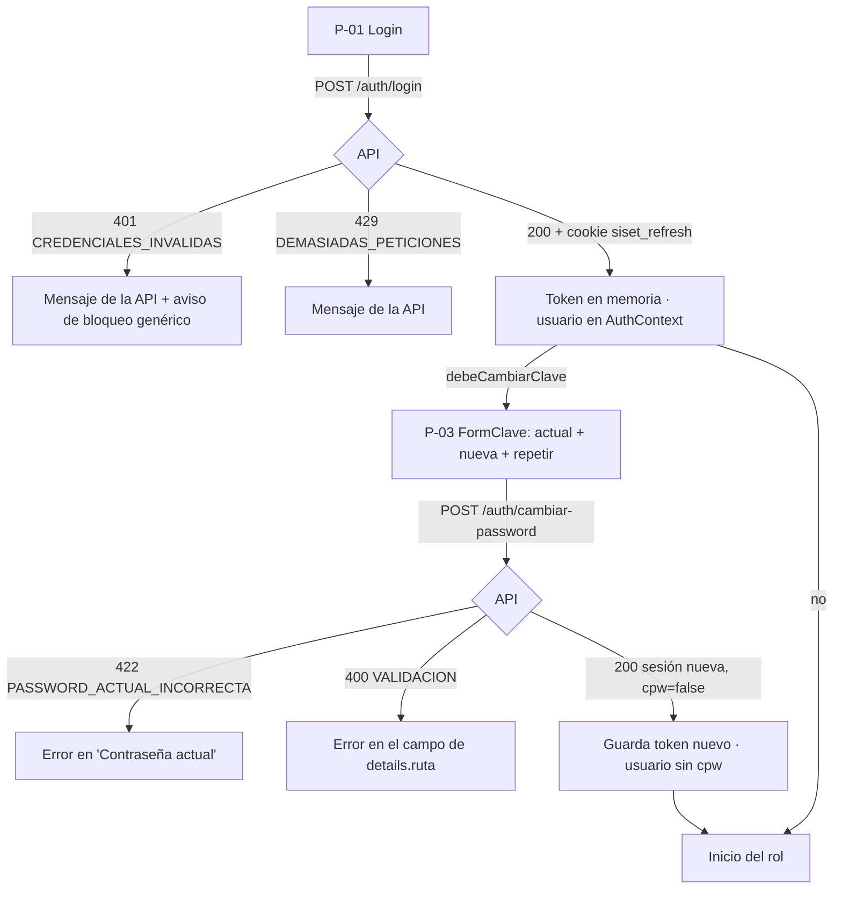

# SDD — S1.9 · Login y cambio obligatorio de contraseña conectados a la API

- **Ticket:** ClickUp **S1.9** (`868mh1kwe`, https://app.clickup.com/t/868mh1kwe).
- **Autor:** generado con Claude (Entregable 1).
- **Estado:** Aprobado (2026-10-14)
- **Versión:** 1.0 · **Fecha:** 2026-10-14
- **Fuentes de verdad citadas:**
  1. `docs/product/PRD.md` RF-01 (CA1 login con CI + contraseña, CA2 bloqueo por intentos), RNF-02
  2. `docs/product/business-rules.md` §Seguridad (login con CI, 5 intentos → 15 min, política de contraseña)
  3. `docs/decisions/LOG.md` — DEC-007 (eventos de acceso), DEC-011 (política de contraseña; campos `password…`), DEC-012 (contrato del login, 401 genérico), DEC-013 (el bloqueo no se revela; valores en `parametro`), DEC-014 (`/auth/cambiar-password` con `passwordActual` y `passwordNueva`, devuelve sesión nueva), DEC-015 #4 (`cpw` obligatorio), DEC-019 #2 / DEC-020 #2 (Kardex restablece; contraseña temporal generada)
  4. `docs/product/dudas.md` D-14b (Kardex restablece), D-25 (CI como usuario)
  5. `docs/sdd/S0.8/SDD.md` §2.2–2.5 (interruptor mock/API, `ErrorApi`, demo solo con todo en mock), `docs/sdd/S1.3/SDD.md` §2.1 y §2.6, `docs/sdd/S1.5/SDD.md` §2.1 y §2.3
  6. `docs/product/prototipo-pantallas.md` P-01, P-03, P-05 (bloque "Cambiar contraseña")
  7. `apps/api/src/modulos/seguridad/auth.rutas.ts` (OpenAPI del login y del cambio de contraseña)

---

## 1 · Alcance

### Entra

- **P-01 Login contra la API**: ya llama a `POST /auth/login` (S1.3); aquí se cierran los mensajes de error
  (credenciales, demasiadas peticiones, sin conexión) y el aviso del bloqueo sin revelar si la cuenta existe.
- **P-03 Cambio obligatorio de contraseña contra la API** (`POST /auth/cambiar-password`): el formulario pide
  ahora la **contraseña actual** (el contrato de DEC-014 la exige), guarda la sesión nueva que devuelve la API y
  entra al inicio del rol sin pasar otra vez por el login.
- El mismo formulario (`FormClave`) sirve al bloque "Cambiar contraseña" de P-05 Mi perfil, sin tocar esa pantalla.
- `authService.cambiarPassword` en API y en mock, con la misma firma y los mismos errores.
- El modo demo (todo en mock) sigue funcionando igual.

### No entra (a propósito)

- **Restaurar la sesión al recargar, refresh automático, inactividad y el contrato final de `useAuth()`** → S1.10
  (se implementa encima de esta rama).
- Rutas por rol, menú, vista 403 y `/auth/mis-permisos` → S1.11. `ProtectedRoute` ya manda a `/cambiar-clave`
  cuando `debeCambiarClave` es verdadero; no se toca.
- E2E contra la API real (backend levantado) → S1.14. Aquí: E2E del proyecto `api` de Playwright con la API
  simulada por `page.route` (igual que `e2e/modo-api.spec.ts`).
- Cambiar la etiqueta "CI o usuario" por "CI": la usa `e2e/modo-api.spec.ts` y la demo entra con usuarios que no
  son CI. Se deja para S1.14, que ya toca esas pruebas.
- Recuperar la contraseña por correo: no existe en v1.0 (DEC-019 #2).

### Premisas verificadas (`task-brief`)

| Premisa del ticket                                     | Qué hay de verdad en el repo                                                                                                                                                                                                                                                                                                                         |
| ------------------------------------------------------ | ---------------------------------------------------------------------------------------------------------------------------------------------------------------------------------------------------------------------------------------------------------------------------------------------------------------------------------------------------- |
| "Las pantallas P-01 y P-03 ya existen; falta la API"   | ✅ P-01 ya llama a la API desde S1.3 (`authApi.login`). ❌ `authApi.cambiarClave` lanza `NO_IMPLEMENTADO`.                                                                                                                                                                                                                                           |
| "`auth.api.ts` con el contrato de S1.3 y S1.5"         | ⚠️ El contrato de S1.5 exige **`passwordActual`**, y P-03 solo pide la nueva y su repetición. Se agrega el campo "Contraseña actual" a `FormClave` (§2.2). No se guarda la contraseña escrita en el login para rellenarlo: ninguna contraseña queda en memoria de la web.                                                                            |
| "Mensajes de error de la API (bloqueo, credenciales)"  | ⚠️ La API **no distingue el bloqueo**: cuenta inexistente, inactiva, bloqueada o contraseña mala dan el mismo 401 `CREDENCIALES_INVALIDAS` (DEC-012 #1, DEC-013 #2). La web no puede ni debe decir "cuenta bloqueada". Se muestra el mensaje de la API y un aviso fijo que no revela nada (§2.1). El mock hoy sí dice "Cuenta bloqueada": se alinea. |
| "El modo demo sigue funcionando con mocks"             | ✅ `auth.service.ts` elige mock o API con `VITE_USAR_API` (S0.8). El mock cambia de firma junto con la API.                                                                                                                                                                                                                                          |
| DoD: "E2E de login real y cambio obligatorio"          | ⚠️ El proyecto `api` de Playwright no levanta el backend: simula la API con `page.route`. El E2E con backend real es de S1.14 (reparto de esta ola). Aquí se cubre con la API simulada.                                                                                                                                                              |
| DoD: "toda escritura y evento de acceso con su evento" | ✅ La web no escribe en la base. `LOGIN`, `LOGIN_FALLIDO`, `BLOQUEO_CUENTA` y `CAMBIAR_PASSWORD` los registra la API (S1.3–S1.5) en la misma transacción. El mock sigue llamando a `auditar` para la bitácora de la demo.                                                                                                                            |
| P-03 dice "Kardex reseteó tu contraseña"               | ⚠️ Desde S1.8 también entra aquí una **cuenta nueva** con su contraseña temporal. Se cambia el texto (§2.2).                                                                                                                                                                                                                                         |
| Recargar en modo API después de este ticket            | ⚠️ `AuthContext` restaura con `authService.obtener`, que en API lanza. Hasta S1.10 se captura el error y se vuelve al login (sin pantalla colgada).                                                                                                                                                                                                  |



---

## 2 · Diseño técnico

### 2.1 P-01 Login

- `login(usuario, password)` no cambia de contrato (S1.3). El componente ya muestra `err.message`; se agrega:
  - Con `codigo === 'CREDENCIALES_INVALIDAS'`, debajo del mensaje, un texto fijo: _"Varios intentos fallidos
    seguidos bloquean la cuenta por un tiempo. Si no puedes entrar, acércate a Kardex."_ Sin números: la cantidad
    de intentos y los minutos viven en `parametro` (DEC-013 #3) y pueden cambiar sin tocar la web.
  - `DEMASIADAS_PETICIONES`, `SIN_CONEXION`, `TIEMPO_AGOTADO`: el mensaje de `ErrorApi` tal cual, sin el aviso.
- La contraseña se borra del formulario tras un error (no se deja escrita en el estado más de lo necesario); el CI se conserva.
- **Mock alineado con la API:** `authMock.login` lanza `new ErrorApi('CI o contraseña incorrectos.', 'CREDENCIALES_INVALIDAS', 401)`
  en todos los casos (también bloqueada), y sigue contando intentos y bloqueando internamente para la bitácora de
  la demo. Así la demo enseña el comportamiento real, no uno que el sistema nunca tendrá.

### 2.2 P-03 y `FormClave`

Campos: **Contraseña actual** (`autoComplete="current-password"`), **Nueva contraseña**, **Repetir contraseña**,
con el indicador de fuerza y las reglas que ya tiene. Validación en el cliente antes de enviar:

| Regla                       | Mensaje                                              | Fuente                        |
| --------------------------- | ---------------------------------------------------- | ----------------------------- |
| Actual vacía                | "Ingresa tu contraseña actual"                       | contrato S1.5                 |
| Nueva no cumple la política | el de `validarClave` (misma tabla que la API)        | DEC-011                       |
| Repetir distinta            | "Las contraseñas no coinciden"                       | ya existe                     |
| Nueva igual a la actual     | "La nueva contraseña debe ser distinta de la actual" | mismo texto que la API (S1.5) |

Errores de la API, en el campo que corresponde:

| Respuesta                        | Dónde se muestra                                                                                     |
| -------------------------------- | ---------------------------------------------------------------------------------------------------- |
| 422 `PASSWORD_ACTUAL_INCORRECTA` | error del campo "Contraseña actual"                                                                  |
| 400 `VALIDACION` con `detalles`  | cada `{ ruta, mensaje }`: `body.passwordActual` → actual, `body.passwordNueva` → nueva; otra → toast |
| 429, sin conexión, otros         | toast con el mensaje de `ErrorApi`                                                                   |

La validación y esta traducción viven en funciones puras de `pages/publicas/form-clave.ts`:
`validarFormClave({ actual, nueva, repetir })` y `erroresPorCampo(e: ErrorApi)`, que valida la forma de
`detalles` con un type guard (sin `any`). Son puras para probarlas con Vitest en `environment: 'node'`, sin sumar
jsdom ni Testing Library: la pantalla en sí se prueba con E2E.

**Envío:** `FormClave` llama a `useAuth().cambiarPassword(actual, nueva)` (nuevo, §2.4) en vez de `authService`
directo: la API revoca todas las sesiones y devuelve una nueva, así que el contexto debe quedarse con ese usuario
y ese token. Al terminar limpia los tres campos y llama a `onListo(usuario)`.

**Página P-03:**

- Texto: _"Tu contraseña es temporal (la asignó Kardex). Antes de continuar, elige una nueva."_ — sirve para cuenta
  nueva y para restablecimiento.
- `onListo(u)` navega a `rutaInicio(u.rol)` con el usuario **devuelto** (hoy usa el del cierre, que puede estar viejo).
- Un botón secundario **"Cerrar sesión"** (`useAuth().logout()` y `/login`): quien no recuerda la temporal no queda
  atrapado en la pantalla.

**P-05 Mi perfil:** no se edita. Recibe el campo nuevo por `FormClave`; su `onListo` sigue sin hacer nada. Como
el contexto ya tiene la sesión nueva, el usuario sigue trabajando sin notar la rotación.

### 2.3 `authService.cambiarPassword`

Se renombra `cambiarClave` → **`cambiarPassword`** (DEC-011 #5: todo campo de contraseña se llama `password…`,
para que la redacción de logs lo tape).

```ts
cambiarPassword(u: Usuario, passwordActual: string, passwordNueva: string): Promise<Usuario>
```

- **API:** `POST /auth/cambiar-password` con `{ passwordActual, passwordNueva }` → `RespuestaLogin`;
  `guardarAccessToken(data.accessToken)` y devuelve `aUsuario(data.usuario)` (con `debeCambiarClave: false`). La
  cookie nueva la deja el navegador. `u` no se usa en API (se mantiene por la firma común con el mock).
- **Mock:** valida la política (`validarClave`), compara la actual con `claves[u.usuario] ?? CLAVE_DEMO` y lanza
  `ErrorApi('La contraseña actual no es correcta.', 'PASSWORD_ACTUAL_INCORRECTA', 422)`; si nueva = actual lanza
  `ErrorApi('Los datos enviados no son válidos.', 'VALIDACION', 400, [{ ruta: 'body.passwordNueva', mensaje: 'La nueva contraseña debe ser distinta de la actual' }])`.
  Guarda la clave, pone `debeCambiarClave = false`, audita y devuelve la copia del usuario.

El mock lanza `ErrorApi` (no `ErrorNegocio`) para que la pantalla tenga un solo camino de errores.

### 2.4 `AuthContext` (mínimo; el contrato completo lo fija S1.10)

- Se agrega `cambiarPassword(passwordActual, passwordNueva): Promise<Usuario>`: llama al servicio con el usuario
  actual, hace `setUsuario` con el devuelto y lo retorna. Sin usuario → lanza `Error('Sin sesión')`.
- El efecto que restaura al arrancar captura el error de `obtener` y vuelve a "sin sesión" (`guardarSesion(null)`):
  en modo API, recargar manda al login hasta que S1.10 lo resuelva.
- `refrescar` queda igual (lo reemplaza S1.10).

### 2.5 Trazabilidad (DEC-007)

La web no registra eventos. Las cuatro acciones de este ticket ya tienen su evento en la API: `LOGIN`,
`LOGIN_FALLIDO`, `BLOQUEO_CUENTA` (S1.3/S1.4) y `CAMBIAR_PASSWORD` (S1.5), en la misma transacción. Un
`PASSWORD_ACTUAL_INCORRECTA` no genera evento ni suma intentos (decisión de S1.5): lo frena el rate limit propio
del endpoint.

---

## 3 · Cambios por archivo/módulo

| Archivo                                          | Cambio                                                                                                                                          |
| ------------------------------------------------ | ----------------------------------------------------------------------------------------------------------------------------------------------- |
| `apps/web/src/services/auth.api.ts`              | `cambiarClave` → `cambiarPassword` (§2.3); se quita `pendienteS1` para esa función.                                                             |
| `apps/web/src/services/auth.mock.ts`             | `login` con el 401 genérico (§2.1); `cambiarPassword` con actual, igualdad y `ErrorApi` (§2.3).                                                 |
| `apps/web/src/context/AuthContext.tsx`           | + `cambiarPassword` en `ApiAuth`; `catch` en la restauración (§2.4).                                                                            |
| `apps/web/src/pages/publicas/Login.tsx`          | Aviso genérico de bloqueo con `CREDENCIALES_INVALIDAS`; borra la contraseña tras un error (§2.1).                                               |
| `apps/web/src/pages/publicas/CambiarClave.tsx`   | `FormClave`: campo actual, regla "distinta", `erroresPorCampo`, `useAuth().cambiarPassword`, `onListo(usuario)`. P-03: texto y "Cerrar sesión". |
| `apps/web/src/services/auth.api.test.ts`         | Casos de `cambiarPassword` (§4).                                                                                                                |
| `apps/web/src/services/auth.mock.test.ts`        | **Nuevo** (§4).                                                                                                                                 |
| `apps/web/src/pages/publicas/form-clave.ts`      | **Nuevo**: `validarFormClave`, `erroresPorCampo` (§2.2).                                                                                        |
| `apps/web/src/pages/publicas/form-clave.test.ts` | **Nuevo** (§4).                                                                                                                                 |
| `apps/web/e2e/modo-api-login.spec.ts`            | **Nuevo**, proyecto `api` con `page.route` (§4).                                                                                                |

No se tocan: `components/layout/*`, `config/permisos.ts`, `hooks/index.ts`, `pages/perfil/MiPerfil.tsx`, la API.

---

## 4 · Plan de tests

| Caso                                                                                                                                                                                                                                   | Nivel                | Cubre          |
| -------------------------------------------------------------------------------------------------------------------------------------------------------------------------------------------------------------------------------------- | -------------------- | -------------- |
| `authApi.cambiarPassword` hace POST `/auth/cambiar-password` con `{ passwordActual, passwordNueva }`, guarda el token nuevo y devuelve el usuario sin `debeCambiarClave`                                                               | Unit (adapter Axios) | §2.3, DEC-014  |
| `authApi.cambiarPassword` con 422 → `ErrorApi` `PASSWORD_ACTUAL_INCORRECTA` y el token anterior intacto                                                                                                                                | Unit                 | §2.3           |
| `authMock.login` con contraseña mala, cuenta inexistente y cuenta bloqueada → mismo `ErrorApi` `CREDENCIALES_INVALIDAS`                                                                                                                | Unit                 | DEC-012/013    |
| `authMock.cambiarPassword`: actual mala → 422; nueva = actual → 400 con `body.passwordNueva`; política → error; ok → `debeCambiarClave` false y la nueva entra al login                                                                | Unit                 | §2.3           |
| `validarFormClave`: actual vacía, nueva que no cumple, repetir distinta, nueva = actual → el error en el campo correcto; todo bien → sin errores                                                                                       | Unit                 | §2.2           |
| `erroresPorCampo`: 422 → campo actual; 400 con `detalles` → campo nueva / actual; `detalles` con otra forma o 429 → mensaje general (toast)                                                                                            | Unit                 | §2.2           |
| P-03: tras éxito navega al inicio del rol del usuario **devuelto**; "Cerrar sesión" va a `/login` (cubierto en el E2E de abajo)                                                                                                        | E2E `api`            | §2.2           |
| E2E (API simulada): login 401 muestra el mensaje y el aviso de bloqueo; 429 muestra su mensaje sin el aviso                                                                                                                            | E2E `api`            | RF-01          |
| E2E (API simulada): login con `debeCambiarPassword` → `/cambiar-clave`; actual mala → error en el campo; correcta → inicio del rol; el cuerpo enviado es `{ passwordActual, passwordNueva }` y lleva `Authorization: Bearer` del login | E2E `api`            | RF-01, DEC-015 |
| E2E mock existentes (`flujos`, `recorrido`) siguen verdes con el campo nuevo                                                                                                                                                           | E2E `mock`           | demo           |

**No se prueba aquí:** componentes con jsdom (no hay infraestructura y no se agrega por un formulario; lo cubre el E2E), el backend real (S1.14), el contador de intentos (S1.4 ya lo prueba en la API), la
restauración al recargar (S1.10).

---

## 5 · Definition of Done

- [ ] SDD en `docs/sdd/S1.9/SDD.md`, Estado = Aprobado.
- [ ] P-01 muestra los errores de la API sin revelar si la cuenta existe o está bloqueada.
- [ ] P-03 cambia la contraseña contra la API pidiendo la actual, y entra al inicio sin volver al login.
- [ ] El modo demo hace lo mismo con el mock.
- [ ] Eventos `LOGIN`/`LOGIN_FALLIDO`/`BLOQUEO_CUENTA`/`CAMBIAR_PASSWORD` los registra la API (ya probado en S1.3–S1.5); nada nuevo en la web.
- [ ] Tests del §4 en verde; quality gate (`calidad`, `base-de-datos`, `e2e`, `docker`) en verde.
- [ ] Commit `S1.9 …` en `feat/S1.9-login-conectado`.

---

## 6 · Riesgos

| Riesgo                                                                               | Gravedad | Mitigación                                                                             |
| ------------------------------------------------------------------------------------ | -------- | -------------------------------------------------------------------------------------- |
| Un usuario bloqueado no entiende por qué no entra (la API no lo dice)                | Media    | Aviso genérico tras cada 401 y "acércate a Kardex"; Kardex puede desbloquear (S1.8).   |
| El usuario no recuerda la temporal cuando P-03 se la pide otra vez                   | Baja     | La acaba de escribir en el login. Si no, "Cerrar sesión" y Kardex la restablece.       |
| Después de cambiar la contraseña, otra pestaña abierta queda con una sesión revocada | Baja     | Su access sigue válido hasta 15 min; luego el refresh falla y S1.10 la manda al login. |
| Hasta que entre S1.10, recargar en modo API pierde la sesión                         | Baja     | S1.10 va encima de esta misma rama; solo afecta al modo API, que aún no se despliega.  |

---

## 7 · Preguntas abiertas

- **Para la escuela:** ninguna. El texto del aviso de bloqueo y el de P-03 son de UI; se pueden ajustar en la
  validación con Kardex (D-16) sin cambiar el diseño.
- **Para `LOG.md`** (se registra junto con S1.10 como **DEC-021** al aprobar):
  1. La web nunca dice "cuenta bloqueada": muestra el 401 genérico y un aviso sin números; el mock se alinea.
  2. El cambio de contraseña pide la actual también en P-03 (contrato de DEC-014); la web no guarda la contraseña del login.
  3. `authService.cambiarClave` → `cambiarPassword` y devuelve el usuario de la sesión nueva.
