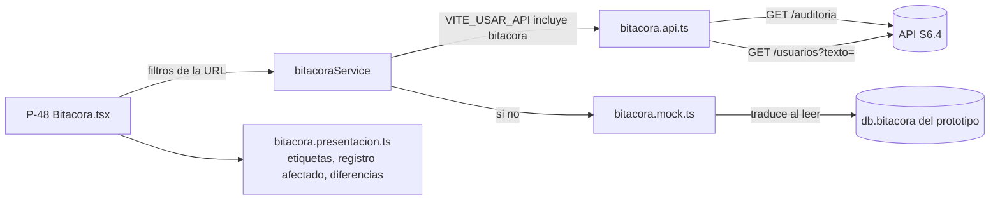

# SDD — S6.5 · Pantalla de bitácora (P-48) conectada a la API

- **Ticket:** ClickUp **S6.5** (`868mh1kx8`, https://app.clickup.com/t/868mh1kx8).
- **Autor:** generado con Claude (Entregable 1).
- **Estado:** Aprobado (2026-10-14)
- **Versión:** 1.1 · **Fecha:** 2026-10-14
  - 1.1 (al implementar): el paginador (`components/ui/Paginacion.tsx`) y el tipo `Pagina<T>` (`types/pagina.ts`)
    son los compartidos con S1.13 (rama `chore/paginacion-compartida`), no propios; el paginador muestra
    "51–100 de 1342" y "Página 2 de 27". El test de sincronía importa el archivo de la API con `?raw` en vez de
    leerlo con `node:fs` (la web no tiene los tipos de Node). En el E2E del mock, "el otro usuario" es SEC_DIR
    recibiendo un pase (`CAMBIAR_ESTADO` con antes y después): el segundo KARDEX del mock está dado de baja.
    `ServicioBitacora` vive en `bitacora.api.ts`; se agrega `describirEntidad` para el chip "Historial de".
    La decisión queda como DEC-024.
- **Depende de:** S6.4 (`GET /auditoria`, en `main`), S1.8 (`GET /usuarios`, en `main`). Supone que S1.10 deja el
  token y el refresh automático funcionando en `lib/api.ts` (este ticket no toca ese archivo).
- **Fuentes de verdad citadas:**
  1. `docs/product/PRD.md` RF-14 (CA1 fecha, usuario, IP, acción, módulo, antes y después; CA3 Kardex filtra por fecha, usuario y módulo)
  2. `docs/decisions/LOG.md` — DEC-007 #4 (filtros por usuario, módulo, acción, fecha y **entidad**: "historial de este registro"), DEC-017 (paginación `{ datos, pagina, porPagina, total }`; consultar la bitácora no genera eventos), DEC-018 #2 (intentos con un CI inexistente: `usuario` nulo y el CI en `entidadId`), DEC-020 #5 (`DESBLOQUEAR_CUENTA`)
  3. `docs/product/dudas.md` D-26 (respondida: se registran los intentos con un CI inexistente), D-27 (cerrada: Kardex administra y ve la bitácora)
  4. `docs/product/prototipo-pantallas.md` §P-48 (tabla, filtros, modal "Antes / Después" con resaltado amarillo, aviso de solo lectura)
  5. `docs/sdd/S6.4/SDD.md` §2.2 (contrato de `GET /auditoria`), `docs/sdd/S1.8/SDD.md` §2.2 (`GET /usuarios?texto=`), `docs/sdd/S0.8/SDD.md` §2.3–§2.4 (interruptor mock/API por servicio)
  6. `apps/api/src/modulos/auditoria/auditoria.esquemas.ts` (listas cerradas de acciones y módulos), `auditoria.consulta.esquemas.ts`, `apps/api/src/modulos/seguridad/eventos-acceso.ts` (`MotivoLoginFallido`)

---

## 1 · Alcance

### Entra

- P-48 (`/bitacora`, solo KARDEX) leyendo `GET /api/v1/auditoria` cuando `VITE_USAR_API` incluye `bitacora`, y el mock en otro caso, **con el mismo contrato** en los dos modos.
- Filtros: rango de fechas, usuario (buscador), módulo, acción y "historial de este registro" (entidad + id). Paginación **en el servidor**.
- Etiquetas en español para los códigos de acción, módulo y motivo de ingreso fallido.
- Modal "Ver detalle" con antes y después lado a lado, resaltando lo que cambió.
- Filtros en la URL (`/bitacora?usuarioId=3&modulo=SEGURIDAD`), para compartir un enlace o volver atrás sin perderlos.

### No entra (a propósito)

- Exportar la bitácora → S6.3.
- Enlaces "Ver en la bitácora" desde otras pantallas (Usuarios P-46, detalle del file P-41): la URL ya los admite, pero esas pantallas son de otros tickets (S1.13, S2.x).
- La pestaña "Historial" del file (P-41) sigue con el mock de `files.service.ts` hasta S2.x.
- Cambios en la API. Lo que falte se anota como riesgo (§6), no se resuelve acá.

### Premisas verificadas (task-brief)

| Premisa del ticket                                   | Qué hay de verdad en el repo                                                                                                                                                                                                                                                                                                                                                                                 |
| ---------------------------------------------------- | ------------------------------------------------------------------------------------------------------------------------------------------------------------------------------------------------------------------------------------------------------------------------------------------------------------------------------------------------------------------------------------------------------------ |
| "UI hecha (P-48)"                                    | ✅ `pages/kardex/Bitacora.tsx` existe, pero sobre el **modelo del prototipo**: `usuario`, `modulo`, `accion` y `registro` son textos libres ("Inicio de sesión", "Hojas de ruta"), filtra en el navegador y pagina en el cliente. La API devuelve **códigos** de listas cerradas, `usuario` como objeto o `null`, `entidad` + `entidadId`, y pagina en el servidor. La pantalla se reescribe en buena parte. |
| "`bitacora.service.ts` con la API de S6.4"           | ⚠️ Hoy es un solo archivo mock. Se parte en `bitacora.service.ts` (selector) + `bitacora.api.ts` + `bitacora.mock.ts`, como `auth.*` (SDD S0.8 §2.3). El nombre `bitacora` ya está en `_modo.ts`.                                                                                                                                                                                                            |
| El mock puede adoptar el contrato de la API          | ⚠️ El almacén del mock (`db.bitacora`, tipo `RegistroBitacora`) lo escriben **20 llamadas a `auditar()`** en servicios de otros tickets (`usuarios.service.ts`, `auth.mock.ts`, `files.service.ts`, …) y lo lee la pestaña Historial del file. Cambiar ese almacén pisaría archivos ajenos. Se decide **no tocarlo** y traducir al leer (§2.4).                                                              |
| Filtro por usuario                                   | ⚠️ La API filtra por `usuarioId` (entero), no por nombre. El select actual se llena con los nombres de los eventos cargados, cosa que deja de servir con paginación en el servidor. Se usa un buscador sobre `GET /usuarios?texto=` (S1.8), más un atajo: clic en el usuario de una fila (§2.5).                                                                                                             |
| Filtro por acción                                    | ⚠️ Hoy es texto libre ("ej. bloquear"). La API acepta solo un código de la lista cerrada → pasa a ser un select con etiquetas.                                                                                                                                                                                                                                                                               |
| "Historial de este registro (entidad)"               | ⚠️ No hay UI para eso. Se agrega: clic en "Registro afectado" filtra por `entidad` + `entidadId` (DEC-007 #4).                                                                                                                                                                                                                                                                                               |
| La lista de acciones y módulos es la misma en la web | ❌ La web no tiene las listas: no puede importar código de `apps/api`. Se copian a `config/auditoria.ts` y un test compara la copia con el archivo de la API (§2.2).                                                                                                                                                                                                                                         |
| Componentes para tests de pantalla                   | ⚠️ La web no tiene Testing Library: los tests son de funciones puras (Vitest) y E2E (Playwright). La lógica de presentación se saca a funciones puras para poder probarla (§2.6).                                                                                                                                                                                                                            |



---

## 2 · Diseño técnico

### 2.1 Contrato del servicio

`bitacoraService` expone **el contrato de la API**, tanto en modo API como en modo mock. Las pantallas solo importan `bitacora.service.ts`.

```ts
// types/bitacora.ts (nuevo)
export interface UsuarioBitacora {
  id: number;
  usuario: string;
  nombre: string;
}

export interface RegistroAuditoria {
  id: number;
  fecha: string; // ISO con zona (UTC desde la API)
  usuario: UsuarioBitacora | null;
  accion: string; // AccionAuditoria; string para tolerar códigos nuevos (§2.2)
  modulo: string; // ModuloAuditoria
  entidad: string | null;
  entidadId: string | null;
  antes: unknown;
  despues: unknown;
  ip: string | null;
  userAgent: string | null;
}

export interface FiltrosAuditoria {
  usuarioId?: number;
  modulo?: ModuloAuditoria;
  accion?: AccionAuditoria;
  desde?: string; // AAAA-MM-DD, hora de La Paz, inclusiva
  hasta?: string;
  entidad?: string;
  entidadId?: string;
}

export interface Pagina<T> {
  datos: T[];
  pagina: number;
  porPagina: number;
  total: number;
}

// services/bitacora.mock.ts y bitacora.api.ts implementan:
export interface ServicioBitacora {
  /** RF-14: solo lectura. No hay funciones para editar ni borrar. */
  listar(f: FiltrosAuditoria, pagina: number, porPagina: number): Promise<Pagina<RegistroAuditoria>>;
  /** Buscador del filtro "Usuario" (hasta 10 resultados). */
  buscarUsuarios(texto: string): Promise<UsuarioBitacora[]>;
}
```

- `Pagina<T>` es el tipo compartido de `types/pagina.ts` (v1.1).
- `bitacora.api.ts` arma los parámetros **sin los vacíos** (no manda `modulo=`), con `pagina` y `porPagina`, y devuelve `data` tal cual: el contrato ya es el de la API. Los errores llegan como `ErrorApi` por el interceptor de `lib/api.ts`.
- `buscarUsuarios` en modo API llama a `GET /usuarios?texto=…&porPagina=10` y se queda con `{ id, usuario, nombre }`. Se llama desde `bitacora.api.ts` y no desde `usuarios.service.ts` para no depender del archivo que está cambiando S1.13. Kardex tiene `usuarios/leer` (DEC-015). Solo devuelve personal (DEC-020 #1): cuando haya estudiantes con cuenta, entran solos por la misma API.

### 2.2 Códigos y etiquetas (`config/auditoria.ts`, nuevo)

Copia de las listas cerradas de `auditoria.esquemas.ts`, con su etiqueta. La pantalla nunca muestra el código crudo salvo que la API devuelva uno que la web todavía no conoce.

| Acción                 | Etiqueta                       | Tono   |
| ---------------------- | ------------------------------ | ------ |
| `CREAR`                | Creación                       | normal |
| `EDITAR`               | Edición                        | normal |
| `DAR_DE_BAJA`          | Baja                           | ámbar  |
| `REACTIVAR`            | Reactivación                   | normal |
| `CAMBIAR_ESTADO`       | Cambio de estado               | normal |
| `LOGIN`                | Inicio de sesión               | normal |
| `LOGIN_FALLIDO`        | Intento de ingreso fallido     | ámbar  |
| `LOGOUT`               | Cierre de sesión               | normal |
| `CAMBIAR_PASSWORD`     | Cambio de contraseña           | normal |
| `RESTABLECER_PASSWORD` | Restablecimiento de contraseña | ámbar  |
| `BLOQUEO_CUENTA`       | Bloqueo de cuenta              | rojo   |
| `DESBLOQUEAR_CUENTA`   | Desbloqueo de cuenta           | normal |
| `REUSO_SESION`         | Reuso de sesión (posible robo) | rojo   |
| `EXPORTAR`             | Exportación                    | normal |
| `IMPRIMIR`             | Impresión                      | normal |

| Módulo       | Etiqueta      |
| ------------ | ------------- |
| `SEGURIDAD`  | Seguridad     |
| `PERSONAS`   | Personas      |
| `CATALOGOS`  | Catálogos     |
| `FILES`      | Files         |
| `HOJAS_RUTA` | Hojas de ruta |
| `PASES`      | Pases         |
| `DICTAMENES` | Dictámenes    |
| `DOCUMENTOS` | Documentos    |
| `REPORTES`   | Reportes      |
| `AUDITORIA`  | Auditoría     |

Motivos de `LOGIN_FALLIDO` (`despues.motivo`): `PASSWORD_INCORRECTA` → "contraseña incorrecta", `CUENTA_BLOQUEADA` → "cuenta bloqueada", `CUENTA_INACTIVA` → "cuenta dada de baja", `CI_INEXISTENTE` → "CI no registrado". La celda de acción muestra "Intento de ingreso fallido · CI no registrado".

- Las etiquetas son `Record<AccionAuditoria, …>`: si la API agrega un código y alguien lo copia a la lista de la web, TypeScript obliga a ponerle etiqueta.
- **Sincronía con la API:** un test de Vitest importa `apps/api/src/modulos/auditoria/auditoria.esquemas.ts` como texto (`?raw`), extrae los dos arreglos y los compara con los de la web. Si alguien agrega una acción en la API (como `DESBLOQUEAR_CUENTA` hoy) y no en la web, la CI falla en `calidad`. Se eligió esto y no un paquete compartido porque son dos listas cortas y montar un paquete del monorepo es más trabajo que el problema.
- Si igual llega un código desconocido (versiones desfasadas en un despliegue), se muestra el código crudo; la pantalla no se rompe.

### 2.3 Pantalla P-48

**Aviso** (igual que hoy): "Registro de solo lectura. No se puede modificar ni borrar."

**Filtros** (una fila, se apilan en celular):

| Filtro       | Control                                                                                                    | Parámetro              |
| ------------ | ---------------------------------------------------------------------------------------------------------- | ---------------------- |
| Desde, Hasta | `Input type="date"`; si `desde > hasta`, mensaje bajo el campo y **no se consulta**                        | `desde`, `hasta`       |
| Usuario      | Buscador (§2.5)                                                                                            | `usuarioId`            |
| Módulo       | Select con las 10 etiquetas + "Todos"                                                                      | `modulo`               |
| Acción       | Select con las 15 etiquetas + "Todas"                                                                      | `accion`               |
| Registro     | No es un control: aparece como chip "Historial de: Usuario 4567890 ✕" al hacer clic en "Registro afectado" | `entidad`, `entidadId` |

Botón "Limpiar filtros". Cambiar cualquier filtro vuelve a la página 1. Los filtros y la página viven en la URL (`useSearchParams`): son la única fuente de estado, así "atrás" del navegador y un enlace pegado funcionan. Los valores de la URL que no pasan la validación (un módulo que no existe, una fecha mal escrita) se ignoran, como si no estuvieran.

**Tabla** (`DataTable` sin buscador, sin orden y con `pageSize` = `porPagina`, porque recibe una sola página ya ordenada por la API: `fecha DESC, id DESC`):

| Columna           | Contenido                                                                                                                                                                    |
| ----------------- | ---------------------------------------------------------------------------------------------------------------------------------------------------------------------------- |
| Fecha y hora      | `dd/MM/yyyy HH:mm:ss` **en hora de La Paz** (§2.7), con segundos: en una auditoría importa el orden fino.                                                                    |
| Usuario           | Nombre y, debajo, el CI/usuario en gris. Es un botón: filtra por ese usuario. Si `usuario` es `null`: "Sin usuario" en cursiva (intentos con un CI inexistente, DEC-018 #2). |
| IP                | `<code>`; "—" si es `null`. Se oculta en celular.                                                                                                                            |
| Módulo            | Badge con la etiqueta.                                                                                                                                                       |
| Acción            | Badge con la etiqueta y el tono de §2.2; motivo si es `LOGIN_FALLIDO`.                                                                                                       |
| Registro afectado | Texto de §2.6 (`describirRegistro`). Es un botón: filtra el historial de ese registro. "—" si no hay entidad.                                                                |
| (acción)          | "Ver detalle" en **todas** las filas: aunque no haya antes ni después, el detalle muestra el navegador (`userAgent`) y la hora exacta, que no entran en la tabla.            |

**Paginación:** debajo de la tabla, "Mostrando 51–100 de 1 342" con "Anterior" / "Siguiente" y "Página 2 de 27". `porPagina` fijo en 50 (el valor por defecto de la API). Subtítulo del encabezado: "1 342 registros".

**Estados:** cargando → esqueleto de la tabla; error → `Alerta` roja con el mensaje de `ErrorApi` y "Reintentar"; sin resultados → "No hay registros con estos filtros" y el botón "Limpiar filtros".

**Modal "Ver detalle"** (P-48: "Antes" y "Después" lado a lado, en amarillo lo que cambió):

- Encabezado: acción · registro afectado. Debajo: fecha y hora con segundos, usuario, módulo, IP y navegador (`userAgent`, en letra chica, cortado si es largo).
- Si `antes` o `despues` son objetos: tabla **Campo · Antes · Después** con la unión de las claves en orden alfabético; la fila va en amarillo si el valor cambió (`diferencias`, §2.6). Valores: texto tal cual; `null` → "vacío"; ausente → "—"; booleanos → "Sí" / "No"; objetos y arreglos → JSON con sangría en `<pre>`. `[REDACTADO]` se muestra tal cual con un candado y el `title` "Dato sensible: no se guarda en la bitácora".
- Si alguno no es objeto (un valor suelto o un arreglo): dos bloques `<pre>` "Antes" y "Después" con el JSON.
- Si los dos son `null`: "Este evento no guarda datos de antes ni después."
- Los nombres de campo se muestran como los guarda la API (`intentosFallidos`, `sedeId`). Kardex es el responsable de sistemas (D-27), y traducir cada campo de cada tabla sería mantener un diccionario que se desactualiza con cada ticket.

### 2.4 El mock con el contrato de la API

`bitacora.mock.ts` lee `db.bitacora` **sin cambiarlo** y traduce cada `RegistroBitacora` del prototipo a `RegistroAuditoria` con `aRegistroAuditoria(r)`:

- **Módulo:** tabla fija `Seguridad`/`Usuarios` → `SEGURIDAD`, `Files` → `FILES`, `Hojas de ruta` → `HOJAS_RUTA`, `Pases` → `PASES`, `Emisión` → `DOCUMENTOS`. Un módulo del prototipo que no está en la tabla lanza un error, y el test de §4 lo detecta: así nadie agrega un módulo nuevo al prototipo sin traducirlo.
- **Acción:** tabla por texto exacto (`Inicio de sesión` → `LOGIN`, `Inicio de sesión fallido` → `LOGIN_FALLIDO`, `Cuenta bloqueada por 5 intentos fallidos` → `BLOQUEO_CUENTA`, `Cierre de sesión` → `LOGOUT`, `Cambio de contraseña` → `CAMBIAR_PASSWORD`, `Resetear contraseña` → `RESTABLECER_PASSWORD`, `Dar de baja usuario` → `DAR_DE_BAJA`, `Reactivar usuario` → `REACTIVAR`, `Reimprimir documento` → `IMPRIMIR`, `Crear …`/`Registrar hoja de ruta`/`Registrar matrícula`/`Carga masiva de files` → `CREAR`, `Bloquear file`/`Desbloquear file` → `CAMBIAR_ESTADO`), luego reglas: módulo `HOJAS_RUTA` o `PASES` → `CAMBIAR_ESTADO` (son las transiciones de `lib/transiciones.ts`), y el resto → `EDITAR`.
- **Usuario:** se busca en `db.usuarios` por nombre → `{ id, usuario, nombre }`; si no está (datos de semilla como `cvargas`), `null`.
- **Entidad:** `SEGURIDAD` → `usuario` con el `id` del usuario cuyo `usuario` es `registro`; `FILES` → `file` con el código; `HOJAS_RUTA`/`PASES` → `hoja_ruta` con el N.º; `DOCUMENTOS` → `documento`. Si no se puede resolver, `entidadId` = `registro`.
- **Fecha:** el prototipo guarda `aaaa-mm-ddThh:mm` en hora local; se convierte a ISO con la zona de La Paz (`-04:00`, Bolivia no tiene horario de verano) y luego a UTC, igual que la API.
- `ip` del prototipo; `userAgent` = `null`.

Después filtra (los mismos filtros y la misma semántica de fechas que la API: comparación sobre la fecha de La Paz, inclusiva), ordena `fecha DESC, id DESC` y pagina. `buscarUsuarios` filtra `db.usuarios` por CI o nombre sin distinguir mayúsculas ni tildes.

**Por qué traducir y no cambiar el almacén:** cambiar `auditar()` obligaría a tocar los servicios mock de S1.9, S1.13 y S2.x, que se están cambiando en paralelo. La traducción vive en un solo archivo de este ticket y desaparece el día que todo use la API.

### 2.5 Filtro por usuario

Componente `BuscadorUsuario` (dentro de `pages/kardex/bitacora/`): campo de texto; desde 2 caracteres y tras 300 ms sin escribir llama a `buscarUsuarios`, y muestra hasta 10 opciones "Nombre · CI". Al elegir, el campo muestra el nombre y queda una ✕ para quitarlo. Al abrir un enlace con `usuarioId` y sin nombre conocido, el campo muestra "Usuario #3" hasta que se elige otro; no se hace una consulta extra solo para el nombre.

Atajo: clic en el usuario de una fila → filtra por su `id` y el campo toma su nombre, sin buscar. Así se pueden filtrar también usuarios que el buscador no devuelve (dados de baja, o estudiantes en el futuro).

No hay filtro "eventos sin usuario": la API no lo tiene. Para ver los intentos con un CI inexistente se filtra por acción `LOGIN_FALLIDO` (§6).

### 2.6 Funciones de presentación (`pages/kardex/bitacora/presentacion.ts`, puras)

- `etiquetaAccion(r)`: etiqueta + motivo si es `LOGIN_FALLIDO`; código crudo si no se conoce.
- `describirRegistro(r)`:
  - `usuario === null` y `despues.motivo === 'CI_INEXISTENTE'` → "CI intentado: 1234567".
  - `entidad === 'usuario'` y `entidadId === String(r.usuario?.id)` → "Usuario " + `r.usuario.usuario` (el propio CI, en login, logout, etc.).
  - `entidad === 'usuario'` → "Usuario #" + id (el afectado por Kardex; la API no trae su CI).
  - otra entidad → "<Entidad legible> <id>" (`file` → "File", `hoja_ruta` → "Hoja de ruta", `documento` → "Documento"; si no se conoce, el nombre tal cual).
  - sin entidad → "—".
- `diferencias(antes, despues)`: lista de `{ campo, antes, despues, cambio }` para el modal. Compara con JSON estable (claves ordenadas), así `{a:1,b:2}` y `{b:2,a:1}` no se marcan como cambio.
- `filtrosDesdeUrl(params)` / `filtrosAUrl(f, pagina)`: lee y escribe la URL validando contra las listas cerradas, fechas `AAAA-MM-DD` y enteros.

### 2.7 Fecha y hora en La Paz

La API devuelve UTC (`2026-10-20T14:03:11.000Z`). `fechaHora` de `lib/formato.ts` usa la zona del navegador; una computadora mal configurada mostraría otra hora en un documento de auditoría. Se formatea con `Intl.DateTimeFormat('es-BO', { timeZone: 'America/La_Paz', … })` en `presentacion.ts`. No se cambia `fechaHora` porque la usan las demás pantallas y el mock guarda horas locales sin zona.

---

## 3 · Cambios por archivo/módulo

| Archivo                                                        | Cambio                                                                                                             |
| -------------------------------------------------------------- | ------------------------------------------------------------------------------------------------------------------ |
| `apps/web/src/types/bitacora.ts`                               | **Nuevo** (§2.1). `RegistroBitacora` de `types/index.ts` queda como está: es el almacén del mock.                  |
| `apps/web/src/config/auditoria.ts`                             | **Nuevo** (§2.2): `ACCIONES_AUDITORIA`, `MODULOS_AUDITORIA`, etiquetas, tonos, motivos.                            |
| `apps/web/src/services/bitacora.service.ts`                    | **Reescrito**: selector `usaApi('bitacora') ? bitacoraApi : bitacoraMock`. Sale `opciones()` (solo lo usaba P-48). |
| `apps/web/src/services/bitacora.api.ts`                        | **Nuevo** (§2.1).                                                                                                  |
| `apps/web/src/services/bitacora.mock.ts`                       | **Nuevo** (§2.4).                                                                                                  |
| `apps/web/src/pages/kardex/Bitacora.tsx`                       | **Reescrito** (§2.3).                                                                                              |
| `apps/web/src/pages/kardex/bitacora/ModalDetalle.tsx`          | **Nuevo** (§2.3).                                                                                                  |
| `apps/web/src/pages/kardex/bitacora/BuscadorUsuario.tsx`       | **Nuevo** (§2.5).                                                                                                  |
| `apps/web/src/pages/kardex/bitacora/presentacion.ts`           | **Nuevo** (§2.6, §2.7).                                                                                            |
| `apps/web/src/components/ui/Paginacion.tsx`, `types/pagina.ts` | **Sin cambios**: se usan los compartidos con S1.13 (v1.1).                                                         |
| `apps/web/src/config/auditoria.test.ts`                        | **Nuevo**: sincronía con la API (§2.2).                                                                            |
| `apps/web/src/services/bitacora.mock.test.ts`                  | **Nuevo** (§4).                                                                                                    |
| `apps/web/src/services/bitacora.api.test.ts`                   | **Nuevo** (§4), con el mismo estilo que `auth.api.test.ts`.                                                        |
| `apps/web/src/pages/kardex/bitacora/presentacion.test.ts`      | **Nuevo** (§4).                                                                                                    |
| `apps/web/e2e/bitacora.spec.ts`                                | **Nuevo**: E2E en modo mock (DoD).                                                                                 |
| `apps/web/e2e/modo-api-bitacora.spec.ts`                       | **Nuevo**: E2E en modo API con `page.route` (entra en el proyecto `api` por el nombre).                            |
| `apps/web/playwright.config.ts`                                | El servidor del proyecto `api` pasa de `VITE_USAR_API=auth` a `auth,bitacora`. Una línea.                          |
| `docs/decisions/LOG.md`                                        | DEC-024 (§7).                                                                                                      |

No se tocan: `lib/api.ts`, `lib/sesion.ts`, `context/AuthContext.tsx`, `components/layout/*`, `config/permisos.ts`, `services/usuarios.*`, `services/auth.*`, `mocks/db.ts`, `types/index.ts`, ni nada de `apps/api`.

---

## 4 · Plan de tests

| Caso                                                                                                                                                                                                                                                 | Nivel                 | Cubre              |
| ---------------------------------------------------------------------------------------------------------------------------------------------------------------------------------------------------------------------------------------------------- | --------------------- | ------------------ |
| Las listas de acciones y módulos de la web son iguales (mismo orden y contenido) a las de `auditoria.esquemas.ts`; cada código tiene etiqueta                                                                                                        | Unit                  | §2.2               |
| `bitacora.api.listar`: arma `GET /auditoria` con solo los filtros presentes, `pagina` y `porPagina`; devuelve la página tal cual; un 403 llega como `ErrorApi` con su código                                                                         | Unit (Axios simulado) | §2.1               |
| `bitacora.api.buscarUsuarios`: `GET /usuarios?texto=…&porPagina=10` y se queda con `{ id, usuario, nombre }`                                                                                                                                         | Unit                  | §2.1               |
| Mock: todo registro de la semilla se traduce a una acción y un módulo de las listas cerradas; un módulo del prototipo sin traducción hace fallar el test                                                                                             | Unit                  | §2.4               |
| Mock: cada filtro solo y combinados (`usuarioId`, `modulo`, `accion`, `desde`/`hasta` con bordes inclusivos, `entidad` + `entidadId`); orden `fecha DESC, id DESC`; paginación con `total` correcto                                                  | Unit                  | §2.4               |
| Mock: un evento nuevo de `auditar()` (p. ej. editar un usuario) aparece primero, traducido, con el usuario resuelto                                                                                                                                  | Unit                  | §2.4               |
| `describirRegistro`: CI inexistente, el propio usuario, otro usuario, file, hoja de ruta, entidad desconocida, sin entidad                                                                                                                           | Unit                  | §2.6               |
| `diferencias`: campos solo en antes, solo en después, iguales, distintos; objetos iguales con claves en otro orden no cuentan como cambio; `[REDACTADO]`                                                                                             | Unit                  | §2.6, P-48         |
| `filtrosDesdeUrl` ignora valores inválidos (módulo inexistente, fecha mal escrita, `usuarioId=abc`) y `filtrosAUrl` omite los vacíos                                                                                                                 | Unit                  | §2.3               |
| Fecha en La Paz: `2026-10-20T03:30:00.000Z` se muestra `19/10/2026 23:30:00` aunque el proceso corra con `TZ=UTC`                                                                                                                                    | Unit                  | §2.7               |
| **E2E mock (DoD):** otro usuario (SEC_DIR) inicia sesión y edita un dato; cierra sesión; Kardex abre la bitácora, filtra por ese usuario y ve "Inicio de sesión" y la edición; "Ver detalle" muestra antes y después con el cambio resaltado         | E2E (Playwright)      | DoD, RF-14 CA1/CA3 |
| E2E mock: clic en "Registro afectado" deja el chip "Historial de" y la URL con `entidad`/`entidadId`; "atrás" del navegador vuelve al filtro anterior                                                                                                | E2E                   | DEC-007 #4         |
| **E2E modo API:** con `page.route`, la pantalla pide `/api/v1/auditoria?modulo=SEGURIDAD&pagina=1&porPagina=50` al filtrar, muestra etiquetas en español, "Sin usuario" + "CI intentado" para el evento de DEC-018 #2, y "Siguiente" pide `pagina=2` | E2E                   | §2.1, §2.3         |
| E2E modo API: un 403 de la API muestra el error y "Reintentar"                                                                                                                                                                                       | E2E                   | §2.3               |

**No se testea acá:** la API (`GET /auditoria` ya tiene sus tests en S6.4) ni el refresh automático (S1.10). No hay tests de componente porque la web no tiene Testing Library; agregarla es una decisión aparte, y la lógica que importa está en funciones puras.

**Prueba manual antes de cerrar:** con el stack de Docker y `VITE_USAR_API=auth,bitacora`, Kardex ve su propio login, un intento con un CI inexistente y una edición de usuario hecha por otro Kardex (S1.8), en la hora correcta de La Paz.

---

## 5 · Definition of Done

- [x] SDD en `docs/sdd/S6.5/SDD.md`, Estado = Aprobado.
- [ ] P-48 funciona en modo mock y en modo API con el mismo contrato.
- [ ] Filtros por fecha, usuario, módulo, acción y registro; paginación en el servidor; filtros en la URL.
- [ ] Ningún código crudo en pantalla para las acciones y módulos conocidos.
- [ ] E2E: Kardex ve el login y la edición hechos por otro usuario.
- [ ] Test de sincronía de las listas con la API en verde.
- [ ] Toda escritura y evento de acceso registra su evento (DEC-007): **no aplica escritura nueva**, la pantalla solo lee y consultar no genera eventos (DEC-017 #3).
- [ ] Tests del §4 en verde; quality gate en verde (`calidad`, `base-de-datos`, `e2e`, `docker`).
- [x] DEC-024 en `LOG.md`.
- [ ] Commit `S6.5 …` en la rama `feat/S6.5-pantalla-bitacora`.

---

## 6 · Riesgos

| Riesgo                                                                                                                                                                                                                       | Gravedad                                                        | Mitigación                                                                                                                                                                                                         |
| ---------------------------------------------------------------------------------------------------------------------------------------------------------------------------------------------------------------------------- | --------------------------------------------------------------- | ------------------------------------------------------------------------------------------------------------------------------------------------------------------------------------------------------------------ |
| **`entidad = 'usuario'` mezcla dos cosas en `entidadId`**: el id del usuario (casi todos los eventos) y el CI intentado (DEC-018 #2). El "historial de" un usuario con id 1234 traería también los intentos con el CI "1234" | Baja (los CI tienen 7–8 dígitos y los ids del piloto son pocos) | La pantalla los distingue al mostrarlos (§2.6). Arreglo de fondo en la API, fuera de este ticket: registrar esos intentos con otra entidad (por ejemplo `ci_intentado`). Se propone como ticket técnico en la DEC. |
| Otro ticket (S1.13) crea su propio paginador o tipo `Pagina<T>` al mismo tiempo                                                                                                                                              | Resuelto                                                        | v1.1: los dos tickets usan el paginador y el tipo compartidos de `chore/paginacion-compartida`.                                                                                                                    |
| `playwright.config.ts` y `components/ui/index.ts` son archivos compartidos                                                                                                                                                   | Baja                                                            | El cambio es de una línea en cada uno; conflicto fácil de resolver.                                                                                                                                                |
| La lista de acciones de la web queda atrás de la API                                                                                                                                                                         | Baja                                                            | El test de sincronía falla en la CI; mientras tanto la pantalla muestra el código crudo sin romperse.                                                                                                              |
| El buscador de usuarios solo encuentra al personal                                                                                                                                                                           | Baja en el piloto (DEC-009)                                     | El atajo de clic en la fila filtra por cualquier usuario. Cuando haya estudiantes con cuenta, `GET /usuarios` los devolverá y el buscador los encuentra sin cambios.                                               |
| Paginar por offset salta o repite filas si entran eventos mientras Kardex pasa de página                                                                                                                                     | Baja                                                            | Es aceptable para una consulta; el orden es estable (`fecha DESC, id DESC`) y "Reintentar"/cambiar filtros recarga. Si molesta, la API pasa a cursor (S6.4 §6).                                                    |

---

## 7 · Preguntas abiertas

- **Para la escuela:** ninguna. D-26 y D-27 ya están respondidas y esta pantalla no depende de ninguna duda abierta.
- **Para el responsable (técnicas, decididas acá; confirmar al aprobar):** ninguna que bloquee.
- **DEC-024 (en `LOG.md`):**
  1. Los servicios de la web exponen el **contrato de la API también en modo mock**; el mock traduce al leer y no cambia el almacén del prototipo.
  2. Las listas cerradas de acciones y módulos se copian a la web con su etiqueta en español, y un test las mantiene iguales a las de la API.
  3. P-48 pagina en el servidor (50 por página) y guarda los filtros en la URL.
  4. El filtro por usuario usa `GET /usuarios?texto=` más el atajo de clic en la fila; no hay filtro "sin usuario".
  5. Las fechas de la bitácora se muestran siempre en hora de La Paz, con segundos.
  6. Propuesta de ticket técnico: los intentos con un CI inexistente se registran con una entidad propia, para no mezclar CI e ids en `entidad = 'usuario'`.
